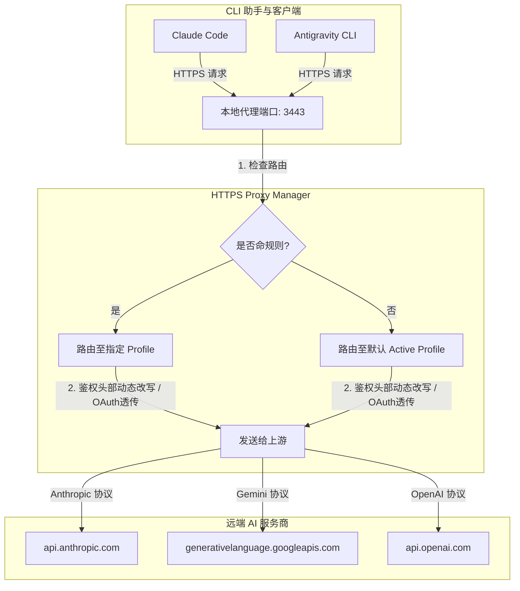

# HTTPS Proxy Manager (HTTPS 代理管理器)

这是一个专为 AI 辅助开发助手（如 Claude Code、Antigravity CLI、Google Gemini CLI、Cursor、VS Code Copilot 等）设计的本地高性能 HTTPS 代理管理器。

它提供了多协议转发、官方直连 OAuth 透传、配置无缝热加载、节点首包延迟测速以及系统级提示词（Markdown）一键同步等进阶生产力特性。

---

## 核心特性 (Features)

1. **官方直连与 OAuth 凭证透传 (Official Direct Auth)**
   - 针对官方大模型和助手（Claude、Gemini、OpenAI、Codex）提供官方预设。
   - 当 `apiKey` 配置留空时，代理自动转为**凭证透传模式**，原样向游上游转发客户端发送的 OAuth 令牌（如 `Authorization: Bearer client-oauth-token`）或特定鉴权头部，完美支持官方 CLI 登录流程。
   - 当配置 `apiKey` 时，自动根据协议重写首部（Anthropic 写入 `x-api-key`，Google 写入 `x-goog-api-key`，OpenAI 写入 `authorization: Bearer`）。
   - Trae International 官方登录通过本地 Trae 扩展桥接复用客户端登录态，详见 [`docs/trae-official-bridge.md`](docs/trae-official-bridge.md) / [`中文版`](docs/trae-official-bridge.zh-CN.md)。

2. **配置动态热重载 (Configuration Hot-Reload)**
   - 代理层引入基于 `fs.watch` 监听配置文件的机制。
   - 配置文件一产生保存（如在 UI 更改了默认上游），代理内存会在 100ms 内瞬间完成重载更新，**彻底避免了频繁重启代理进程的中断痛点**。

3. **节点延迟一键测速 & 区间色阶渲染 (Latency Grade Testing)**
   - GUI 管理器内置一键并发测速。
   - 动态调用本地代理的首包延迟测试接口，并根据延迟区间向用户渲染直观的彩色色阶 Badge：
     - **极速绿 (< 100ms)**：网络响应极佳，推荐使用。
     - **琥珀橙 (100ms ~ 300ms)**：网络一般，存在轻微延迟。
     - **警示红 (>= 300ms / 失败)**：延迟较高或不可达。

4. **提示词统一同步管理 (Markdown Prompts Syncer)**
   - 提供左侧侧边栏专属“提示词同步”标签页。
   - 统一编辑 Markdown 系统指令，一键将其保存并同步到本地助手的系统目录下。目前支持：
     - **Claude Code** (`~/.claude/CLAUDE.md`)
     - **Antigravity CLI** (`~/.antigravity/CLAUDE.md`)
     - **Codex** (`~/.codex/AGENTS.md`)
     - **Gemini CLI** (`~/.gemini/GEMINI.md`)
   - 拥有 `localStorage` 草稿防丢锁，自动为各平台独立记忆编辑草稿。

5. **全平台浏览器直接访问与 REST API 降级桥接 (Cross-Platform Browser Administration)**
   - 即使在不包含 Rust (`src-tauri`) 编译外壳的环境中，前端管理器与代理核心依然可以**完美活过来**。
   - 在非 Tauri 容器（如常规浏览器 Chrome/Edge 等）下运行时，前端 `window.proxyManager` 会自动触发**降级桥接机制**，直接通过 HTTP REST API 向本地代理服务器读写本地配置、获取真实日志、测试模型列表以及控制 Active 节点，保持体验的完全一致。

---

## 架构示意图 (Architecture)



---

## 快速开始 (Quick Start)

### 1. 准备依赖与启动
在终端中进入项目根目录：

```bash
# 安装依赖
npm install

# 启动本地代理服务器
node openai-proxy.js

# 启动前端静态 web 服务
node scripts/dev-static-server.js
```

### 2. 访问图形管理器
服务启动后，在您的浏览器（Chrome、Edge 等）中打开：
👉 **[http://localhost:1430](http://localhost:1430)**

在此页面上即可进行全部上游目标更改、延迟测速、路由映射与系统提示词同步操作，配置将自动写入本地的 `proxy.config.json` 文件中。

### 3. 证书与信任
为了保证本地 HTTPS 请求不会因为 TLS 证书问题报错：
1. 在 UI 页面中切换到 **“证书与信任”** 标签页。
2. 点击 **“安装到当前用户证书库”**。
3. 重启您的开发终端或客户端，代理即可正常拦截解密 HTTPS 数据流。

### 4. 本地助手环境变量对接
要在命令行助手（如 `claude`）中应用代理，只需在终端中声明环境变量：

```bash
# Windows PowerShell
$env:CLAUDE_BASE_URL="https://localhost:3443/v1"

# macOS / Linux / Git Bash
export CLAUDE_BASE_URL="https://localhost:3443/v1"

# 启动官方助手
claude
```

---

## 自动化测试与验证

我们提供了一套覆盖“鉴权分流、OAuth 转发、热加载、延迟及提示词同步”的完整集成测试套件。

```bash
# 运行全套集成测试
node test/headers-routing.test.js
```

运行后将验证如下测试点：
- [x] **Claude/OpenAI Official (空 Key)**：透传客户端原有 OAuth 头。
- [x] **Claude/Google/OpenAI Profile (带 Key)**：将 Key 转换成对应协议特有的 Auth 头部。
- [x] **热加载检测**：运行时更新配置文件，断言新参数秒级在代理中生效。
- [x] **本地延迟与提示词同步 API**：发送测速并断言首包耗时，以及将 Markdown 提示词分别同步至 `.claude` 与 `.antigravity` 的正确性。
