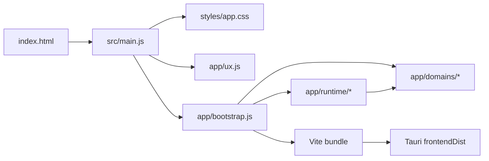

# Project Architecture

This repository contains three runtime layers and two generated-output layers.
Source code must not depend on generated directories.

```text
HTTPS-Proxy/
├─ openai-proxy.js             Node proxy process entry
├─ hpm-cli.js                  Command-line entry
├─ lib/
│  ├─ proxy/                   Proxy application and protocol modules
│  ├─ release/                 Release validation and safety rules
│  └─ governance/              Repository architecture rules
├─ tauri-ui/
│  ├─ index.html               Only frontend document entry
│  ├─ src/
│  │  ├─ main.js               Vite entry
│  │  ├─ app/
│  │  │  ├─ bootstrap.js       Frontend composition and application coordinator
│  │  │  ├─ ux.js              Shared browser UX boundary
│  │  │  ├─ domains/           Independently configured UI domains
│  │  │  └─ runtime/           Dependency-free state, DOM and timing primitives
│  │  └─ styles/
│  └─ dist/                    Vite output; generated and ignored
├─ src-tauri/                  Native shell, commands, permissions and bundling
├─ scripts/                    Build, verification and operational entry scripts
├─ coverage/                   Disposable test coverage reports
├─ test/
│  ├─ frontend/                Frontend behavior and architecture tests
│  └─ *.test.js                Proxy, release and integration tests
└─ dist/
   ├─ staging/runtime/         Disposable Node runtime for Tauri packaging
   ├─ artifacts/
   │  ├─ installers/           Collected installers and checksums
   │  ├─ portable/             Portable directory and zip
   │  └─ sbom/                 Release software bills of materials
   └─ archive/                 Local-only legacy artifacts; never uploaded
```

## Frontend dependency direction



The dependency rules are:

1. `main.js` is the only Vite entry and contains no business logic.
2. `bootstrap.js` owns application startup and domain composition. Its current
   size budget is 4,250 lines and may only decrease.
3. Domain modules do not import `bootstrap.js` or other domain modules. They
   receive browser, state and service dependencies through their
   `configure*()` boundary.
4. `domains/prompts.js` owns prompt storage, synchronization and template DOM
   bindings. `domains/rate-limits.js` owns limit state, polling and rendering.
5. Runtime modules have no project-relative imports. They expose small,
   independently tested primitives for shared state, DOM operations,
   dependency binding and performance scheduling.
6. The frontend ESM graph must remain acyclic.
7. `tauri-ui/dist/` is generated only by Vite. The removed
   `dist/tauri-ui/` path must never return.

These rules are enforced by `npm run check:architecture` and therefore run
before every production frontend build.

## Generated output lifecycle

- `npm run clean:frontend` removes only `tauri-ui/dist/` and the obsolete
  `dist/tauri-ui/` path.
- `npm run clean:coverage` removes only coverage reports.
- `npm run clean:staging` removes only disposable release staging.
- `npm run clean:artifacts` removes only final release deliverables.
- `npm run frontend:build` runs architecture checks, cleans frontend output,
  and creates a fresh Vite bundle.
- `npm run clean:release` removes staging, final artifacts, frontend output and
  Cargo output. It preserves `dist/archive/` and local application state.
- `npm run clean:release:cache` removes only Cargo target directories.

Generated output is ignored by Git and must not be used as an editable source.
Release automation reads and uploads only `dist/artifacts/`; it never reads
`dist/archive/`.

`src-tauri/target/` is a disposable Cargo compilation cache and can be large.
`.hpm-runtime/` is different: it contains local application state and may
include generated certificates, so cleanup commands deliberately never remove
it.

## Verification entry points

- `npm test`: unit, frontend, thinking persistence and environment tests.
- `npm run test:all`: `npm test` plus integration tests.
- `npm run verify`: syntax, lint, architecture, CI/release governance,
  coverage, integration, frontend build and Rust tests.
- `npm run tauri:build`: production Tauri build and installer collection.
