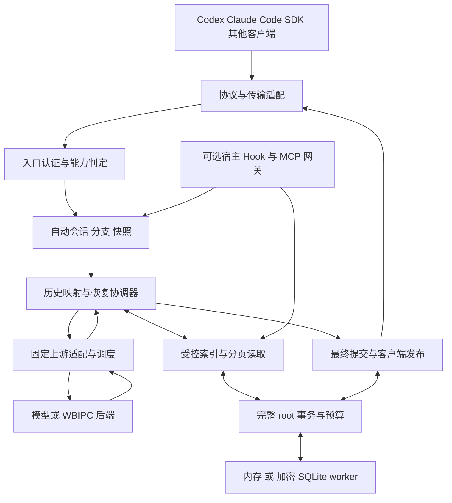

# HTTPS-Proxy 多端无感上下文恢复完整方案

## 2026-10-21：保留历史请求的 Unicode 扫描优化，存储延迟仍阻塞交付

CPU 采样发现 JSON 字节核算中的 Unicode 分类扫描热点。当前仅优化 context-recovery-history-request.js：保留 ASCII 路径，宽字符文本使用码元范围扫描与既有无损 UTF-8 校验；C0 控制字符、引号、反斜杠和孤立代理仍交给原生 JSON 编码。C1 字符及配对代理无需生成整段 JSON 副本。未改变节点、深度、逐项/总字节、冻结、预算、TTL 或授权边界。状态编码器候选在带转义 ASCII 对照中表现退化，已撤回，context-recovery-state-data.js 与本轮备份 SHA256 相同；不把候选收益套用到保留实现。

新增 C1 无副本回归在修改前失败；全 UTF-16、补充平面及旧运行时回退检查进入既有统一 CI 文件。候选 v1 期间定向 30/30，包括四根 32MiB 加密重开 101915.8671ms；这是此前候选的定向证据，不能替代当前完整门禁。当前保留版本的前后 normalizer 对照见 json-scan-normalizer-benchmark-v2-result.json：Unicode 样本有 CPU 收益，ASCII 墙钟仍有波动，不作整条请求时延保证。

当前源码完整 test:client:coverage 已退出 1：1335 项，1329 通过、3 失败、3 取消、0 跳过，主体 319355.0382ms。失败为 Chat/Responses Core 持久化请求原 5000ms 截止时间、原五档两 worker 容量资格 60000ms；取消为加密 staging 重开 30000ms、授权恢复重开 30000ms、四根 32MiB 重开 180000ms。覆盖率语句/行 99.06%、分支 95.22%、函数 99.29%；history-request 语句/函数 100%、分支 98.16%，state-data 与 UTF-8 helper 语句/分支/函数 100%。32 文件源码冻结复核无差异。定向 Lint、语法、格式、CI 及发布治理通过，完整门禁仍未通过。

进一步的隔离 worker 计时确认一次操作 3561ms、线程 CPU 62ms、已记录文件检查约 22ms；下一次捕获 scan-reference 的 SQLite COMMIT 2911ms、线程 CPU 0ms。后一次 DELETE 诊断虽然通过，也不能撤销历史超时。仅在诊断进程比较 TRUNCATE，保留 synchronous=FULL 与 secure_delete=ON，仍在重开第二轮 5015ms 超时，因此未修改产品日志模式；运行源码仍使用 DELETE。现有证据说明存储线程内部阻塞是延迟来源之一，未证明所有超时有同一根因，也未排除系统调度或其他文件系统等待。

证据均位于 .hpm-acceptance/context-plugin-vault-20261021-01/：json-scan-regression-before.log、json-scan-regression-after.log、json-scan-normalizer-benchmark-v1-result.json、json-scan-normalizer-benchmark-v2-result.json、json-scan-client-full.log、json-scan-source-freeze.json、storage-operation-worker-timing.jsonl、storage-operation-worker-sqlite-timing-v2.jsonl、storage-operation-worker-sqlite-TRUNCATE-timing-v3.jsonl 及对应 Core 日志。诊断只记录固定操作名、计数、耗时及 CPU，无请求参数、原文或凭据；辅助脚本未进入生产路径。真实请求仍 137/144，本轮新增 0；未安装插件、改日常配置或重启生产。容量、持久化期限、完整客户端/插件与全仓门禁仍待完成，整体 active。


## 2026-10-21：实际 Core 大原文窗口回归与加密重开未通过

实际 Core 的 WBIPC 测试新增 long-json、long-sse、long-failed：约 600KB 原始工具结果超过现有 384KiB/96Ki token 窗口，私有阶段使用可信留存引用，公开阶段使用中性占位及独立验证的 READ 证据；失败后仍能重新读取原始内容。该版本 Core 文件 30/30 通过，证据为 `.hpm-acceptance/context-plugin-vault-20261021-01/wbipc-core-window-regression.log`。使用 FakeWbipcSocket，不代表真实 WBIPC 端点。

随后新增 long-persistent，使用真实 Windows 加密存储 worker，关闭后物理重开，检查原文不出现在 SQLite 文件、来源与绝对到期时间不变、预算继续扣减及公开发布确认。当前测试仍未通过：完整文件 28/30，Responses 重开后第二轮和 Claude 第一轮超过原 5000ms；Chat 本轮通过。后续诊断还观察到普通内存模式超时，不能据此把根因归结为加密存储。最新单独 Responses 诊断在持久化第一轮完成私有读取及发布阶段，但仍超时；READ 和存储操作计时仅用于定位，未证明故障根因或修复。

新增测试保留在既有统一 CI 入口 `test/client-context-target.test.js`，原负载、5000ms 请求截止时间、预算及门禁均未放宽。阶段诊断仅记录固定测试模式、操作名、计数和耗时，不记录原文或凭据。证据：同目录 `wbipc-core-persistent-regression-v3.log`、`wbipc-core-persistent-timing-v1.log`、`wbipc-core-persistent-timing-v2.log`、`wbipc-core-persistent-timing-v3.log`。定向 ESLint 通过；新增测试后的完整覆盖率门禁尚未重跑，前次完整门禁失败保持有效。

最终当前源码复跑为 27/30，三个协议的 long-persistent 第一轮均超过原 5000ms（总耗时 125244.0704ms），0 取消、0 跳过；日志为同目录 `wbipc-core-persistent-final.log`。其中 Responses 的 settle-reader 单次 3276ms，Claude 的 load-reference 单次 1801ms，Chat 的 save-reference-state 单次 1236ms；这些是耗时观测，不能单独证明因果。此前 Chat 通过保留为历史结果，不能作为当前通过。

真实请求新增 0，累计 137/144；此前 Claude v25 的全真实验收仍仅覆盖 owner HTTP 入口，不扩大到当前 Core、已安装插件或生产。容量、加密重开期限、真实 WBIPC、插件迁移及全仓门禁仍阻塞整体交付。未修改日常配置、安装插件、重启或激活生产；整体保持 active。


## 2026-10-21：WBIPC 双预算实现最终验证，完整门禁保持失败

冻结 31 文件运行 npm run test:client:coverage，终态 exit 1：1333 项，1328 通过、2 失败、3 取消、0 跳过，344657.0418ms。覆盖率行/语句 99.06%、分支 95.20%、函数 99.29%；三个 WBIPC 模块均行/语句/函数 100%，新窗口模块分支 97.61%。定向 97/97、Lint/格式、CI 与发布清单通过；新增测试已处于原统一客户端入口。失败为 direct-upload fixture 启动期限及原五档两 worker 容量 60000ms 超时；三项取消为 staging 清理重开 30000ms、当前授权/读取预算重开 30000ms、四根 32MiB 私有历史重开 180000ms。上次四根提前失败与本轮明确超时均保留，尚未定位共同根因；覆盖率达标不改变失败结论。全部 31 文件 SHA256 在门禁结束后复核一致。

当前源码的 Codex 原生经实际 Core 合成复验通过。Claude 同期 v4 在原 20 秒启动期限内未发出请求并失败；在完整测试进程结束后，v5 单独复验以相同期限通过三次原生压缩、精确 READ/公开证据/最终答案、无私有事件泄漏及进程终结，失败记录保留，不能据此声称并发启动问题已修复。本轮真实调用新增 0，累计仍 137/144。

WBIPC 双预算本地代码已实现：保留完整宿主原文，仅投影已证明留存的历史结果，继续使用现有最终发布事务；2.4MB 多轮会话、私有/公开隔离、非法 UTF-8、引用篡改、独立预算、撤权与发布前取消后的原文重读均有回归。仍需补实际 Core 的大窗口发布/加密重开组合及真实 WBIPC 端点验收，不以 FakeWbipcSocket 证据代替真实传输。容量/启动/重开稳定性、完整插件/Hooks 与迁移/真实旧读取器、24h 到期实测、全仓门禁及最终空闲生产启用继续待完成；生产与日常配置未更改，整体 active。

证据：.hpm-acceptance/context-plugin-vault-20261021-01/wbipc-window-outcome.json、wbipc-window-runtime-source-freeze.json、wbipc-window-final-module-coverage.json、wbipc-window-client-full.log、claude-native-recovery-core-synthetic-wbipc-v5-result.json 与上节列出的回归/失败日志。

## 2026-10-21：WBIPC 长历史增加原文证明和双预算传输投影（完整门禁运行中）

新增 context-recovery-wbipc-window：保留宿主完整规范历史，仅在 format3 的 WBIPC 传输副本超限时，按当前会话 captured/visible 集合中的 callId、SHA256、精确 UTF-8 字节数和绝对到期证明，替换已留存的历史工具结果。私有阶段使用来源引用；独立公开阶段使用无私有目录标识的固定占位说明，并继续附带成功 READ 的已验证证据。用户消息、工具调用、工具定义和私有 READ 回执不截断；没有确切留存证明、非法 UTF-8 或替换后仍超任一预算时拒绝，不连接 IPC、不执行外部工具。引用查询不消耗或重置读取预算，不创建新保存事务；继续复用已有最终响应 prepare/sending/finished 与撤回边界。

WBIPC 入口与协议转换采用 owner 的 historyFormat，format3 允许原 32MiB 历史边界，单项和单次结果批次仍为原 2MiB；传输仍受原 384KiB 和 96Ki Token 两项上限控制，未提高任何上限。旧 format2、凭据/endpoint 绑定、工具历史配对和认证撤销规则保留。新模块进入发布清单，新增回归位于原统一 test:client 测试文件。

四文件定向 97/97 通过（21481.1165ms），包含已有实际 Core 集成、新 2.4MB 多轮会话的投影、精确 READ 和发布前取消后再次读原文。新窗口模块定向覆盖率语句/函数 100%、分支 93.75%（新增 UTF-8/非法边界回归之前的采集）；最终标准 test:client:coverage 正在运行。当前源码的 Codex 原生经过实际 Core 合成复验通过；Claude 同期在原 20 秒 native_deadline 内未发出模型请求，待完整门禁终态后单独复验，失败记录保留。不冒充真实 WBIPC 端点或已安装插件验收。

证据：.hpm-acceptance/context-plugin-vault-20261021-01/wbipc-window-runtime-source-freeze.json（31 文件）、wbipc-window-core-regression.log、wbipc-window-owner-regression-final.log、wbipc-window-coverage.log、wbipc-window-lint-frozen.log、wbipc-window-format-frozen.log、wbipc-window-ci.log、wbipc-window-release.log、wbipc-window-client-full.log、codex-native-core-synthetic-wbipc-v2-result.json、claude-native-recovery-core-synthetic-wbipc-v4-result.json。本轮真实请求新增 0，累计 137/144；生产 PID 未重启，日常配置未改，整体 active。

## 2026-10-21：两端原生客户端经过实际 Core 的合成验收通过

新增端到端证据：原生 Claude 与 Codex 客户端经 createCoreRequestHandler 进入默认恢复路径，使用测试注入的认证、临时路由和本地合成上游。两端均完成三次原生压缩，原始外部工具只执行一次，私有 READ 后逐字节证据进入独立公开生成，最终答案精确，私有工具事件未泄漏，客户端进程结束。Claude 消耗 18 次本地合成响应，Codex 13 次，真实模型新增 0。此证据覆盖原生客户端到实际 Core 的默认恢复调用链；不覆盖完整 openai-proxy composition、安装插件/Hooks、真实上游或生产部署。历史两端真实验收仍保持其原 owner HTTP 入口和源码范围。

证据：.hpm-acceptance/context-plugin-vault-20261021-01/claude-native-recovery-core-synthetic-v3-result.json 和 codex-native-core-synthetic-v1-result.json。复核原 25 文件 diagnostic-source-freeze 的源码 SHA256 均一致，未通过变更恢复逻辑取得本轮通过。夹具早期路径/缺失依赖失败日志保留，最终两端均 exit 0。容量 60000ms 稳定性及完整客户端失败门禁仍未解决；插件安装/迁移与真实旧读取器、WBIPC 长历史双预算、24h 到期实测、全仓门禁和最终生产启用仍待完成。真实预算仍 137/144，生产与日常配置未更改，整体 active。

## 2026-10-21：撤回纯文本指纹候选，容量门禁保持未通过

纯文本消息的 canonical SHA256 快路径通过 40 项等价性回归和定向 Lint，但原五档、两 worker、c8 覆盖率下的完整耗时对照为基线 58989.9289ms、候选 99477.4894ms，候选不具备可保留的稳定收益。候选在原 60000ms 资格用例中仍超时，已恢复源码和本轮候选测试；原 25 文件 diagnostic-source-freeze 的 SHA256 全部一致，恢复后绑定回归 39/39。诊断脚本的 qualified 字段只表示五档数据完整，未包含原资格命令的 60 秒期限，因此不得解释为标准门禁通过。历史完整客户端失败结果保持有效。

证据位于 .hpm-acceptance/context-plugin-vault-20261021-01/：scalar-canonical-outcome.json、capacity-scalar-canonical-baseline-result.json、capacity-scalar-canonical-candidate-result.json、scalar-canonical-restored-regression.log。后续实际 Core 与两端原生客户端的合成链路已通过，见上节；未安装插件，未更改生产或日常配置，本轮真实请求新增 0，累计 137/144，整体 active。
## 2026-10-21：原文 UTF-8 校验去除重复整段复制，完整门禁仍未通过

新增共享 isWellFormedEvidenceText：在原生 String.prototype.isWellFormed 可用时直接校验 UTF-16 是否能无损往返 UTF-8；旧运行时保留原 Buffer 往返校验。原文形状门禁和摘要校验均使用它，避免为相同校验分配整段 Buffer/字符串副本。原输出字节上限、JSON 转义预算、SHA256、逐回执校验、读取偏移、缓存上限、所有期限与负载不变。

账本回归 31/31：逐一比较全部 65536 个 UTF-16 单元，分块覆盖全部补充平面码点，同时验证原生与强制旧运行时回退等价；原生路径形状检查不分配原文 Buffer，摘要检查只创建所需的摘要/读取边界 Buffer，缓存命中仍拒绝错误摘要与非法 UTF-8 偏移。加密存储/根状态/收养三文件 72/72，包括四个根、32 MiB 私有历史的真实加密重开，整组 92395.2424ms。定向 Lint、CI 与发布清单通过，新模块已声明。

当前源码的标准 npm run test:client:coverage（含原生工具和网关标准重建）终态为 1325 项、1323 通过、2 失败、0 取消/跳过，144479.1159ms，exit 1。全门禁覆盖率语句/行 99.06%、分支 95.18%、函数 99.29%；本次 UTF-8 helper 与两个关联模块均达到语句/函数/分支 100%。失败为原 60000ms 容量资格超时，以及四根 32MiB fixture 在 38482ms 内恢复轮次提前失败（并非触及 180000ms 期限），具体错误码尚待诊断。已补只含 index/suffix/安全 code 的断言信息，原轮次、负载、并发与期限均未变；三文件诊断已 92/92 通过（95927.5439ms），其中原五档、两 worker 容量资格 51745.5068ms，通过原 60000ms 期限。该结果不替代全并发门禁，也未证明此前失败根因已消除。带安全断言的第二轮完整标准客户端门禁终态为 1325 项、1324 通过、1 失败、0 取消/跳过，218607.3158ms，exit 1；仅原 60000ms 容量资格超时。覆盖率语句/行 99.06%、分支 95.19%、函数 99.29%。四根 32MiB 此轮通过，但首轮提前失败未定位到根因，不能据重跑通过声称已修复。日志 evidence-native-unicode-client-diagnostic-full.log，第一轮失败记录保留。额外隔离诊断：在 c8 下只运行原容量资格用例也于原 60000ms 超时（测试总计 60557.5647ms），不能只归因于文件并发；未关闭覆盖率采集，也未放宽任何门禁。日志 capacity-coverage-isolation.log。完整失败保持失败，独立 103 项通过不替代门禁。日志 evidence-native-unicode-client-full.log。当前源码的 Codex synthetic-unicode-v42 与 Claude synthetic-unicode-v27 原生零模型回归均通过三次压缩、精确最终答案、无私有事件泄漏和进程终结；scope 仍是原生客户端加恢复 owner HTTP 入口，不是完整安装插件或生产路径。新源码尚未做真实模型重验，历史 Codex/Claude 真实通过保留原证据范围。生产与日常配置不变，本轮真实请求新增 0，累计仍 137/144。容量 60000ms、全仓门禁、完整插件/Hooks 接入、WBIPC 长历史、迁移/真实旧读取器、24h 到期和最终生产启用仍待完成。整体 active。

证据目录 .hpm-acceptance/context-plugin-vault-20261021-01/：evidence-native-unicode-regression.log、evidence-native-unicode-root-regression.log、evidence-native-unicode-lint.log、evidence-native-unicode-ci.log、evidence-native-unicode-release.log、evidence-native-unicode-runtime-source-freeze.json、evidence-native-unicode-outcome.json。

## 2026-10-21：阶段计时完成，第二项缓存候选撤回

原五档/两 worker 的最大负载阶段计时（含嵌套，不能相加）：入站历史规范化 19781ms、frontier.calculate 30653ms、完整根导出 8849ms、重开恢复 16715ms。仅保留固定阶段名、次数与耗时，不记录原文或请求参数。

第二项候选用请求内 UTF-16LE 摘要加速大文本缓存比较，保留持久化规范链、每次入站校验与缓存上限；独立 60000ms 门禁仍超时。紧邻的完整原负载对照为旧实现 92529.2461ms、候选 90796.9834ms，两者功能断言全过，差距约 1.87%，不足以证明稳定收益，已撤回新模块、接线、运行清单及实验测试。23 文件与前轮冻结清单再次逐一匹配，未保留新的缓存格式。下一步优先查完整状态导出/重开中的重复处理，不放松任何校验。

证据：.hpm-acceptance/context-plugin-vault-20261021-01/capacity-stage-timing-thread-*.json、capacity-stage-timing-result.json、capacity-item-fingerprint-*-diagnostic-result.json、capacity-stage-and-rejected-fingerprint-outcome.json。本轮新增真实模型请求 0，预算仍 137/144，生产和日常配置不变。整体 active。

## 2026-10-21：容量热点采样与文本复用实验撤回，性能门禁仍失败

对原五档、两 worker 容量负载完成 CPU 采样：五档功能断言全部满足，带分析器总耗时约 134.7 秒；该结果不能替代原 60000ms 门禁。热点集中在历史克隆、规范编码、指纹 SHA 与 GC。请求内文本复用实验的定向比较虽较快，完整负载对照为原实现 120416.86ms、实验 126789.8618ms，两者功能断言均通过而性能门禁均失败，因此撤回源码与实验专用测试，原源码 SHA256 和上一轮 21 文件冻结清单全部复核一致。

实验阶段绑定/私有容量/会话回归 90/90、定向 Lint 和 CI 清单通过，仅是被撤回候选的证据，不冒充最终性能验收。本轮无新增真实模型请求，累计仍 137/144；未修改任何期限、负载、worker 上限、日常配置或生产。证据：.hpm-acceptance/context-plugin-vault-20261021-01/capacity-profile-and-rejected-intern-outcome.json、capacity-intern-*-diagnostic-result.json、CPU.20261021.080819.*.cpuprofile。整体 active。


## 2026-10-21：默认隔离入口与 Claude 完整真实复验通过，整体未完成

Core 集成补充：30/30 全部通过，含 JSON/SSE、多协议转换、三次规范压缩、WBIPC 与撤权。发现 Gemini 对含先前工具历史的相邻用户消息合并会破坏公开证据边界；修复恢复路径保持原消息边界，补回归。Gemini 转换与直接 Chat 测试通过；默认入口 Codex 原生合成 v41 三次压缩通过，零真实调用。标准完整客户端首次复跑为 1322 项、1299 通过、21 失败、2 取消（306757ms）；该次混有尚未更新的旧三轮 Core 测试。Core 修复后最终完整门禁为 1323 项、1315 通过、3 失败、5 取消、0 跳过，315001.7422ms，exit 1。失败为容量资格、独立 ACL 校验和旧 DPAPI 互操作；取消涉及加密 worker 重开、加载、撤权、4 根 32MiB 历史及网关启动。覆盖率行/语句 99.06%、分支 95.18%、函数 99.28%，不因覆盖率达标改判通过。当前源码封存为 default-isolated-security-final-source-freeze.json，旧封存保留为历史。

HTTP 与 WebSocket 默认恢复入口已改为内部恢复后独立公开生成。普通 HTTP 响应只有在实际传输完成后才获得公开来源标记；普通 WebSocket 响应先准备，完成发布确认后才允许续接。旧未知来源响应、未完成公开发布均不具备公开祖先权限。无法证明公开祖先时，清理成功后返回安全的 previous_response_not_found，客户端可自行携完整公开上下文重发；代理不会自动重试。

WebSocket 增量投影加入工具目录一致性条件，避免公开阶段继承私有响应 ID。回归覆盖原生形态工具、长历史、连续三轮外部结果、分片、断线重连、客户端完整窗口重发、撤权、发布失败与加密 SQLite 关闭重开。私有阶段若返回未广告的外部工具调用，拒绝并隐藏；所有外部调用均来自独立公开阶段。相关五文件 210/210，协议转换等八文件 107/107；定向 Lint/格式通过。入口/WS 三模块覆盖率语句/行 95.89%、分支 91.08%、函数 96.15%。这些是合成上游和本地传输证据。

Claude v25 使用真实原生客户端、新建隔离任务、真实模型贯穿 seed、三次压缩、两次中间续接和最终恢复；默认 HTTP 入口直接接管，无 isolated 选项包装。17 次真实请求、3 次原生压缩、原始 MCP 工具仅执行 1 次，精确私有读回、公开证据投影及最终答案全部通过，未检测到私有工具事件泄漏，客户端进程已终结。它验证恢复 owner HTTP 入口，仍不是完整 Core/插件安装或生产验收。Codex v38 的全真实通过属于先前源码，不能冒充当前源码重验。

新授权仅用于 Claude 完整复验及诊断，累计预算 137/144，剩余 7 次；没有自动重试或修改日常配置。生产未重启、未启用本次改动、未安装插件。标准完整客户端门禁仍未通过，容量/worker/ACL/DPAPI/启动问题保持待解决。容量资格单独诊断仍在原 60000ms 超时（测试总计 61202.6754ms）；未改期限、负载或两 worker 上限。依赖升级后 Windows 密钥组单独诊断 24/24 通过，原生/旧 DPAPI 双向兼容通过；不能以单组通过替代原并发门禁或认定根因已修复。WBIPC 长历史、完整 Core/插件/Hooks 多端接入、迁移与真实旧读取器、24 小时到期及最终生产启用仍未交付，整体保持 active。

安全依赖分两批升级：@modelcontextprotocol/sdk ^1.32.1、Vite ^6.4.5。按标准流程重建网关完整性产物；升级后网关/发布回归 32/32、前端构建通过，npm audit 各严重度均为 0。完整客户端门禁发生在依赖升级前，未冒充升级后全量结果。升级后 Claude 默认入口原生合成 v26 三次压缩通过，零真实请求；精确答案、无私有事件泄漏及进程终结均通过。

证据位于 .hpm-acceptance/context-plugin-vault-20261021-01/：default-isolated-source-freeze.json、default-isolated-entry-verified.log、default-isolated-protocols.log、default-isolated-coverage.log、default-isolated-lint-final.log、default-isolated-format-final.log、claude-native-recovery-isolated-complete-v25-result.json、real-model-budget.json。

## 2026-10-21：独立公开响应来源与持久化续接边界

已补宿主来源证明：Responses 的 previous_response_id 只有在当前 principal/target/policy 绑定到唯一父快照，父响应确由独立公开生成产生且完成发布后，才可进入公开请求。私有响应 ID、旧单缓冲流程的未知来源 ID、未完成发布与歧义祖先继续拒绝。私有读取仍沿原私有状态机进行；公开请求仅延续宿主证明过的公开响应 ID，绝不取私有阶段的 response ID，因此不需要另存完整用户历史。

持久化采用显式 publicGenerationFormat=1 和每个快照的 publicResponse 布尔值；标记保存在原加密状态中，旧无标记状态默认不具备公开祖先权限。封存器/元数据层严格校验标记类型、协议与快照关联；既有快照的来源属性在引用状态更新中不可提升或降级。旧读取器的精确字段契约会拒绝新增格式，但真实旧版二进制仍待验收。没有增加原文容量、读预算、快照上限或延长绝对到期时间。

测试已证明：完成发布后跨状态重开可续接；刚发生的私有 READ、草稿、私有响应 ID 均不进入公开请求；来源标记篡改、缺失、未知格式、未完成发布与旧状态均按边界拒绝；实际 Windows 加密 worker 关闭/重开后仍可使用公开祖先，原到期时间相同。扩展回归 153/153、持久化/绑定组 144/144、最新定向 46/46；隔离模块覆盖率行/语句 98.15%、分支 94.54%、函数 100%。定向 Lint/格式、CI 与发布清单检查通过。两端新原生合成模型验收均完成三次压缩、精确恢复、单根与无私有工具泄漏，零真实请求；不是完整 Core/插件或真实模型验收。

性能字符扫描实验未保留：替代实现未呈现稳定收益，原五档/两 worker 容量实测 60121.7393ms，超过原 60000ms 并超时。恢复了历史计量源码的原始 SHA256，保留新增穷举回归，覆盖全部 UTF-16 单元和补充平面码点与 JSON 精确字节等价。不宣称容量或性能合格。

目前来源证明仅由 isolated 宿主选项使用，默认 HTTP/WS 尚未切换；仍需验证实际发布时序、缓存失效、完整传输/插件与兼容迁移。上一轮 Codex v38 全真实通过属于上一轮源码，不冒充本轮新字段的真实复验。真实请求预算仍 120/120，本轮新增 0；追加授权待用户回复，不能继续真实调用。完整客户端与全仓门禁尚未在这批最终源码上重跑；上一轮失败记录仍有效，整体 active，生产与日常配置不变。

证据：public-lineage-final-source-freeze.json（补充祖先注释后重封存）、public-lineage-source-freeze.json、public-lineage-outcome.json、public-lineage-*-final.log、public-lineage-coverage.log、两端 synthetic-v24/v40-result.json、history-character-*-benchmark-result.json 与 capacity-character-set-deadline-result.json，位于 .hpm-acceptance/context-plugin-vault-20261021-01/。

## 2026-10-21：私有恢复与独立公开生成（未完成整体交付）

最终冻结源码复核 SHA256 一致；最新扩展回归 274/274、定向 42/42，两端新合成原生三次压缩均通过；新模块覆盖率行/语句 98.07%、分支 93.82%、函数 100%。标准完整客户端最终终态：1314 项，1302 通过、3 失败、9 取消、0 跳过，373312.0762ms，exit 1。整体交付未完成。

全仓语法检查通过（3871 个 JavaScript 文件）；全仓 Lint 失败（7697 errors、669 warnings），本轮修改文件定向 Lint/格式及 CI/发布清单检查通过。最终完整客户端覆盖率行/语句 99.01%、分支 95.13%、函数 99.13%；失败门禁不因覆盖率达标改判。全仓 verify/build/security 全链路未完成。

用户已选择严格隔离：先内部完成恢复，再以独立公开请求生成最终输出。新增独立协调器与证据投影模块；公开侧仅收到原始可见请求、原外部工具和经宿主成功 READ 校验的证据页。目录回执、私有工具定义/调用 ID、错误、中间草稿和 thinking 不跨该边界。校验包括来源 ID、完整摘要、分页范围/总字节、UTF-8 和分块 SHA256；保留 8 轮、64 次读取、512 KiB 上限，私有最多 7 轮，为公开生成预留一轮。无可读证据时直接公开生成，避免无效私有发现。

目前仅新增宿主选项 publicGeneration=isolated，原生探针显式启用。默认 HTTP/WS 尚未切换，带 provider previous_response_id 且缺少完整公开祖先时明确拒绝，尚需设计可验证的公开历史重建；不能称为默认无感集成或完整 Core/Hook 验收。

新隔离 Codex v38 全程真实模型验收通过（13 次请求）：真实原文捕获一次、三次原生压缩、后续私有请求读回精确原文、独立公开请求含精确授权证据、最终值精确匹配、单根、无私有工具事件泄漏。Claude v16/v18 全流程真实验收失败；v19 的安全结构诊断定位到公开摘要含两个 summary 开标签、一个闭标签，严格封存器正确拒绝 context_recovery_summary_invalid。没有放松封存规则；仅对已识别的原生摘要公开请求增加唯一 summary 块的系统格式要求，并关闭该请求的 thinking。v20 修复后单次真实公开摘要与原生压缩通过（种子/私有阶段合成），v21 最终真实公开生成答案严格匹配（种子/三次压缩/私有阶段合成）；二者不能合并冒充 Claude 全流程真实通过。

累计真实模型预算已获批至 120 次，现 120/120；无自动上游重试、无日常配置改动、无生产重启/激活。完整标准客户端中间门禁为 1312 项、1297 通过、14 失败、1 取消、0 跳过，306295.54ms；覆盖率行/语句 99.06%、分支 95.17%、函数 99.28%。运行期间有源码后续修正，故该轮仅诊断，不是最终冻结源码门禁。失败包括加密 worker/ACL/DPAPI 启动与重开、冷导入期限及容量资格，均保留失败记录，没有提高期限或跳过测试。

容量原负载诊断 85118ms 仍超过原 60000ms；热点包括历史 clone/编码、规范化、SHA、GC，尚不能认定性能合格。24h 原样本绝对到期仍为 2026-10-22T00:55:55.109Z，尚未实际到期验收，不重播种或延长。整体 active；仍需 Claude 修复后全真实复验、默认 HTTP/WS 与完整 Core/插件/Hook、WBIPC format3 长历史事务与传输、旧插件迁移/真实旧读取器和回滚、全仓门禁、到期观察及最终空闲激活。

本轮证据目录：.hpm-acceptance/context-plugin-vault-20261021-01/。保留所有失败与成功报告；真实预算 real-model-budget.json，Codex codex-http-recovery-isolated-complete-v38-result.json，Claude claude-native-summary-stage-v19-result.json、claude-native-isolated-summary-format-v20-result.json、claude-native-isolated-final-format-v21-result.json。最终本地回归和源码摘要见 isolated-generation-outcome.json、isolated-generation-source-freeze.json。

## 2026-10-21：Claude 原生续接、流元数据与计量兼容

Claude 原生压缩后会插入 assistant 消息；旧的全 user 条件因此丢弃有效回执。现在解析完整回执，只有唯一已观察到且确实源于该回执的后代窗口才能优先于旧回执；不相关和歧义分支继续拒绝。绑定层返回本次是否真正跨摘要窗口，私有历史仅首次重建，后续继承最新映射，避免重复恢复到旧摘要。回归涵盖有/无 acknowledgment、重开后的原文精确读取与新映射保留、伪造/跨身份/跨目标/策略变更/撤回/撤权/到期和冲突分支。测试仍在统一 CI 入口。

供应商只新增 Anthropic 的精确 beta=true 路径，以及 HTTPS443、同 host、api-key 模式和 claude profile 下 DeepSeek 的精确 /anthropic/v1/messages（含 beta=true）路径；额外查询、错 host/port/protocol/auth 和非法对象继续拒绝。对应扩展回归 61/61。

真实 Claude v8/v9 首轮失败，v9 上游实际为 200/SSE；v10 原样转发公开响应后完成首次工具捕获，但后续恢复拒绝。安全结构诊断发现 usage.service_tier 为字符串；官方 Anthropic SDK 明确定义 standard/priority/batch/null。新增精确枚举校验，不把档位计入数值汇总，只保留最终响应的合法档位；未知字符串、嵌套伪造和 accessor 仍拒绝。Claude SSE 收集器另修复丢失 message_start 的 type/model/stop_sequence，并应用最终 delta 的 stop_sequence，空缺字段兼容旧 fixture，非法元数据拒绝。新增 JSON/SSE 往返、正常/空/非法/极端与安全回归 98/98，旧失败记录保留。官方类型来源：https://raw.githubusercontent.com/anthropics/anthropic-sdk-typescript/main/src/resources/messages/messages.ts 。

原生 Claude v7 零模型通过三次实际压缩、真实 MCP 捕获一次、精确私下读取与答案、单根和无泄漏。两端新建全真实模型任务：Codex v36=true（9 次请求），Claude v11=false（6 次请求）。这些探针均经过恢复 HTTP 入口，并未覆盖完整 Core 或 Hook。

回执/绑定扩展回归 289/289；元数据修复前的标准完整客户端门禁 1275 项，1269 通过、3 失败、3 取消、0 跳过，291435.413ms。覆盖率语句/行 99.08%、分支 95.14%、函数 99.27%；容量资格、加密 owner 重开/启动等未通过。存储用例单独复核 21/21 通过，不替代完整门禁。原五档负载、两 worker、所有期限未改变。最终源码仅完成相关扩展回归，完整门禁没有宣称绿色；Lint、格式、语法、CI 清单、架构与发布清单检查通过。

当前真实模型预算 83/88，重复请求在探针网关拦截、不改日常配置、生产未激活。完整 Core HTTP/WS/Hook、WBIPC 长历史事务、容量性能、迁移/旧版回滚、全仓门禁、24h 到期观察与空闲激活仍未完成，整体 active。

本轮机器证据：claude-receipt-outcome.json、claude-metadata-source-freeze.json、claude-receipt-expanded.log、claude-metadata-usage-expanded.log 与相应原生验收结果。


## 2026-10-21：Codex 工具历史边界、原生摘要格式与可选读取字段

新增 Codex additional_tools 协议边界：普通生成把完整内嵌工具清单（含原生 id）纳入策略和精确历史；只有已识别的本地压缩可使用独立连续性指纹定位唯一已观察祖先。principal、target、instructions/system 与歧义拒绝保持；连续摘要收据使用独立索引并随根状态导出、重开、撤回和到期清理。持久化增加显式 identityFormat 标记，未知标记、跨协议和篡改拒绝；旧解析器的精确字段规则会拒绝新增状态，但尚未以真实旧版二进制完成降级验收。

原生零模型 v27 完成工具原文捕获、三次压缩、私下列目录/读取、后续请求精确原文与正确答案，且没有私有调用泄漏。v26/v27 证明探针使用 phase=final 会被当前原生客户端忽略；已支持并原样保留官方 final_answer（也支持 nullable phase）。真实摘要形状 v33 进一步发现 output_text.logprobs；仅接受并保留空数组，非空概率、非法类型、accessor、签名/opaque 和混合工具响应继续拒绝，避免新增收据与 token 概率错位。

v34 全程真实模型执行 8 次请求，完成三次实际压缩，但最终模型只调用带 afterSourceId 的目录请求，未读回原文，保留 passed=false。官方文档说明 Responses 在省略 strict 时会尝试规范化为严格 schema；代理注入的两个读取函数现显式 strict=false 以保留原可选字段契约，不改外部工具，也不放松宿主参数验证。回归覆盖空参数、未知字段、非法游标、分页类型与上下界、必填 sourceId/digest 及其他协议。修复后 v35 用真实模型自行完成目录→读回→答案，3 次请求、精确原文字节、正确最终值与事件级隐私检查均通过；但 v35 的种子和三次摘要仍为合成响应，不能替代全程真实验收。v29 曾把用户回显误计为泄漏；原失败记录保留，v30 零模型通过事件路径证明同提示只在 userMessage 回显命中，未追溯改判 v29。

Claude v3 零模型观察到无新对话时连续 /compact 只有一次实际压缩；v4 在压缩之间加入对话，完成三次摘要请求与三次 compact_boundary。该结果仅验证原生客户端命令/事件形状，不包含原文恢复、真实模型、Hook 或完整 Core 入口。另已只读验证生产能力检查当前拒绝 Anthropic 的 /v1/messages?beta=true 及现有 DeepSeek 的 /anthropic/v1/messages?beta=true；Claude 路由能力边界仍需精确修复和回归，尚未放宽供应商准入。

本轮先后扩展回归 92/92、93/93 与最新读取声明回归 118/118。首轮完整客户端 1270 项中 1267 通过、1 失败、2 取消；相同冻结源码仅将外层测试进程限制为 2 的诊断为 1270 项、1269 通过、1 失败、0 取消，容量资格仍在原 60 秒超时，32 MiB 加密重开在 163215ms 完成。该诊断没有进入 package/CI 配置；原五档负载、两 worker 和所有期限保持。最终 21 个源码/配置文件冻结后，标准完整客户端终态：1272 项，1265 通过、2 失败、5 取消、0 跳过，315205.9199ms；覆盖率语句/行 99.08%/99.08%、分支 95.14%、函数 99.27%。源码 SHA256 复核一致。

用户授权累计上限 64 次，目前 64/64，本轮新增真实请求 20 次；没有自动重试、修改日常模型/凭据、安装插件或激活生产。真实新任务在修复后的全程 Codex/Claude 精确恢复、完整 Core HTTP/WS/Hook、WBIPC 长历史事务发布、容量性能、旧插件迁移/回滚、全仓门禁、24h 实际到期观察与空闲窗口生产激活仍未完成，整体 active。24h 样本仍沿原到期 2026-10-22T00:55:55.109Z，不重播种。继续使用统一预算账本；新增真实请求需追加授权。

官方依据：[assistant phase](https://developers.openai.com/api/docs/guides/reasoning)、[Responses 输出格式](https://developers.openai.com/api/reference/resources/responses/methods/create)、[函数 schema 默认语义](https://developers.openai.com/api/docs/guides/function-calling)。本轮证据：inline-tools-*-source-freeze.json、inline-tools-*-client.log、optional-reader-schema-expanded.log、real-codex-http-recovery-*-v27/v34/v35-result.json、claude-native-compaction-synthetic-v4-result.json；最终机器记录 inline-tools-schema-outcome.json。


## 2026-10-21：省略 tools 的摘要识别修复，发现 additional_tools 历史边界

本轮先定位而未重发上一失败任务。新建 v14 真实诊断执行 3 次请求，确认原生压缩包含预期 checkpoint/handoff 提示、tool_choice=auto，但省略顶层 tools，导致旧分类器未识别摘要。累计账本 44/48，剩余 4 次；没有自动重试，也没有改日常配置或激活生产。v14 的 passed 仅表示诊断阶段完成，不代表恢复通过。

分类器现在接受省略或显式空数组 tools；显式 null、非空工具、错误选择器及非摘要继续拒绝。绑定与会话层重建内部摘要请求时省略内部 null 哨兵，避免规范化拒绝或错误策略冲突。重复收据窗口测试同时覆盖两种格式，并验证精确原文、多轮重开、单根及绝对到期时间。首次回归暴露绑定层尚未兼容的问题，修复后 3/3，完整绑定/摘要/协议/usage 扩展回归 67/67；Lint、格式、CI 与发布清单检查通过，测试仍在原统一 CI 入口。

v15–v20 使用真实原生客户端与本地合成 SSE 响应，均为零模型请求并已终止；这些实验不是真实模型验收。v16–v20 仍拒绝摘要祖先为 context_binding_compaction_unobserved，失败证据保留。无内容结构诊断观察到：原生请求首项 type=additional_tools、role=developer；压缩时该项工具由 3 个变为 0 个，同时 id 更换，其他已比较的字段不变。该差异足以改变现有精确历史指纹，但合成响应没有证实完整原生任务输出链，不能将其解释为唯一剩余原因。没有通过删除整项或宽松匹配绕过边界。

下一步需要将嵌入历史的工具策略纳入明确的 Codex 协议边界：普通生成保持完整工具策略与历史精确匹配；仅已识别的本地压缩可定位唯一已观察祖先，仍绑定 principal、target、instructions/system；摘要收据、歧义拒绝、持久化重开和旧读取器失败关闭必须同步验证。若新增祖先指纹字段，须显式处理持久化版本/降级兼容，不能挪用已有 echo 字段。之后才使用剩余额度验证实际原文进入后续上游请求与最终任务。

冻结 15 个源码/配置文件后完整客户端测试终态 exit 1：1263 项，1252 通过、4 失败、7 取消、0 跳过，耗时 341792ms；覆盖率语句/行 99.01%、分支 95.06%、函数 99.11%。11 个未通过项涉及加密冷恢复、两个入口启动、五档两 worker 容量资格、Windows 密文清理/ACL/启动/重开、32 MiB 四根重开及 source runtime API；失败均记录原有超时，没有改变期限、负载、并发或跳过门禁。冻结 SHA256 全部复核一致。整体目标仍 active；WBIPC、真实多端精确恢复、性能/全仓门禁、24h 到期与生产激活尚未完成。证据为 omitted-tools-*.log/json、real-codex-http-summary-classifier-v14-result.json 及 real-codex-http-summary-native-local*-result.json。


## 2026-10-21：真实第二轮 usage 根因修复，完整恢复仍未通过

追加授权已记入账本，累计上限 48 次；本轮新增 17 次，目前 41/48，剩余 7 次。未自动重试，复用现有模型/凭据，日常配置及生产不变。v8/v9/v10 为独立结构诊断，只保存类型、字段名和计数是否合法，不保存原文、归因条目身份或凭据。

真实工具回传后的第二轮响应增加 usage.attribution.request_fields.tools，内容为四项非负安全整数计数。归因校验模块精确支持此已观察结构；未知字段、非法计数及 content 嵌套继续拒绝，归因仍从公开 usage 中剔除。新增边界回归进入现有统一 CI 测试文件；4/4 定向、89/89 扩展回归通过，模块语句/分支/函数/行覆盖率均 100%，Lint、格式、CI 与发布清单检查通过。

v11 隔离真实 Codex 工具调用、回传后第二轮校验、runner release 与编码通过，2 次请求、原生进程已终止。v12 新任务连续三次真实压缩通过，5 次请求；这仍不证明精确私有原文恢复。v13 新的完整闭环探针发起 4 次请求后，在第二次压缩阶段 gateway_failed（该请求未取得响应状态），仅完成一次压缩，进程已终止；未自动重发，也未宣布最终任务/原文后续上游请求验收通过。

此前冻结的 1261 项完整门禁属于 usage 修订之前的源码；本次修订仅有上述定向验证，不能继承为完整最终门禁。当前完整目标仍 active，容量、冷恢复/启动、32 MiB 重开、WBIPC、真实多端精确恢复与 24h 到期/生产激活仍待完成。证据为 request-fields-*.log、real-codex-http-usage-shape-v8/v9/v10-result.json、real-codex-http-usage-fixed-v11-result.json、real-codex-http-compaction-fixed-v12-result.json 及 real-codex-http-recovery-fixed-v13-result.json。


## 2026-10-21：WebSocket 延迟加载与冻结源码完整验证（整体未通过）

新增独立 lazy-websocket-proxy 模块，主入口保留共享生命周期及实时配置 getter，仅在首次 upgrade 加载 WebSocket 实现。初始化失败返回空 503，仅记录固定错误码；成功初始化缓存，实际处理器的参数、接收者及返回值保持。新增 4 项定向回归通过，覆盖真实 HTTP upgrade 失败、安全日志、延迟加载、认证轮换及实际模块入口；扩展传输/生命周期/架构回归 101/101（第四项随后单独通过）。Lint、格式、CI 与发布清单检查通过。

冻结源码 lazy-ws-source-freeze-v2.json 的 9 个文件 SHA256 已复核一致。完整客户端门禁 1261 项，1256 通过、3 失败、2 取消、0 跳过，总耗时 332135ms。五个未通过项：加密 worker 冷恢复 30 秒超时、两个入口启动 15 秒超时、原五档两 worker 容量资格 60 秒超时、四根 32 MiB 历史重开 180 秒超时。覆盖率 statements/lines 99.06%、branches 95.09%、functions 99.27%。独立启动用例 2/2 通过不代表完整门禁下启动达标；未修改负载、并发或期限。

内容无关编码诊断记录 192 轮/四根/每根 40 次读回，耗时 11018ms，仅用于定位；另一项 scalar-layout 实验 12944ms 对比基线 12990ms 无有意义改善，已字节恢复。未保留指纹算法优化，未把小负载诊断作为容量资格。

用户已明确追加最多 24 次真实模型请求，统一账本累计上限从 24 调至 48；沿用现有模型和凭据、不自动重试、不改日常配置。后续先采集真实第二轮 usage 的无内容结构，再决定修复。生产未激活；WBIPC 事务压缩、真实多端恢复、完整门禁和 24h 到期观察仍待完成。证据位于 .hpm-acceptance/context-plugin-vault-20261021-01，整体目标保持 active。


## 2026-10-21：容量性能采样与两项撤回实验（门槛未变）

沿用现有实现，对四任务候选档执行 192 轮、每根 40 次读回的独立诊断，完成 768 次写入并精确读回；此诊断不替代原五档、两 worker、60 秒容量资格门禁。未采样基线单次耗时 12990ms，CPU 采样基线为 15191ms。采样定位到请求内编码函数，JSON.stringify 所在线 826 个采样 tick、字符串缓存查询所在行 295 个 tick；还包括校验、哈希和检查点往返，尚不能把容量超时归因于一个函数。

实验一通过完整当前文本的校验和复用旧规范指纹，41 项局部回归通过，但同规模诊断为 24124ms；实验二将请求内字符串缓存改为 FIFO，诊断为 17192ms。两项均未证明提速，已经撤回；新增实验模块和测试从工作树移除，原 package 命令、发布清单及公共窗口源码恢复，原绑定回归 38/38。仅保留诊断结果及 CPU 采样证据，不将较小负载的通过写为容量达标，也未改变负载、并发或超时。

本轮 0 次新增模型请求，账本仍为 24/24，追加额度尚未收到答复。真实第二轮 usage 差异、完整多端恢复、启动及容量门禁仍未通过；生产不变，整体目标保持 active。下一步继续沿序列化/验证调用次数定位，避免用额外哈希或缓存策略猜测替代实测。证据在同目录 capacity-profiling-outcome.json 和 capacity-diagnostic-192*.json/cpuprofile。


## 2026-10-21：真实 HTTP 原文捕获修复与 usage 边界，整体尚未验收

本批累计真实模型请求 24/24（含失败请求），已到用户授权上限；未自动重试、未改日常模型/凭据配置、未激活生产。后续真实请求必须先获追加额度。所有本批原生探针已终止。

真实 Codex 使用 Code Mode：外层 custom_tool_call 的 call_id 不同于客户端内层工具调用 ID；原文返回为 custom_tool_call_output.output 数组。原生回显会省略 metadata 和 internal_chat_message_metadata_passthrough 两个服务端字段。新增 context-responses-observed-echo.js，仅由独立观察到的服务端输出生成精确备用指纹；入站历史不做宽松投影，原始输出/原文保持完整。绑定、选择、现代私有历史窗口和持久化恢复支持该指纹。v3/v4 实测从两根分裂修复为单根，并观察到 visibleSources=1、24245 字节原文捕获。摘要收据允许受限 metadata/phase，仍拒绝签名与 opaque 内容。

官方 usage.attribution 是输入条目级重复计数，包含条目身份和 content 数组；新增独立校验模块，合法结构不会进入汇总计量或公开 usage，避免重复计费统计及私有条目 ID 泄漏。保持未知/非法计数与可执行对象拒绝。真实首轮 usage 校验与 JSON/SSE 编码已通过诊断，但工具结果回传后的下一轮 usage 仍拒绝，runner 记录 context_recovery_invalid_turn；尚未查清该轮具体差异，不能据此认定恢复链路通过。最后单次诊断使用合成的已有工具调用/数组结果，只支持字段结构诊断，不算真实任务验收。

本轮验证：定向回归 197/197、插件打包/存档测试 16/16；最新新增模块定向覆盖率 statements/lines/functions 100%，branches 98.36%；Lint、CI 配置与发布源码清单检查通过。插件运行闭包重新构建为 25 个模块，没有安装到日常客户端；旧存档升级/回滚的通过结论只对应原固定包，不能扩展为本次新增代理模块的原生回滚/Hook验收。

最新完整客户端运行 1257 项：1255 通过、2 失败、0 取消、0 跳过；覆盖率 statements/lines 99.06%，branches 95.09%，functions 99.27%。仍失败：原有 15 秒启动期限与 60 秒容量资格测试。 独立运行同一五档/两 worker 容量命令也于 60103ms 触发原 60 秒超时，不能归因于覆盖率并行负载。该完整运行期间 attribution 路径校验有后续局部修订，最后源码仅经上述定向验证，仍须完成一次源码冻结后的完整门禁。此前 1254 项运行的 4 失败/2 取消与更早失败证据均保留，没有加长超时、删减五档负载或更改两 worker 配置。

边界与后续：旧二进制可能拒绝新增 echo 指纹字段，旧读取器降级兼容未验收；现代窗口路径支持别名，旧逐项前缀路径不因此获得等价支持。仍待真实 Codex/Claude 三次压缩后精确读回、完整 core HTTP/WS、插件与真实 Hook、WBIPC 事务压缩、启动/容量性能及源码冻结后的全仓门禁。24h 到期样本保留原到期时间 2026-10-22T00:55:55.109Z，尚未到期，不重置样本。

证据：.hpm-acceptance/context-plugin-vault-20261021-01 下 real-codex-http-recovery-v3/v4/v5-result.json、real-codex-http-usage-diagnostic-result.json、real-codex-http-compaction-v6-result.json、real-codex-http-stages-v7-result.json、real-codex-http-tool-array-diagnostic-v4-result.json、real-model-budget.json 与 echo-usage-outcome.json。完整目标保持 active，未宣称整体完成。


## 现有凭据真实客户端基线：连通通过，Codex 三次本地摘要连续性已观察，代理恢复未验收

用户已授权复用现有模型/凭据，以新建合成任务最多发起 24 次真实模型请求、不自动重试并保留日常配置。本批统一账本 real-model-budget.json 已计 8/24 次，包括失败请求；所有原生进程确认终止，凭据仅在内存转发，没有写入临时配置或普通输出。逐阶段转发门禁拒绝第二次请求，未将客户端重试再次转发。

Claude 保持 deepseek-v4-flash，Codex 保持 gpt-6.1-sol；两者真实原生客户端生成及精确合成标记回答通过。首个 Claude 探针重复拼接 /anthropic 导致上游 404，1 次真实请求计入总额；客户端第二次尝试被本地门禁拦截。该失败原样保留。修正后的新合成任务 exit 0、1 次尝试/转发、HTTP 200。新增 scripts/lib/claude-acceptance-target.js 明确只允许 DeepSeek Anthropic messages 路径，正常/空/非法/极端/越界与敏感查询拒绝回归 2/2，通过统一 unit 自动发现；Lint、格式、check:ci 和 release:check 通过。

Codex app-server 真实合成线程执行 seed → compact-1 → compact-2 → compact-3 → final，共 5 次转发、均 HTTP 200，原生 turn 均 completed，观察到 3 个 contextCompaction 完成项，最终准确返回压缩前标记。实际走 /responses 本地摘要路径，未走 /responses/compact；原探针要求远程 compact 的 passed=false 与 compactionVerified=false 原样保留。这只支持“三次真实本地摘要压缩后标记连续性”的分项结论，不支持远程 opaque compact 通过，也不证明代理私有原文读取、插件恢复、Hook 执行或多端无感恢复完整验收。

证据位于 .hpm-acceptance/context-plugin-vault-20261021-01：real-claude-baseline-result.json、real-claude-baseline-v2-result.json、real-codex-baseline-result.json、real-codex-native-compaction-result.json、real-codex-native-compaction-phases.jsonl、real-model-budget.json、real-acceptance-outcome.json。仍待代理原文精确进入后续上游请求/最终任务、Claude 连续压缩、插件/Hook、WBIPC 双预算、容量/启动/存储压力门禁和真实 24h 到期。整体目标保持未完成，生产未激活。


## 独立存档原生升级与回滚验收通过，实际加载版本已确认（整体未完成）

隔离 Codex 原生安装及 app-server 验收确认加载版本 0.1.1 → 诊断 0.1.2 → 0.1.1。初装 30522ms、活动升级 37958ms、回退 37346ms，均在原 60000ms 安装期限内完成。两个活动线程在升级/回退后精确 Unicode/CRLF 原文和绝对到期时间保留，升级后及回退后新线程独立捕获/读回通过。诊断 0.1.2 只用于版本观察，不是产品发布。

自有临时 marketplace 源被物理删除后，从固定 SHA256 存档恢复并完成原生回退；原生安装器仍清理了退役 0.1.2 缓存，该历史完整性门禁仍为 false。独立存档再次恢复校验通过，因此回滚来源无需依赖退役缓存。首次探针因未观察到版本而终止，未执行升级/回退；v2 仅在隔离 MCP launcher 显式传入观察环境，以握手版本作为断言，没有放宽版本门禁。

证据 .hpm-acceptance/context-plugin-vault-20261021-01/native-vault-v2-result.json 与 native-vault-v2-phases.jsonl；原生进程确认终止。0 次模型请求，未变更日常配置或生产。实际 Hook、真实模型连续恢复、旧 0.1.0 首次迁移、容量/启动/存储压力门禁、WBIPC 和 24h 到期仍待完成，不能据此宣布整体交付。


## 插件独立回滚包存档落地：真实整包删除后恢复与启动通过，原生回退验收仍待完成

新增 scripts/lib/local-evidence-plugin-vault.js，以完整文件清单和 SHA256 为寻址身份，在原生可清理缓存之外保存运行包。安装脚本在调用原生 marketplace/add 之前保存待安装包，并在回执记录 snapshotId、版本、文件数与大小；原有日常一次性安装 guard 保留，本轮没有执行日常安装。

存档包含运行模块、SDK 与依赖文件，检查三个包版本身份、lock/SDK 身份及完整 runtime closure；拒绝符号链接、硬链接、未声明根目录、路径越界、缺失/篡改/额外文件、非法 JSON、过深结构和超大文件。文件读取按已检查大小分配有界 buffer，单文件 16 MiB、整包 128 MiB、16384 文件、32 层。先构造并验证独立暂存目录再发布；恢复拒绝覆盖已有目标，写入失败清理本次拥有的暂存目录并返回固定错误，不输出原始路径或内容。

新增 6 项边界/安全/失败回归由统一 unit 自动发现；局部覆盖率语句/行 99.25%、分支 97.67%、函数 100%，门槛通过。与原 MCP/整包删除用例合跑 20/20。Lint、格式、check:ci 与 release:check 通过。没有重跑并声称整体客户端或全仓门禁通过：上一轮完整客户端 1233/1244、5 失败和 6 取消仍保留，容量/启动/存储压力问题没有因包存档而解决。

实际整包探针使用当前暂存 0.1.1，保存 3690 文件、17291656 字节，物理删除自有临时源副本，再从固定 snapshotId 恢复。真实 restored/server.cjs stdio 握手确认加载版本 0.1.1，Unicode/CRLF 精确原文读回及异线程拒绝通过，transport 已关闭、命令 exit 0。此证据只证明独立包来源可恢复并运行，不证明原生 Codex 已从存档完成升级回退，也不关闭旧 0.1.0 首次迁移、Hook 或真实模型恢复验收。旧原生退役缓存完整性失败没有删除或改为通过。

该存档保存插件程序包，插件证据 fallback 仍为 memory-only 30 分钟；它没有把插件改成代理的 24h 加密原文存储，也没有迁移或读取用户原文、凭据、日常客户端配置。WBIPC 仍缺会话发布事务内的双预算压缩/恢复；不能仅放宽 32 MiB 入口而称已落地。

证据 .hpm-acceptance/context-plugin-vault-20261021-01：coverage.log、coverage/coverage-final.json、expanded.log、actual-package-result.json、ci.log、release.log、outcome.json 与源码哈希。本段插入前原文独立备份并逐字保留。整体目标继续，生产未变更。


## 新启动器当前源码完整客户端门禁：1233/1244，整体未通过

原 npm run test:client:coverage 已结束：1233 通过、5 失败、6 取消、0 跳过；测试 323787.6374ms。语句 98.78%、分支 95.02%、函数 99.1%、行 98.78%。没有修改源码、并发量、负载、期限或覆盖率门槛来改变本轮结果。

未通过项目：
- actual isolated proxy captures Chat/Responses/Claude JSON and SSE, then serves exact evidence through generic MCP
- qualification command distinguishes capacity refusal from execution error
- actual encrypted worker startup removes orphan staging and retains committed evidence across reopening
- encrypted worker reopen continues writing after an uncertain publication without exposing its source
- encrypted worker reopens four full session roots with 32 MiB of exact private history
- standalone release uses only packaged files and builtins, reads exactly and exits on EOF
- source runtime API discovers tools, executes once and owns downstream cleanup
- source runtime API startup failure closes transport and exposes a fixed error
- actual startup credential failure drains recovery before reporting failed process exit
- actual management listener rejects requests while credentials are pending and opens entries only after acknowledgement
- core target detection defers protocol-specific validators but the first matching request still validates

本轮完整门禁不能替代为前轮 1241/1242 或局部 14/14。启动、容量、存储的压力稳定性仍需修复；原生升级/回退仍保留退役缓存完整性失败及真实加载版本、Hook、模型验收边界。local-evidence-plugin-package 回归由统一 unit 发现并执行，不在当前显式 test:client:coverage 文件列表；不能把本轮完整客户端门禁说成也执行了整包物理删除回归。该回归单独结果保留在本目录 regression.log/coverage.log。

证据 .hpm-acceptance/context-plugin-cache-release-20261021-01/full-client-coverage.log、独立 full-coverage-final.json 与 full-outcome.json，含覆盖源码/测试/package SHA256。本段插入前另存 full.before 并逐字保留原尾部。无模型请求、日常插件或凭据变更、生产重启；整体目标继续。


## 新启动器跨版本原生探针：活动升级与回退读写通过，退役缓存完整性失败（整体未交付）

隔离 Codex 中以当前待发布 0.1.1 为基线，构造仅版本身份不同、其他行为相同的诊断 0.1.2，再切回 0.1.1。诊断版本只存在于隔离 marketplace，不是产品发布。初装 18767ms、活动升级 41431ms、活动回退 41267ms，原安装命令 60000ms 期限均未改变，全部 exit 0；升级目录发生变化，目标安装闭包 25 模块校验通过。

旧活动线程精确 Unicode/CRLF 原文和原到期时间保留；升级后新线程独立捕获/读取成功；回退后两个活动线程原文/到期时间保留，最终新线程捕获/读取成功。仅证明显式私有 RPC 和目标包身份，不证明真实 Hook、模型恢复或新线程实际加载版本身份。

最后保留原退役包完整性门禁：安装器已清理诊断 0.1.2 的 server/manifest，因此探针在 retired_cache_integrity 断言失败、整体 exit 1。没有删除或弱化该断言来宣称完整升级回滚通过。后续需要由我们维护独立、校验过的回滚包来源，不能依赖原生可清理缓存；旧日常 0.1.0 进程尚有 cwd 锁的首次迁移也未解决。

证据 .hpm-acceptance/context-plugin-cache-release-20261021-01/native-version-result.json、native-version-phases.jsonl、native-version.cjs 与 version-outcome.json。原生进程已确认终止，无模型请求、日常安装/凭据变更或生产重启。当前源码完整客户端门禁另在执行，本段不预判其结果。


## 插件释放 Windows 缓存目录占用：回归 14/14，原生同版本重装通过（整体未交付）

实际 stdio 插件以缓存目录作为 cwd 时，删除整个运行包稳定触发 EBUSY。新增独立启动 helper，先加载模块并创建 runtime，再切换到系统临时目录，最后连接 stdio；普通 factory 使用者不改变 cwd。启动输入拒绝未知字段、访问器与非法函数，失败统一安全错误并尝试关闭 session。主入口只负责装配。

新增真实整包删除回归：含 node_modules 的完整暂存包在进程活动时被物理删除，旧 Unicode/CRLF 原文仍精确读取、新捕获可用、原绝对到期时间不变、异线程拒绝。修复前真实 EBUSY，修复后回归及扩大失败路径覆盖均 14/14；MCP 模块语句/行/函数 100%，分支 90.32%。待发布 0.1.1 的 25 个模块逐一与源码和 manifest 匹配。相关 Lint、格式、check:ci、release:check 在前轮通过；当前新源码完整客户端门禁仍需重跑。

实际隔离 Codex CLI/app-server：初装 17002ms、活动同版本重装 55232ms，均在原 60000ms 期限内 exit 0；最终包完整，活动线程原文与到期时间保留，新线程捕获和精确读取通过。此原生重装证据没有 sentinel/inode 检查，不能证明安装器实际替换同版本缓存；物理删除证据来自独立回归，不能据此宣布跨版本升级回滚或 Hook 执行成功。

证据 .hpm-acceptance/context-plugin-cache-release-20261021-01：baseline.log、regression.log、coverage.log、独立 coverage/coverage-final.json、native-reinstall-result.json、native-phases.jsonl 与 outcome.json。没有模型请求、日常插件/凭据配置变更或生产重启。旧 0.1.0 进程不能追溯释放 cwd，首次迁移和跨版本回滚仍待验收；容量 60s、WBIPC 双预算、真实模型连续恢复、24h 到期及生产激活继续属于完整交付范围。


## 最新分页边界修复与完整门禁：1241/1242，剩余容量 60s 超时（2026-10-21 UTC；整体未交付）

修复实际可复现的页长选择错误：payload 100001 字节、offset 99990、limit 11、预算恰好容纳末页时，旧二分搜索只返回到 99999；因为末页 nextOffsetBytes=null 使编码大小不再严格递增。现在先检查最大候选，保留可完整放下的末页。

分页大小改为精确的小 header 加 UTF-8 文本双重 JSON 编码成本，普通文本直接计字节，转义文本使用本次至多 64 KiB 页范围的有界前缀计数。仍逐次选择合法 UTF-8 边界，返回前对真实 chunk 计算 SHA256，不将用于计尺寸的 digest 占位值作为结果。没有修改页大小、读额度或返回预算。新增全部 ASCII 字符、Unicode/控制/转义、空页/EOF、每一预算值与穷举合法 UTF-8 边界的独立 oracle 比对，以及真实 EOF 回归，直接进入统一客户端覆盖率和 unit 自动发现。

扩大回归 60 项中 59 通过，唯一失败为原容量子进程 60s 超时；分页模块语句/分支/函数/行覆盖率均 100%。候选局部对照显示普通文本和转义文本分页明显减少序列化成本，不能等同整体任务提速。Lint、格式、check:ci、release:check 通过。待发布插件 0.1.1 重新构建后 25 模块都与当前源码/manifest SHA256 一致；这不是日常安装或实际新版 Hook/模型验收。

最新完整 npm run test:client:coverage 已终止 exit 1：1242 项中 1241 通过、1 失败、0 取消、0 跳过，测试执行 280618.7146ms。覆盖率语句/行 99.05%、分支 95.05%、函数 99.26%，门槛通过。本次实际代理启动、暂存清理及三次加密 worker 重开均通过；32 MiB 四根精确私有历史加密重开 162742.7648ms，通过原 180s 期限，仅证明本轮结果。唯一失败仍是原五档、两个 worker 容量资格命令触发原 60000ms ETIMEDOUT，未用局部提速代替该门禁。

证据 .hpm-acceptance/context-page-sizing-20261021-01：旧包模块 page.before.js 与旧 manifest 匹配；comparison-v2.json、scoped/scoped-v2.log、expanded.log、完整 full-client-coverage.log、独立 coverage-final.json 和 outcome.json；回执含当前覆盖源码/测试入口/package 的 SHA256 与插件全部 25 模块校验。本段插入前原文备份并逐字保留。

整体仍待容量期限、WBIPC 双预算恢复、实际 Codex/Claude 连续原文恢复与 Hook、插件迁移回滚、真实 24h 到期和生产激活验收。本轮没有模型请求、日常凭据/插件安装变更或生产重启；不能宣布全面交付。


## 最新容量性能迭代：单元素安全克隆已验证，60s 门禁仍未通过（2026-10-21 UTC；整体未交付）

对恢复历史准入的单元素嵌套数组使用 array literal 创建 own data slot，保留每槽 descriptor、原型、key 数、循环、深度、共享节点、单项 2 MiB 与总字节门禁；不调用继承数字 setter。原多元素和未知结构继续走既有完整校验。新增 exact Unicode/CRLF、独立冻结副本、深度边界、own accessor/iterator、隐藏槽、伪装空洞、循环、字节溢出及隔离子进程 index-zero setter 回归，直接进入已有统一 CI 的 context-binding 测试文件。

相关绑定/会话覆盖率回归 83/83：修改模块语句/函数/行 100%、分支 98.07%，阈值通过；Lint、格式、check:ci 与 release:check 通过。包含原容量资格命令的扩大回归 93 项中 92 通过、1 失败、0 取消/跳过；唯一失败仍是原 60000ms ETIMEDOUT。之前 1237/1238 完整门禁保留在下方，但它不是本次新源码的完整覆盖率验收。

重新对原五档和原两个 worker 的容量命令做 CPU 诊断：全部画像结束，最大档 1920 轮、400 次精确恢复、20 次 JSON 重开及最终 drain 完整；本次采样总时长 62651.631ms，最慢 worker 62249.427ms。诊断没有把超过 60s 的结果算作期限内通过，也不代表 transport/durable/model 验收。旧采样约 88.7s 与本次 62.7s 的差异同时受代码和系统负载影响，不归因为单个小优化。当前仍需容量提速，不能宣布全面完成。

另有 .hpm-acceptance/context-encoding-token-20261021-01：请求内编码 token 复用候选摘要相等，但交替基准无稳定收益，未应用运行代码；同目录保留改动前原容量 60s 单独失败证据。单元素候选交替基准、初始深度测试断言失败与修正后结果、当前 CPU 原件、cpu-summary.json、coverage/coverage-final.json、regression.log 和当前源码 SHA256 回执存于 .hpm-acceptance/context-single-array-20261021-01。

未改变五档负载、两个 worker、容量/存储/启动期限或覆盖率门槛；没有模型请求、凭据或日常插件改动、没有生产重启。整体仍包含 WBIPC 双预算、实际 Codex/Claude 连续恢复与 Hook、迁移回滚、真实 24h 到期和生产激活等未完成验收。


## 最新完整客户端门禁：1237/1238，剩余五档容量 60s 超时（2026-10-21 UTC；整体未交付）

恢复状态克隆优化后，按当前源码再次执行原 npm run test:client:coverage，prepare、并发量、两个容量 worker、全部画像、期限与覆盖率阈值均保持原值。进程已终止 exit 1：1238 项中 1237 通过、1 失败、0 取消、0 跳过；测试执行 284678.9037ms。覆盖率语句/行 99.04%、分支 95.01%、函数 99.26%，覆盖率门槛通过。

上一轮四处未通过中，本次实际 Chat/Responses/Claude 代理与 direct-upload 均通过原 15s 启动门禁；首次真实请求分别 2835ms、2115ms。暂存清理及三次加密 worker 重开 18557.9696ms，四个完整 session root 的 32 MiB 精确私有历史加密重开 173483.4748ms，通过各自原 30s/180s 期限。32 MiB 仍接近上限，且这些是本次结果，不能据此宣称压力稳定性已验证或把多次运行差异全部归因于克隆优化。

唯一失败仍是 qualification command distinguishes capacity refusal from execution error：保留五档画像和两个 worker 的容量资格子进程约 60150ms 触发原 60000ms ETIMEDOUT。下一步继续针对容量真实热点优化，不缩减负载或改超时制造通过。当前整体还包含 WBIPC 双预算恢复、实际 Codex/Claude 多轮原文恢复/Hook、插件迁移回滚、真实 24h 到期与生产激活等待完成，不能把 1237/1238 当作全面交付。

证据：.hpm-acceptance/context-root-cpu-20261021-01/full-client-coverage.log、coverage-final.json、full-outcome.json（覆盖源码/统一测试入口/包脚本当前 SHA256）。本段插入前原文另存 .full.before 并逐字保留。本轮模型请求为 0，没有改日常凭据、安装插件或重启生产。


## 最新恢复状态克隆优化：扩大回归 168/168，完整并发待重验（2026-10-21 UTC；整体未交付）

对原 32 MiB 四根历史真实加密重开做 CPU 采样，单独用例通过，107684.5072ms。主线程和两次存储 worker 的采样中，恢复状态 clone 合计 self 约 26.6s，是最大的应用代码热点。完整 CPU 原件和摘要保存在 .hpm-acceptance/context-root-cpu-20261021-01。

恢复状态数组克隆改用 null-prototype length carrier 的 Array.from own data-slot 构造，保留源数组原型、own-key、逐槽 data descriptor、递归深度、共享节点与精确 JSON 字节校验。不会通过继承数字 setter 或调用者/继承 iterator 构造内容；不新增全局原文缓存。新增继承 iterator、伪装空洞、隐藏槽与访问器、空数组字节边界回归，纳入既有统一 CI 测试文件。局部交替基准中位 45.40→35.48ms，约 21.8% 改善，仅代表克隆基准。

实际 root-state、storage、storage-service、lifecycle、private-capacity 五个文件扩大回归 168/168，通过且无跳过或取消，156703.4291ms；其中 32 MiB 四根历史重开 106882.758ms、暂存清理及三次重开 12154.0915ms。另有六项针对性回归、相关 Lint/格式、check:ci 与 release:check 通过。此处扩大回归不等同完整客户端并发：没有宣称端到端提速、容量 60s 或启动 15s 已修复，下面保留最近完整门禁的四处未通过记录。

证据含 scoped.log、CPU 原件、cpu-summary.json、clone-comparison.json、normalizer.log、regression.log、改动前源码及 outcome.json 的当前源码 SHA256。未改期限、容量画像或 worker 数；未调用模型、改日常凭据/插件或重启生产。整体目标仍待完整并发和多端实际模型、WBIPC 双预算、迁移回滚、真实 24h 到期及生产激活验收。


## 最新完整客户端门禁：延迟 core 初始化后 1232/1236 通过（2026-10-21 UTC；整体未交付）

主入口通过独立 lazy core 工厂推迟请求处理模块加载；恢复生命周期仍在启动阶段组合。首次请求保持原来的认证、验证和分发，初始化失败可重试。新增回归已进入统一客户端覆盖率入口；局部扩展验证 13/13，Lint、格式、CI 入口检查和发布清单检查通过。

完整并发 npm run test:client:coverage 已终止，exit 1：1236 项中 1232 通过、2 失败、2 超时取消、0 跳过，测试执行 310705.7957ms。覆盖率语句/行 99.04%、分支 95.01%、函数 99.26%；覆盖率通过不代表行为门禁通过。

四处未通过：实际 Chat/Responses/Claude 代理启动 15s、五档容量子进程 60s、孤立暂存清理及加密 worker 三次重开 30s、四个完整 session root 的 32 MiB 私有历史加密重开 180s。所有期限、画像、两个 worker 和并发量保持原值。direct-upload 本次启动 11007ms、首次请求 2316ms；其中延迟 core 加载约 1974ms。该样本只证明真实请求执行到了延迟模块，不能证明并发启动已修复。

证据目录 .hpm-acceptance/context-startup-lazy-core-20261021-01：完整日志、coverage-final.json、outcome.json、局部 expanded.log 及 lint.log。outcome 记录覆盖源码和测试入口的当前 SHA256；本段插入前原文已备份并逐字保留。模型请求为 0；未修改日常凭据、插件安装或重启生产。下一步按完整门禁暴露的阶段瓶颈继续处理，整体仍待性能、WBIPC 双预算、真实客户端/Hook、回滚与真实 24h 到期验收。


## 最新回滚候选：新目录恢复旧行为可保留活跃读回，但旧缓存仍不完整（2026-10-21 UTC；整体未交付）

在全新隔离环境中，将真实 0.1.0 的 13 个模块制作为仅用于诊断的 0.1.2 包：12 个模块逐字节不变，MCP 模块仅将握手版本标识从 0.1.0 改为 0.1.2；同步调整包身份和清单摘要，没有修改日常安装包、源码行为或生产配置。该诊断包不是正式发布版本，也不是当前 0.1.1 的后续交付包。

原生 CLI 安装 0.1.0、升级 0.1.1、安装旧行为的新目录 0.1.2 分别约 30089/40836/37138ms，均在原 60000ms 安装期限内成功。各安装的独立 stdio 握手版本均验证；切换后原有 0.1.0 与升级后新建的两个活跃会话均仍可精确读取其原文、expiresAt 不变。它们都属于隔离私有 RPC 的合成证据，没有真实 Hook 或模型调用。

最终完整性门禁失败：0.1.0、0.1.1 目录仍存在，但 server.cjs 与 runtime-manifest.json 均已消失；只有诊断 0.1.2 的 13 模块仍完整匹配清单。新版本目录安装也不能保证旧缓存文件保留，之前的 oldCacheRetainedAfterUpgrade 仅检查目录存在，不足以证明缓存可重用。当前证据不能确定每个旧文件具体在哪一次安装被清除；不据最终状态杜撰删除顺序或原生内部实现。

结论仍为整体回滚不通过：本次只证明两代已运行的内存会话在切换后读回连续，不能证明惰性依赖、进程重开、实际 Hook 或新模型请求都安全。探针按原门禁在完整性失败处停止，没有执行后续新回滚线程验收。下一步需解决服务进程工作目录与安装缓存的生命周期耦合，并验证运行期间移除旧包时模块可用性；不能只靠递增版本号或跳过完整性检查交付。

证据：.hpm-acceptance/context-plugin-forward-rollback-20261021-01/ 下 migration-v5-result.json、phases.jsonl、outcome.json。失败终态及隔离目录保留；各原生子进程已退出、日常 0.1.0 模块哈希仍匹配原清单。当前覆盖源码和测试文件仍匹配上一轮完整门禁回执：1230/1233，剩余两项启动和一项容量超时；没有修改运行代码来试凑通过结果。容量、WBIPC、实际客户端和其他完整目标继续保留。


## 最新完整客户端门禁：1230/1233 通过，剩余启动与容量超时（2026-10-21 UTC；整体未交付）

按当前源码重新执行 npm run test:client:coverage，含原有 prepare 与完整并发，1233 项中 1230 通过、3 失败、0 取消、0 跳过，测试执行 258639.8836ms，进程 exit 1。覆盖率阈值通过：语句/行 99.04%、分支 95%、函数 99.25%；覆盖率通过不抵消行为测试失败。

之前未通过的孤立暂存清理/加密 worker 重开，以及四个完整 session root 的 32 MiB 私有历史加密重开，本次都在完整并发下通过。这只记录该次结果，不删除此前失败或声称压力稳定性、真实客户端和生产已经验收。

剩余三个失败：实际隔离 Chat/Responses/Claude JSON+SSE 代理与 direct-upload 代理各触发原 15000ms 启动期限；五档原容量资格命令触发原 60000ms 子进程期限。没有改变五档画像、两个 worker、并发量、容量和存储期限或覆盖率门槛。一次启动已到 module_graph_ready 约 13.1s、servers_created 约 14.9s，尚需完成安全凭据落盘和监听，不能靠缩减健康检查或延长期限宣称修复。

证据：.hpm-acceptance/context-client-current-gate-20261021-01/client-coverage.log、独立保存的 coverage-final.json 与 outcome.json；回执包含当前覆盖源码和客户端测试入口文件 SHA256。另有 .hpm-acceptance/context-fingerprint-buffer-20261021-01/comparison.json：局部摘要分块候选在长历史上仅约 2% 改善，未应用到运行代码，不能算容量修复。日常配置、插件和生产未因本轮门禁改动；整体仍待性能修复、实际 Hook/多端模型、WBIPC 双预算、回滚和真实 24h 到期等验收。


## 最新回滚定位：活跃旧缓存重装失败并留下不完整目录（2026-10-21 UTC；整体未交付）

补充带阶段计时的隔离验收：同步 CLI 演练在升级阶段达到原有 60000ms 安装期限，尚未到回滚。另起全新隔离环境，用异步管道持续消费活跃 app-server 输出，保持同一 60000ms 安装期限；旧版安装 21503ms、升级 42599ms 成功，已安装 stdio 身份握手、升级前原文精确读取和原 expiresAt 保持、新线程独立读取适配均通过。不能据此认定同步阻塞是前一轮超时的唯一原因。

这次活跃回滚在安装 CLI 内经过 28498ms 返回 exit 1，非超时，也未进入回滚握手。只保存错误词类 cache/used，不输出原始诊断。失败后只读检查发现 0.1.0 目录仍存在，但 server.cjs 与 runtime-manifest.json 均已消失；0.1.1 的 25 个模块仍全部匹配清单。因此目录存在不等于旧版本可用，不能采取未经验证的旧缓存复用或把失败当成无副作用。

独立 Windows 对照用自有子进程占用自有空目录作为 cwd：非递归 rmdir 返回 EBUSY，观察子进程退出后相同空目录可以删除。这支持 cwd 占用机制与上述原生失败相容，但尚未取得原生系统调用级因果证明，不把对照误写成原生错误码。失败后活跃旧会话是否仍可读未继续验收，不作保留成功声明。

回滚约束：不得在活跃宿主仍使用目标旧缓存时原地重装该版本。后续交付需要受控退出后的冷态恢复，或宿主支持且经过验收的不覆盖缓存切换；目前后者未实现、未验证。受控退出会丢失旧插件的内存证据，因此不能据冷态安装通过声称旧会话连续性或 24h 加密持久化兼容。代理新版本加密 root 的保留、权限、到期及关闭恢复后回滚仍须独立验收；不要清除新 schema 或延长旧记录期限。

证据：.hpm-acceptance/context-plugin-active-rollback-20261021-01/migration-v3-result.json，以及 .hpm-acceptance/context-plugin-async-migration-20261021-01/ 的 migration-v4-result.json、phases.jsonl、failure-inspection.json、cwd-control.json、outcome.json。所有相关子进程均观察到终态，没有模型生成请求、凭据传递、日常配置改动或生产重启。日常旧插件 13 个模块哈希与先前清单一致，源码仍匹配此前 60/60 门禁所记录哈希；本轮没有新增完整代码门禁通过声明。实际 Hook、客户端三次连续压缩、性能/容量/并发存储、WBIPC 双预算和真实 24h 到期要求继续未完成。


## 最新原生验收：隔离 Codex 安装和升级读取通过，活跃回滚未通过（2026-10-21 UTC；整体未交付）

使用当前 Codex 0.160.1 原生 plugin marketplace/add 与 app-server，在新建隔离 CODEX_HOME 中安装 0.1.1：25 模块逐文件匹配当前源码及清单，实际已安装 server.cjs 的 stdio 握手版本为 0.1.1。原生宿主发现的模型可见工具仅为两个读取工具；通过宿主私有 RPC 注入合成完成事件后，精确换行/Unicode 读取与第二线程拒绝读取通过，新会话初始为空，相关原生子进程退出已观察到。

这仍是原生安装/MCP 适配证明：隔离 Hook 已发现且 enabled，但 trustStatus 为 untrusted，没有自动信任或执行真实 Hook。没有模型调用、没有旧聊天读取或凭据传递；不得把显式私有 RPC 注入当成实际 PostToolUse 捕获，更不能当成多次模型压缩后恢复验收。

升级/回滚演练先在探针 30000ms 期限失败；补充诊断显示安装器约 42330ms 可完成切换。项目既有正式安装器本来使用 60000ms，因此另起隔离演练按这个既有边界复验，没有修改正式安装器或容量/启动门禁。该演练 0.1.0→0.1.1 升级后，原会话原文仍可读、原 expiresAt 保持不变，升级后新建会话可加载并完成独立读取适配。旧插件默认的 30 分钟内存留存没有被冒充为新的 24h 加密留存。

同一演练在活跃会话下退回 0.1.0 的阶段未通过，具体失败仍需进一步定位；已经关闭相关会话后，独立原生重新安装 0.1.0 在 34794ms 完成。后者只证明冷态重装，不能证明活跃会话回滚与旧原文连续性。故升级证据保留，回滚、实际 Hook 和多端模型验收继续标为未完成，不据此升级日常插件。

证据：.hpm-acceptance/context-plugin-native-011-20261021-01/，含 native-result.json、migration-result.json、install-diagnostic-60s.json、migration-v2-result.json、rollback-diagnostic.json、outcome.json；首轮失败与后续诊断均保留，隔离目录保留用于核对。所有原文为新建合成数据，RPC 方法白名单不含 turn/start 或其他模型生成操作。日常 0.1.0 插件的 13 个副本仍匹配先前哈希，未修改日常配置、未重启生产。前一轮 60/60 代码门禁对应源码哈希仍一致，但本轮没有新增完整客户端门禁通过声明；此前启动、容量、存储并发、WBIPC 双预算、真实 24h 到期与整体落地要求均未关闭。


## 最新交付包修复：可选插件 0.1.1 暂存包与当前源码一致，尚未安装激活（2026-10-21 UTC；整体未交付）

重新核对真实安装缓存：hpm-local-evidence 0.1.0 的 13 模块清单与其副本一致，但更新前有 8 个副本不同于当前源码；仓库暂存包有 4 个旧副本。不能把旧安装收据当成本轮交付。现已生成 0.1.1 暂存包：兼容 manifest、portable 模板、package/lock、MCP 握手版本一致；25 个依赖模块逐文件匹配当前源码与 SHA256 清单，运行目录没有清单外 JS。SDK 仍直接固定 1.31.0，没有升级依赖或改动已安装客户端。

发现并修复构建器保留退役生成模块的问题：读取有大小、数量、路径和摘要校验的旧清单，只删除清单声明且摘要不变的退役文件；全部候选验证后才删除，拒绝用户改动、链接/硬链接及权限错误，不递归删除目录或处理清单外用户文件。三个历史孤立副本与旧已安装模块哈希一致，已单独备份后移出暂存包。负例回放旧构建器可复现新增回归失败；当前构建器通过。

最新相关覆盖率回归 60/60、无失败或取消，MCP 入口和新退役边界共 129/129 语句、61/61 分支、6/6 函数全部覆盖。包含实际无凭据 stdio 子进程、暂存 server.cjs 握手、精确换行/Unicode 回读、跨线程拒绝、旧包残留检测、异常清单与链接/文件系统失败。已有测试文件由统一 unit/客户端入口发现；相关 Lint、格式、CI 入口与发布清单检查通过。此证据不等于 Codex 实际 Hook、多次模型压缩或已安装 0.1.1 加载验证。

完整五档合成容量诊断另跑完毕，最大四任务 1920 轮、400 次精确恢复及最终 drain 均完成，但 CPU profile 总时长约 88677ms，明确超过原 60000ms 资格期限。该无期限诊断不替代资格门禁，也不证明传输或持久化存储容量通过。最新热点仍在归一化 clone、规范编码和 SHA 更新；ASCII 正则候选未改善、对象编码循环候选约 2% 差异，均未应用。没有修改工作量、worker 数、并发或门禁期限。

证据：.hpm-acceptance/context-capacity-current-profile-20261021-01/，包括 plugin-static-inventory.json、plugin-static-inventory-after.json、staged-before/、version-before/、orphan-backup/、orphan-retirement.json、old-builder-negative.log、covered-complete.log、profile.log、profile-summary.json、outcome.json。安装缓存 13 个旧副本与其原清单仍逐字节哈希一致，未 reload、未改日常配置、未发模型请求、未重启生产。整体尚待完整门禁、WBIPC 双预算、真实多端多次压缩、最终安装迁移回滚、真实 24h 到期和生产验收；先前五项全量并发失败仍未关闭。


## 最新局部改进：历史数组构造与安全回归通过，容量资格仍超时（2026-10-21 UTC；整体未交付）

本轮仅将 normalizeRecoveryHistoryRequest 外层历史数组从逐项 Object.defineProperty 改为 Array.from 的原生 own-data-slot 构造。计数载体为 null prototype，不读取继承迭代器；原数组槽位仍逐项取 descriptor，全部输入、单项和总字节、节点、深度、原型及不可变校验保留。没有跨请求原文缓存。新增继承迭代器、空历史、晚项 getter、失败后修复重试与旧结果不可变回归；已有数字 setter 安全回归继续通过。测试文件已在统一客户端 CI 入口。

局部交替基准 16 轮、每轮 8 次标准 480 轮/1440 条历史归一化，中位数 45.60→37.58ms，约 17.6% 改善；只证明本机该函数成本下降。批量 descriptor 候选 48.93→69.94ms、嵌套数组候选 79.09→83.88ms 均更慢，未应用。各基准负载及主机状态不同，不横向比较绝对值。

绑定测试 35/35，扩展 binding/sessions/root-state/loading 覆盖率测试 162/162、无失败或取消，耗时 200247.2772ms；修改模块语句/行 100%、函数 100%、分支 97.97%。实际四根满额 32MiB 私有历史加密重开在专项中通过（145893.6084ms），不能替代完整并发验收。相关格式、Lint、CI 入口、发布清单检查通过。

之后运行原 context-recovery-capacity-workload.test.js：9/10，通过不了资格子命令原 60000ms 期限（ETIMEDOUT），总 65719.9231ms。保留五档负载、两 worker、原超时和全部断言。未为这次局部改进重跑已知失败的完整客户端门禁；上一源码快照的 1226/1231 及五项未通过仍保留在下一节，不能当成本次源码完整验收。下一步仍需降低容量整体成本并解决启动和存储全量并发稳定性。

证据：.hpm-acceptance/context-history-descriptor-batch-20261021-01/，包含 comparison-final.json、covered.log、capacity.log、outcome.json、原始源码备份与未采用候选。生产未启用、未修改安装配置、未发真实模型请求；WBIPC 双预算、多端实际客户端、安装迁移回滚和真实 24h 到期验收仍未完成。三份历史文档尾部逐字节保留。


## 最新完整门禁：1226/1231，启动依赖拆分未解决全量并发超时（2026-10-21 UTC；整体未交付）

本轮将 Responses 目标判定和上下文溢出响应拆成轻量模块；转换与规划依赖在已验证的请求分支加载。核心路由、鉴权和配置仍在就绪前加载，旧导出兼容。新增冷加载依赖拒绝、首个匹配请求验证、缺失模块传播与溢出边界回归，并将两模块纳入统一客户端覆盖率入口和发布清单。实际 core 冷加载项目模块 133→108；单次耗时受主机负载影响，没有证明启动延迟改善。

最终定向覆盖率测试 60/60 通过，语句/行 90.64%、分支 89.44%、函数 91.83%。之后按原命令运行完整 test:client:coverage，退出 1：1231 项、1226 通过、3 失败、2 取消，耗时 320369.0051ms。完整覆盖率语句/行 99.04%、分支 95%、函数 99.17%，原阈值通过；完整测试门禁仍失败。未改变并发、两 worker、五档容量负载、15 秒启动、60 秒容量或原存储期限。

同五项未通过：Chat/Responses/Claude JSON/SSE 实际隔离代理启动、direct-upload 隔离代理启动、容量资格命令、孤立 staging 清理和多次加密存储重开、四根满额 32MiB 私有历史加密物理重开。首条启动诊断 core 约 6.56 秒，但 15 秒内整个模块图仍未完成；不能将单个 import 或单次定向通过当成完整解决。存储重开三次打开累计约 29.86 秒，随后超过 30 秒；密钥解保护单次约 0.43–0.60 秒，不能仅归因为 DPAPI。

证据目录：.hpm-acceptance/context-startup-provider-boundaries-20261020-01/，包括 covered-final.log、client-coverage-current.log、modules-before.json、modules-final.json、outcome-current.json；早期失败实验保留。下一步须定位全量并发下启动模块图、容量 CPU 和存储生命周期成本，并保持全部安全校验。WBIPC 双预算、真实客户端多次压缩、安装迁移回滚、真实 24h 到期及生产启用仍待完成；真实模型请求、安装配置修改和生产重启均未执行。三份方案原尾部逐字节保留。


## 最新完整门禁：1225/1230，启动和容量及存储重开超时待修复（2026-10-20；整体未交付）

包含新原文校验模块的原 test:client:coverage 完整运行退出 1：1230 项、1225 通过、3 失败、2 取消，302559.7993ms。覆盖率语句 99.04%、分支 95%、函数 99.17%、行 99.04%，原阈值通过，但完整测试门禁没有通过。

原两条 15 秒代理启动和 60 秒容量命令仍超时；另有 actual encrypted worker startup removes orphan staging and retains committed evidence across reopening 触发原 30000ms 期限。其诊断显示第一次打开约 4.9 秒，第二次打开从约 8.3 秒到 21.3 秒，清理和关闭到约 29.1 秒，第三次打开尚未完成便到期。不能把这个整体失败归因为单个 DPAPI 调用，也不能用此前专项通过替代本次完整并发失败。没有调整测试并发、工作量、worker 数、期限或阈值。

满额四根 32MiB 私有历史物理重开在本次完整并发中也触发原期限，属于取消项；此前 184/184 扩展专项通过保留，但不能证明全量并发稳定性。完整失败和取消名称共 5 项，精确列表保存在收据中。最新结果较上一源码快照额外暴露两项并发超时，尚未解决。

证据：.hpm-acceptance/context-payload-verification-20261020-01/client-coverage-current.log、full-gate-outcome.json；184/184 专项和局部基准保留在该目录。账本解析的局部性能收益没有解决完整门禁。启动、容量和多次存储重开稳定性仍需修复，WBIPC 双预算、真实多端、最终安装迁移回滚、真实 24h 到期和生产验收也未完成。未发真实模型请求、未修改已安装客户端、未重启生产；凭据选择仍待用户答复。三份方案原尾部逐字节保留。


## 最新增量：账本单次解析复用原文校验，原容量期限仍未通过（2026-10-20；整体未交付）

新增独立 context-evidence-payload-verifier，仅在一次账本解析内缓存相同不可变字符串的 UTF-8 Buffer 和 SHA-256，最多 128 项/4MiB；不跨请求、不跨解析保存。每条 source 仍独立验证原文长度、摘要、读取位置，所有者、时间、来源身份、配额和累计读取状态继续由账本解析器逐项验证。UTF-8 全文先精确往返检查，前缀位置通过 UTF-8 continuation byte 判定边界，避免为完整前缀再分配和解码一份文本。空原文、控制字符、中英文/组合字符/emoji、孤立代理、非法和极端入参、摘要/字节/读取边界篡改、128 项/4MiB 饱和及跨解析隔离均有回归；新测试在原统一客户端门禁文件内。发布运行时清单已登记新模块，首次发布检查的缺失告警已修正，没有绕过门禁。

新增集成回归在旧解析器下失败（相同内容逐条重算 4 次摘要，预期两个不同内容各一次），最终专项账本 29/29；扩展账本、sessions、root-state、storage-blobs 和 protocol 共 184/184、0 取消，修改的两个模块语句/行 186/186、分支 111/111、函数 9/9，均 100%，原覆盖率门槛通过。四根满额 32MiB 私有历史加密 worker 重开在该扩展运行通过，约 170 秒；此前 139 秒属于不同运行，不能称本次改善该路径。Lint、格式、CI 和最终发布治理通过。

480 来源/15MiB 原文、10 种重复内容、8 轮交替、每轮 4 次解析的局部基准中位 249.5ms -> 57ms，约 77% 局部解析改善；不是整体恢复或生产提速。原容量整文件依然 9/10，原 60000ms 子进程 ETIMEDOUT，五种工作量、两 worker、并发和覆盖率要求未调整。最近完整客户端仍为上一源码快照 1227 项/1224 通过/3 失败，本次新增三个测试后的完整客户端尚待运行。

本轮另两项实验未进入最终代码：大消息单次哈希约 307ms 对现有前缀复用 95.5ms，明显更慢；共享准入编码约 184ms 对 187.5ms，收益不足以支持新增接口。后者涉及四个运行时文件及绑定测试，已对先前备份/收据逐字节核验恢复。没有保留这些实验的产品接口或测试。

证据：.hpm-acceptance/context-payload-verification-20261020-01/ 的 before.log、ledger.log、covered.log、comparison.json、capacity.log、*-final.log、outcome.json；另外两实验结果在 context-large-fingerprint-20261020-01/experiment.json 和 context-admission-encoding-share-20261020-01/comparison.json。仍需启动与容量修复、WBIPC 双预算、真实多端、打包安装迁移回滚、真实 24h 到期和生产验收。真实模型凭据选择仍待答复；未发真实模型请求、未改已安装客户端、未重启生产。历史方案原尾部逐字节保留。


## 最新完整门禁：1224/1227，三项原超时仍待修复（2026-10-20；整体未交付）

在历史文本计数和小消息一次哈希改动后，原 test:client:coverage 完整运行测试结果为 1227 项、1224 通过、3 失败、0 取消，耗时 274348.84ms。覆盖率语句 99.04%、行 99.04%、分支 94.99%、函数 99.17%，原阈值通过，整体测试门禁仍失败。失败仍为两条 15 秒代理启动和原 60 秒容量子进程，没有修改工作量、并发、worker 数、超时或覆盖率门槛。本次其余物理存储和四任务路径通过，不能替代真实客户端或生产验收。

当前源代码的独立 CPU 诊断保留原五种容量画像与两个 worker，五种均完成，最大画像完成 1920 轮、400 次精确恢复和最终结果观察；总耗时约 83.2 秒，最大 worker 约 82.7 秒。这是超过门槛的诊断结果，不能称为容量资格通过。主要自耗时仍是历史克隆约 8.4 秒、hash.update 约 8.1 秒、canonical 字符串编码约 7.4 秒，以及大小计算和转义扫描；包容耗时不可直接相加，也不能据前后宿主负载差异作总体提速承诺。

证据：.hpm-acceptance/context-small-fingerprint-20261020-01/client-coverage-current.log、full-gate-outcome.json、profile-summary.json、profile-outcome.json。仍需修复启动与容量性能，并完成 WBIPC 双预算、真实多端恢复、打包安装迁移回滚、真实 24 小时到期和生产验收。真实模型凭据选择尚待答复；未发真实模型请求、未更改日常配置、未重启生产。历史原尾部逐字节保留。


## 最新增量：小消息指纹减少哈希对象分配，容量期限仍未通过（2026-10-20；整体未交付）

单次准入内的小 canonical 消息改用 Node 原生 crypto.hash 一次计算 SHA-256；旧运行时保留 createHash 回退，大消息继续使用既有前缀状态复制。canonical 字节、字段排序、摘要算法、128 项及 4MiB 缓存限制、认证作用域、绝对到期和持久格式不变。新增回归验证原生分支和旧运行时回退摘要一致，覆盖空对象、Unicode、孤立代理、NUL、嵌套工具、数字键序和大消息；已有缓存边界回归保留并纳入统一客户端门禁。

最终绑定、history-map、sessions、protocol 共 118/118，通过原覆盖率门槛；修改模块语句/行 181/181、分支 83/83、函数 11/11，均为 100%。作用域 Lint、格式、CI 和发布治理检查通过。实际候选在预热后 8 轮交替、每轮 12 次准入、1441 条消息的局部测量中位数 109ms -> 93.5ms，约 14%；同候选未预热测量约 2%，初始诊断约 20%，说明宿主负载和 JIT 差异明显，不能当作整体性能承诺。

原容量整文件仍 9/10，失败为原 60 秒资格子进程 ETIMEDOUT；五种工作量、两个 worker、测试并发与覆盖率阈值保持原值。最近完整客户端门禁是此前快照 1225 项中 1222 通过、3 失败，早于本次及上次文本计数优化，不能视为当前版本完整通过。完整仓库格式门禁此前仍有 404 文件告警，本轮没有批量改写或增加忽略。

证据：.hpm-acceptance/context-small-fingerprint-20261020-01/ 的 before.log、covered.log、comparison-final.json、comparison-warm.json、capacity.log、final-*.log、outcome.json。新容量 CPU 画像是诊断，不替代原 60 秒门禁。真实客户端凭据选择仍待用户答复；没有真实模型请求、日常配置变更或生产重启。整体仍需容量和并发启动修复、WBIPC 双预算、真实多端恢复、安装迁移回滚、真实 24h 到期和生产验收。三份历史方案尾部逐字节保留。


## 最新增量：历史文本计数减少分配，容量期限仍未通过（2026-10-20；整体未交付）

历史请求规范化在每次准入内缓存未命中文字的 UTF-8 大小；普通无转义文本直接加 JSON 双引号的两字节，不再为计数生成一份同样大的 JSON 字符串。Unicode 控制字符、引号、反斜杠和全部代理字符仍走原生 JSON.stringify，保持配对/孤立代理的既有结果；descriptor、节点、深度、单项/总字节、冻结和版本准入不变。Lint 不允许显式控制字符正则，最终采用既有模块使用的 Unicode 分类正则，没有关闭规则。新增回归在计数缓存饱和后阻止长普通文本序列化，同时检查实际 JSON 字节、克隆和冻结；原 Unicode/转义/孤立代理及 2MiB 精确边界回归保留。

最终绑定、history-map、sessions、protocol 共 117/117，通过原 85/80/90/85 覆盖率门槛，修改模块语句/行 100%（221/221）、分支 98.01%（148/151）、函数 100%（9/9）。Lint、格式、CI 和发布治理通过。最终 1441 条消息/15836541 编码字节，每轮 12 次规范化、8 轮交替，中位数 128ms -> 117.5ms，约 8% 本地局部收益，不能外推生产或完整容量速度。另一项指纹编码实验未体现收益，生产文件已逐字节恢复原版本。

最终原资格命令专项仍在原 60000ms 子进程期限 ETIMEDOUT；它仍执行原五种工作量和两个 worker，没有缩小四任务或绕过最终 drain。早先本轮容量整文件两次均 9/10；最终专项针对同一个失败测试，不能称为完整容量通过。最近完整 client 仍是上一快照 1225 项/1222 通过/3 失败/0 取消，本次没有重复完整 client，新增回归后的全量仍待验证。上一轮全仓 format:check 已退出 1，404 文件告警主要是 .codex-tmp/tmp 历史诊断和生成证据；没有批量改写、忽略或提高 baseline。

证据：.hpm-acceptance/context-string-sizing-20261020-01/ 下 before.log、covered-final.log、comparison-final.json、capacity-current.log、final-*.log、outcome.json。整体仍需处理两条 15 秒启动和原容量超时、WBIPC 双预算/实际客户端、包安装迁移回滚、真实 24h 到期及生产验收。未更改日常客户端、未发真实模型请求、未重启生产；三份历史方案原尾部逐字节保留。


## 最新完整门禁：1222/1225、三项超时、无取消（2026-10-20；整体未交付）

在存储请求不可变复用改动后，原 test:client:coverage 完整执行退出 1：1225 项、1222 通过、3 失败、0 取消，272140.9422ms。语句/行覆盖率 99.04%（23439/23665）、分支 94.98%（11280/11875）、函数 99.17%（1201/1211），原阈值通过，测试门禁未通过。两条原 15 秒代理启动和原 60 秒容量 qualification 命令仍超时；不修改并发、工作量、两个容量 worker 或期限。此前完整运行中另七个失败/取消事件本次未复现，不能据此承诺永久消除；特别是 DPAPI 与物理 worker 仍需稳定运行证据。

本次启动诊断在 15 秒截止仍未完成模块加载：core imports 合计约 7.5/8.3 秒，并且到期时分别仍加载 profile_auth/rate_limits。该数据指导排查启动模块图，不证明已修复。容量命令为 spawnSync 原 60000ms ETIMEDOUT。四根完整私有历史物理测试在本次统一并发中通过，无取消；先前独立 139 秒结果保留。完整仓库 format:check 另行执行，已有非本任务 .codex-tmp 历史诊断与生成覆盖率文件格式告警；不批量改写用户证据或提高 baseline。

证据：.hpm-acceptance/context-storage-request-reuse-20261020-01/client-coverage-current.log、full-gate-outcome.json、repository-format.log。整体目标仍需解决三项完整门禁失败、完成实际多端/WBIPC、安装迁移回滚、真实 24h 到期和生产验收。未发真实模型请求、未更改日常客户端配置、未重启生产。


## 最新核验：存储请求不可变复用、物理恢复剖析及客户端声明配置（2026-10-20；整体未交付）

存储 worker owner 与 SQLite engine 对同一已解析请求重复规范化。storageRequest 现在只复用模块私有 WeakSet 登记的深冻结解析结果；原输入不会冻结，跨 JSON/structuredClone/worker 边界重新校验，外部冻结对象或伪造字段不能获得复用资格。没有修改协议、权限、scope/revision/expiry 检查或配额。新增回归覆盖冻结嵌套结构、原输入隔离、复制后重验、getter/toJSON 不执行、非法字段/版本/大小拒绝、revision conflict、到期及关闭行为。存储、blob、service、opening、root-reader、lifecycle 共 195/195 通过；修改模块语句/行 98.91%、分支 96.44%、函数 100%，原覆盖率门槛通过；最终 Lint、格式、CI 和发布治理通过。

8MiB 请求连续解析两次的 8 轮交替局部基准，中位数 2002ms -> 986.5ms，约 51% 局部改善，不能外推整体请求速度。四根实际 session 历史、2048 快照、4096 私有调用、32MiB 私有历史的加密 save/close/reopen/load/restore 独立测试 1/1，139050.7264ms；此结果未体现整体提速，也未覆盖每根原文 16MiB 同时用满。新 CPU 剖析显示存储 worker 的 reference state 校验、清理、容量统计路径仍重复处理大记录，下一步应针对事务内重复工作验证优化；不得省掉认证或语义验证。

只读安装和声明配置盘点：Codex CLI 0.160.1 选择 custom provider，origin 为 http://localhost:3085；Claude Code 2.1.292 的 settings 与当前环境 origin 均为 https://api.deepseek.com，当前声明路径绕过代理。只读取 origin 和字段存在性，没有输出凭据、完整 base path 或用户内容，没有修改配置或发真实模型请求。因此无插件 Claude 兼容尚未交付，需隔离配置实际验收。最近完整 client 门禁仍为 1221 项、1211 通过、8 失败、2 取消，且早于本次修改；不能用本次专项绿色替代完整并发失败。

证据：.hpm-acceptance/context-storage-request-reuse-20261020-01/ 下 before.log、covered.log、comparison.json、full-physical-profile.log、profile-summary.json、client-config-inventory.json、final-*.log、outcome.json。保留原 24 小时观察数据和绝对到期时间；未重启生产。完整门禁、多端/WBIPC、安装迁移回滚及生产验收仍待完成，三份方案原尾部逐字节保留。


## 最新核验：历史克隆分配优化、完整门禁重跑及超时清理（2026-10-20；整体未交付）

历史请求 normalizer 将每个递归节点临时创建的 spend 闭包改为操作级函数，稠密数组按已验证长度直接索引，避免生成临时名字数组及回调。自有 descriptor、继承 setter 防护、冻结、单项/总字节、节点、深度及版本限制均保留，没有新增缓存或原文留存。绑定文件 32/32 通过。1441 条消息、15836541 编码字节、每轮 12 次规范化、8 轮交替基准，中位数 119.5ms -> 111ms，约 7% 本地局部改善，不能外推整体或生产速度。

原完整 test:client:coverage 本轮退出 1：1221 项，1211 通过、8 失败、2 取消，328919.0238ms；覆盖率语句/行 99.01%、分支 94.99%、函数 99.09%，覆盖率阈值通过但测试未通过。修改 normalizer 的语句 216/216、函数 9/9、分支 149/152。失败包括原两条 15 秒代理启动、原 60 秒容量命令，以及 v7 强制退出、idle corruption、旧 DPAPI 互通、staged 清理重开、混合期限重开、物理强制退出和新增四根满额物理测试。两条取消为原 30 秒 staged 重开及新增 180 秒四根测试；不能继续用上一轮 3 项失败描述当前全量结果。

新增存储/DPAPI/强制退出失败六条分组复核 6/6、15942.5316ms，并不证明完整并发失败已修复。日志明确记录一次 legacy_unprotect PowerShell 后端原 10 秒 ETIMEDOUT。新增满额测试完整并发下 180 秒超时，独立成功不能替代该失败。未降低统一并发、两个容量 worker、工作量、原期限或覆盖率阈值。

为避免测试超时后的原异步函数继续构造后续根，在满额夹具循环和物理测试的 await 边界使用 runner 原取消信号；取消后进入原 finally 关闭 worker、session 并删除经校验的自有目录。新增已取消夹具回归验证在建 session/读取时钟前停止，与单根 512 快照/8MiB 实际恢复测试共 2/2；补信号后的四根物理测试独立 1/1，成功路径仍需四根、2048 个快照/4096 调用/32MiB 及相同内容/期限。此清理修正没有修复完整门禁的性能超时。Lint、Prettier、CI 与发布治理最终通过。

24 小时真实观察第 6 次仍 awaiting-real-deadline，保留原绝对截止 2026-10-22T00:55:55.109Z。完整门禁、实际多端/WBIPC、安装迁移回滚与生产验收仍未完成；未重启生产、未改已安装客户端、未发真实模型请求。本轮只对修改后的取消边界及满额成功路径做专项验证，未再次重复完整 client 命令，最近全量结论仍为上述失败。

证据：.hpm-acceptance/context-history-clone-20261020-01/ 下 benchmark.log、comparison.json、binding-regression.log、client-coverage-current.log、current-client-summary.json、failed-storage-group-recheck.log、cancellation-and-full-session.log、full-physical-cancellation-safe.log、final-*.log、outcome.json。三份历史方案文档原尾部逐字节保留。


## 最新核验：容量性能重采样与快照索引缺失查询优化（2026-10-20；整体未交付）

原 60 秒容量门禁本轮基线仍为 9/10，耗时 72099.5716ms。另一次不作为门禁通过证据的 CPU 采样完成全部五画像，最大 worker 85395ms、主进程 85816ms，五画像均 qualified，四任务画像完成 1920 轮、400 次精确恢复、20 次重开与最终原文 drain；它只证明合成会话逻辑能完成，不能替代原 60 秒性能资格、物理存储、真实客户端或生产验收。

新采样主要耗时仍为 begin 45944ms、历史规范化 19964ms、绑定指纹/前沿 22113ms、根恢复 15175ms（包含关系有重叠，不可直接相加）。索引 has 自身约 1199ms，因此不是主瓶颈。为减少已有线性父链上的缺失键遍历，给每个私有快照索引加入固定 256 字节位图，仅记录短字符串键的非加密混合位；不保存原文或键值，不参与授权、序列化、版本或到期判断。位图阴性才直接拒绝，任何可能命中仍通过原 Map 精确遍历。每个子分支独立复制位图，父快照和 sibling 不可互相加入键；非字符串和超过 256 字符的键保留原 Map 路径。位图饱和/碰撞仅影响性能，不改变成员关系。

新增回归先在原实现得到缺失查询探测门禁失败，修复后 sessions 45/45。扩大到 sessions、root-owner、private-capacity 共 93/93，修改模块语句/分支/函数/行均 100%，原 85/80/90/85 阈值通过。覆盖父子/sibling 隔离、空键、超长键、对象不强制转换、NaN、负零、symbol、4096 个字符串饱和、重复拒绝、完整迭代与恢复。测试留在既有统一入口列出的 sessions 文件。Lint、Prettier、CI 与发布治理通过。

8 轮交替局部基准每轮 24 条 480 深度链，中位耗时 baseline 793.5ms、candidate 627.5ms，约改善 21%；仅为本地合成索引基准，不代表整体恢复或生产速度。原容量门禁修改后仍 9/10、64788.8854ms，60 秒子进程超时，未解决整体性能失败；不能以两次超时总时长推算总体提速。五画像、两 worker、工作量、原超时和覆盖率阈值均未改动。本轮未再次执行完整 client coverage，最近全量 3 项失败仍未关闭。其余多端/WBIPC/打包安装回滚/真实 24 小时到期/生产验收仍待完成；未重启生产、未改已安装客户端、未发真实模型请求。

证据：.hpm-acceptance/context-capacity-current-20261020-01/ 下 CPU profiles、profile-summary.json、profile-run.log、snapshot-filter-before.log、snapshot-filter-covered.log、snapshot-filter-benchmark.json、capacity-filter-after.log、snapshot-filter-outcome.json；基线原门禁为 .hpm-acceptance/context-request-encoding-reuse-20261020-01/capacity-current-baseline.log。三份历史文档原尾部逐字节保留。


## 最新核验：真实会话四任务满额私有历史的加密重开（2026-10-20；整体未交付）

新增两个测试进入已有 root-state 文件及统一 client coverage 入口。通过真实 sessions.begin、recovery.accept、complete 生成数据，未直接注入伪造历史：每根 512 个快照、512 条私有映射、1024 次私有调用、511 个实际原文来源。首快照混合公开 lookup 与私有 LIST，后续 511 个 sibling 分支捕获各自原文并执行两个参数不同的 LIST；原防重复调用检查保持不变。先以两个真实快照测量固定开销，再填充每条精确 16384 字节，断言每根私有历史合计 8MiB。

四根实际通过 Windows 密钥保护的加密 worker 保存 reference-state，关闭所有原 sessions 和 worker，重新打开存储，逐根 load 并比较检查点摘要、全部私有历史摘要、全部原文来源及原绝对到期。随后四根批量恢复 sessions，再导出全部根并完整比对历史，单独验证 observedAt 单调递增，所有到期时间严格保持不变。总计 2048 个快照、4096 次私有调用、32MiB 私有历史。此处验证的是私有历史满额，未声称每根 16MiB 原文配额同时满额。

首次物理测试已通过加密保存/重开/读取，但错误地要求恢复后 observedAt 不变而失败；测试现按既有观察时钟语义单独检查该字段，其他历史字段完整深比较，未修改运行时代码或放宽容量/期限。最终 root-state 全文件 55/55，通过耗时 186316.783ms；四根物理测试 131748.1165ms。单根满额独立测试通过，Lint、Prettier、CI 治理及发布治理通过。保留全部夹具调试失败记录。

本轮没有再次执行完整客户端门禁，最近完整结果仍为 1214 项中 1211 通过、3 失败，两条代理启动和原 60 秒容量命令尚未修复。原五画像、两 worker、60 秒容量期限和既有覆盖率阈值均未修改。24 小时真实观察第 5 次仍 awaiting-real-deadline，原截止 2026-10-22T00:55:55.109Z；未重置或续期。后续仍需性能/重开稳定性、WBIPC 预算内恢复、全仓门禁、打包安装迁移回滚、真实多端和生产验收。未重启生产、未改安装客户端、未发真实模型请求。

证据：.hpm-acceptance/context-request-encoding-reuse-20261020-01/full-session-capacity-sixth.log、full-physical-capacity-first.log、full-session-root-suite.log、full-session-physical-outcome.json。三份历史方案文档原尾部逐字节保留。


## 最新核验：四根满容量历史的批量恢复修复（2026-10-20；整体未交付）

新增实际 history-map 满容量用例，四个 v3 根各 512 条 sibling 记录、每条两次私有调用，共 2048 条记录/4096 次调用/精确计费 33554432 字节（32MiB）；各根 8MiB、1024 次调用。每个根先通过真实 prepare/commit 和 export 生成，导出 512 个 tip，再批量恢复并逐 tip 重建，以 SHA-256 比对全部 4096 个实际结果。此用例补充此前四根各四个条目的调用上限测试，没有替换旧测试或缩小容量目标。

修复前，四根分别合法并可导出，合并 restoreContextHistoryRoots 却失败 invalid_context_history_state。证据为每根 19465 节点，批次 77885 节点、编码 33418437 字节（低于原 48MiB 总上限）；旧入口先整体规范化，错误地让四个新根共享一个 65536 节点预算。新增断言同时确认通用 normalizer 仍拒绝该批次，未扩大通用限制。

现在批量入口仅用 descriptor 校验外层数组/包装及小 scope，每根交给原版本化 parser 独立检查字节、节点、深度及语义；计入逗号/包装/scope 的 48MiB 总编码上限保持不变，最终仍执行全局数量/字节/四根配额。v1/v2 子集继续通过原整体 normalizer 保持共享节点/深度限制，只有已定义的 v3 采用独立根预算。成功前不构造 live map。新增 malformed/sparse/accessor/隐藏字段/第五根/重复条目/末根失败等拒绝回归，验证不执行 getter、非法批次不调用 owner 时钟且既有源 map 仍可读；另验证两个分别合法的大 legacy 根仍因共享节点超限拒绝，v1/v2/v3 混合恢复保留原版本与各自绝对到期。

修复前满容量负控 0/1，修复后 1/1；history-map 全文件 25/25。扩大到 history-map、root-state、root-owner、private-capacity 四文件后 126/126，语句/行 92.73%、分支 90.33%、函数 91.66%，原 85/80/90/85 专项阈值通过；Lint、Prettier、CI 与发布治理均通过。新增测试位于原 unit 自动发现与原 client coverage 显式列出的 history-map 文件中。

本轮没有再次执行完整客户端门禁，最近完整结果仍为 1214 项中 1211 通过、3 失败（两条代理启动与原 60 秒容量命令），不能用此次专项替代全量。满容量用例是实际私有映射的内存导出/恢复，不证明同规模加密 SQLite/真实客户端/生产资格；此前七 MiB 物理 worker 恢复也不能外推到本次 32MiB 满额目标。后续仍需满额物理根验收、启动/容量性能与重开稳定性、WBIPC 预算内恢复、全仓门禁、最终打包安装迁移回滚、真实多端/24 小时到期及生产验收。未重启生产、未改已安装客户端、未发真实模型请求。

证据：.hpm-acceptance/context-request-encoding-reuse-20261020-01/ 下 full-private-roots-before.log、full-private-roots-after.log、full-private-roots-expanded.log、full-private-covered.log、full-private-coverage/、full-private-roots-outcome.json。本次保留全部历史文档尾部，并记录新文件哈希。


## 最新核验：JSON 克隆局部优化及数组 setter 边界修复（2026-10-20；整体未交付）

通用 JSON 规范化中的空原型对象改用直接自有数据赋值，保留所有 descriptor 校验、深度/节点/字节限制、最终 JSON 转义后计量；数组仍使用 Object.defineProperty，避免继承的数字 setter。新增回归验证 __proto__/constructor/prototype、继承 setter 不执行、精确数据描述符与克隆隔离。8000 条合成记录、每轮 12 次规范化、8 轮交替顺序对照，中位数 934ms -> 819.5ms，约 12% 局部改善；这是 normalizer 微基准，不能外推整体恢复或生产速度。原五画像、两 worker、60000ms 容量子进程仍超时，回归 9/10、65571.8341ms。

沿此边界发现并修复两个实际缺陷：normalizeRecoveryStateData 与 normalizeRecoveryHistoryRequest 对数组直接赋值（后者还使用 history.push）会执行 Array.prototype 上继承的数字 setter，导致已验证值遗漏。两处独立回归在修复前均出现 setter 调用计数 1 != 0；现在所有复制出的数组元素显式创建自有数据描述符，空原型对象保持直接赋值。请求回归覆盖外层 history 与嵌套 content 数组，检查完整 JSON 相等和冻结；状态回归检查末项、null prototype、数据描述符及源对象隔离。无接口、版本、容量或到期语义变更。

初次四文件 87/87，但整个 envelope 模块语句覆盖 83.84% 未达 85% 门禁；补入已有 lifecycle/evidence 用例后 102/102、门禁通过。加入两处数组修复后最终七文件 135/135，三个修改模块语句/行 99.73%、分支 95.94%、函数 100%，原 85/80/90/85 阈值通过。新增测试均位于既有 unit 自动发现文件中，binding/root-state 也在 client 入口。Lint、Prettier、CI 和发布治理通过。保留首次覆盖率拒绝及修复前安全回归失败日志。

最终原 test:client:coverage 退出 1：1214 项中 1211 通过、3 失败、0 取消，188503.9393ms；语句/行 99.04%、分支 94.96%、函数 99.17%。剩余失败是两条 isolated proxy 原 15000ms 启动期限与容量 qualification 原 60000ms 期限。存储重开本次通过，但此前全量存在超时，未确认根因，不能据此报告稳定性已修复。没有降低任何工作负载、并发、超时或覆盖率阈值。

证据：.hpm-acceptance/context-request-encoding-reuse-20261020-01/ 下 normalizer-alternating.json、normalizer-comparison.cjs、normalizer-covered.log（首次覆盖率失败）、normalizer-covered-final.log、normalizer-security-covered.log、normalizer-capacity-original.log、state-array-setter-{before,after}.log、history-array-setter-{before,after}.log、client-coverage-normalizer-security.log、normalizer-security-outcome.json。整体仍未交付：启动/容量性能及重开稳定性、满容量私有存储和混合失败路径、WBIPC 预算内原生恢复、全仓门禁、打包安装迁移回滚、真实多端与 24 小时到期观察、生产验收未完成。未重启生产、未改已安装客户端、未发真实模型请求。


## 最新核验：全量剩余超时与三协议私有调用边界（2026-10-20；整体未交付）

原 test:client:coverage 重跑退出 1：1205 项中 1202 通过、2 失败、1 取消，193398.5769ms；语句/行 99.04%、分支 94.94%、函数 99.17%，覆盖率达标但测试门禁未通过。失败仍包括 isolated proxy 15000ms 启动期限、容量 qualification 原 60000ms 子进程期限，以及真实加密 worker 三次重开测试的 30000ms 期限。最后一个测试第三次 ready 在 29957ms 才到达，尚未完成最终读取；不能报告恢复验收通过。未降低原工作负载、两 worker、并发、期限或阈值。

修正三个测试中的旧版本假设：v10 是合法版本，非法版本改为 v11，新增 v9/v10 正常与超限解析覆盖。四文件定向测试 104/104。测试诊断增加受控 CPU user/system 累计毫秒，与墙钟耗时并列；固定标签、整数、限长，拒绝 getter/非法/倒退采样且不影响原操作。全量内存首请求从 first_start 1241ms 到 storage_load_start 3303ms，CPU 增量约 594ms；这只表明耗时差异，不足以确认超时根因。

随后新增七个进入既有统一 unit/client 门禁的 history-map 回归，最终该文件 22/22：Chat/Responses/Claude 分别在旧私有版本 64 次和新版 1024 次调用后拒绝第 65/1025 次、祖先重复 ID 和版本切换；拒绝不改变存量计费；JSON 导出恢复逐条比对全部私有结果；到期前可读、绝对到期时引用与字节均清零。另一个实际 history-map 用例同时保留四个根、每根 1024 次调用，拒绝第五根且不丢已有结果，跨 scope 不可重建，并逐根导出恢复精确比对。它验证 8 个实际条目中的 4096 次调用，不等同于四根各 512 条/8MiB 的满容量物理存储验收。

新增测试首轮因 Claude 公开字符串 content 的结果提取写法失败 2 项，改用 Array.isArray 后通过；保留失败日志。Lint、Prettier、CI 和发布治理均通过。最终 22/22 边界文件是在上述全量运行之后修改，尚未再次纳入完整并发重跑，不能把两个结果合并成新的全量通过。

真实 Windows 密钥链加密留存第 4 次独立检查通过，仍 awaiting-real-deadline；原绝对到期 2026-10-22T00:55:55.109Z 未改，无后台任务。未重启生产、未改已安装客户端、未发真实模型请求。容量性能、启动/重开超时根因、四根完整条目/字节边界及混合/失败清理集成、WBIPC 预算内原生恢复、全仓门禁、最终打包安装迁移回滚、真实多端与生产验收仍未完成。

证据：.hpm-acceptance/context-request-encoding-reuse-20261020-01/ 下 client-coverage-cpu-current.log、full-failure-fixes-focused.log、private-call-boundaries.log（首轮失败）、private-call-boundaries-final.log、private-four-roots-final.log、boundary-followup-outcome.json；留存使用原 receipt.json，未重置计时。


## 最新核验：容量实验撤回与 v10 独立进程验收修正（2026-10-20；整体未交付）

原始容量测试仍为 9/10，qualification 子进程在原 60000ms 上限超时；不带采样的完整五画像诊断随后也触及 180000ms 观察上限，未取得完整报告，不能据此宣称内容或性能通过。诊断超时没有替代或修改原门禁。

尝试在单请求内复用规范化阶段的字符串 JSON 编码，跨请求仍重验全历史。1441 项历史、480 个 32KiB 工具输出、每轮八次完整 admission 的三轮局部对照，中位数由 1016ms 变为 1660ms，未证明收益。候选已撤回，history-request、public-window、binding-frontiers、binding 四个运行时文件与实验前备份逐字节一致；不保留该优化，不外推整体速度。

修正了 v10 验收夹具遗漏：publication 容量新增 v10 正向断言并用 v11 检查未知版本；Codex 摘要 schema 断言更新为 v10，仍检查未知版本拒绝；独立 owner 辅助程序接受已支持的 v10，并保留 7/8/9。修正前绑定/摘要回归 39/41，两个子进程因辅助程序不接受 v10 失败；修正后 41/41，通过 Windows 加密存储的两独立 owner 精确读取，以及强制终止 owner、重开读取、提交撤销后再强制终止再重开的完整序列。publication 专项另为 1/1。Lint、格式、CI 与发布治理通过，测试位于既有统一 CI 入口。

证据：.hpm-acceptance/context-request-encoding-reuse-20261020-01/ 下 capacity-before.log、baseline.json、admission-baseline.json、admission-candidate.json、after-restore-regression.log（失败记录）、after-helper-regression.log、outcome.json 和文档保尾收据。整体仍需容量性能与全量并发门禁、WBIPC 预算内恢复、全仓验证、最终安装/迁移/回滚、真实客户端、真实 24 小时观察结束及空闲窗口生产启用。已有留存观察不得重新 seed 或续期；未重启生产、未修改已安装客户端、未发真实模型请求。


## 最新进展：v10 私有历史及加密冷恢复（2026-10-20；整体未交付）

v10 新根支持按根隔离的 8MiB/512 条/1024 私有调用历史，四根合计 32MiB；旧根不借用新配额，原绝对期限不变。引用摘要与加密清单按版本补齐容量路径，实际 Windows 加密 worker 关闭重开后精确恢复 7MiB 私有历史和原文。引用扩大回归 193/193；落盘扩大回归修正旧未知版本断言后 151/151，专项覆盖和 Lint/格式/治理通过。真实 24 小时留存观察已启动，固定到期 2026-10-22T00:55:55.109Z，仍待真实到期检查。原全量并发/60 秒容量性能、WBIPC、最终安装迁移回滚、真实客户端与生产启用仍未完成。详见[实施状态](./context-recovery-implementation-status.md)。


## 最新进展：写入配额复制成本（2026-10-20；整体未交付）

原文写入的配额检查已改为直接遍历 live/pending 记录，保留原计费、隔离、事务与期限。2048 条混合记录三轮对照仅证明局部中位数 662ms -> 602ms；扩大回归 43/43、专项覆盖/Lint/格式/治理通过。文本计数候选经原工作负载对照未证实收益并已撤回。原 60 秒容量门禁仍 9/10，未调整工作负载、worker、期限或阈值。详见[实施状态](./context-recovery-implementation-status.md)。


## 最新进展：容量性能定位（2026-10-20；未交付）

原五画像 CPU 采样均完成内容校验，但最大 worker 约 110 秒（带采样诊断值）；原始 60 秒容量门禁仍失败。无转义文本字节计数优化未达门禁并已撤回，保留精确 JSON 字节边界回归；绑定文件 31/31、专项覆盖及 Lint/格式/治理通过。未改变原工作负载、期限、并发或覆盖率阈值，性能和全量失败仍待解决。详见[实施状态](./context-recovery-implementation-status.md)。


## 最新进展：加密长历史冷恢复（2026-10-20；整体未交付）

已验证独立进程 SQLite 加密冷恢复、WebSocket 响应 ID 续接与完整大历史重发；修复完整窗口私有结果重建误用 2MiB 历史总量限制，私有结果自身额度不变。四文件专项 203/203，修改模块语句/行/函数 100%、分支 97.29%，Lint/格式/CI/发布治理通过。此前原始全量 client coverage 仍退出 1（1167 通过、12 失败、8 取消），未降低工作负载、并发、超时或覆盖率阈值。真实多端安装、生产验收及 24 小时观察尚未完成，详见[实施状态](./context-recovery-implementation-status.md)。


最新进展（2026-10-20）：修复 WebSocket 长历史接收、调度、warmup admission 和共用异步 owner 加载的隐藏 2MiB 上限。真实本地压缩/分片 WS 已完成约 2.7MiB 历史与私有精确读取链路；大请求发送仍由真实绑定授权，普通小队列、响应及旧格式维持原边界。专项 185/185、覆盖率及 Lint/格式/CI/发布治理通过。完整门禁、WBIPC、私有配额、长历史冷恢复、最终客户端安装与真实留存仍未交付，见[实施状态](./context-recovery-implementation-status.md)。


最新进展（2026-10-20）：九条 HTTP 转换路径均已补齐受信长历史资格与请求发送；请求侧保真摘要同步使用版本化历史额度，元数据/工具/响应及旧格式保留原边界。最终专项 121/121、本地真实 HTTP 九路径逐条原文与长度校验，以及 Lint/格式/CI/发布治理通过；修改模块语句/行 99.22%、分支 90.22%、函数 100%。本地合成上游不代表真实模型或客户端验收。完整并发门禁仍未通过，WebSocket/WBIPC、私有配额、最终安装和真实留存未交付，详见[实施状态](./context-recovery-implementation-status.md)。


最新进展（2026-10-20）：Responses / Claude 转 Chat 已补齐受信格式 3 的长历史额度，单条消息/元数据、响应及旧格式仍保留原边界；专项 112/112 与修改模块覆盖率、Lint/格式/CI/发布治理通过。容量调度仍为两个 worker 和完整五档，单独回归 10/10；原完整客户端覆盖率检查却有 5 项失败、4 项取消，仍需解决超时。完整检查发生在本次转换修复前，修复后全量尚未通过。实际客户端、24 小时观察与生产激活未完成，见[实施状态](./context-recovery-implementation-status.md)。


最新性能增量（2026-10-20）：检查点重建只在单次调用内有界复用成功的来源策略校验，保留逐条摘要/期限/所有者/预算/关联验证；缓存固定工具、ID 编码长度与原文，失败不缓存，最多 128 项/4
MiB。最终专项 284/284 与格式/Lint/治理/发布清单/网关准备和新模块独立覆盖通过，源码摘要稳定。原五档容量内容 5/5，未采样 69594
ms；原 60 秒性能门槛仍未通过。完整门禁、其他协议长历史、最终包、多端及真实留存仍未交付，证据和边界见[实施状态](./context-recovery-implementation-status.md)。

最新版本 9 进展（2026-10-20）：16 MiB/根原文、112
MiB 显式检查点预算已贯通加密持久化与 Worker，实际 Windows 加密 Worker 完成四任务合计 64
MiB 原文保存、关闭重开及精确读取，第五任务拒绝后旧四任务保留。原生 Chat/Responses/Claude 的 HTTP、私有续轮及后续映射重建已贯通绑定格式 3 的 32
MiB 聚合请求；单消息、元数据和响应仍各限 2
MiB，旧任务不自动升级或续期。存储相关 351/351、原生 HTTP 相关 469/469 及各自格式/Lint/治理/发布清单/网关准备通过，HTTP 冻结 1467 个源码文件哈希稳定。这些是专项证据；转换协议、WBIPC/WebSocket 和独立私有留存的大历史资格、87571
ms 容量性能与原 60 秒门禁、启动稳定性、完整门禁、最终包、迁移/回滚、多端实机及 24 小时真实观察仍未完成。整轮缓冲仍为默认，未重启生产、修改已安装客户端或请求真实模型。完整边界和失败记录见[实施状态](./context-recovery-implementation-status.md)。

最新原文校验进展（2026-10-20）：完整账本与引用写入的原文列表已逐条校验并累计实际编码字节，避免这两处整批序列化。新模块全覆盖，冻结相关 293/293、完整客户端 1139/1139；原有 12
MiB 总界限、每根 4
MiB 原文和绝对期限不变。容量仍 4/5，版本化原文及物理存储扩容、检查点和 HTTP/私有生成大载荷仍待贯通；当前证据与范围见[实施状态](./context-recovery-implementation-status.md)。

最新 H1 内部长历史（2026-10-20）：新绑定格式 3 的内部请求允许 32
MiB，单条历史/策略等元数据仍限 2
MiB；旧格式任务不自动升级。逐条校验、不可变复用和有界的单次请求编码缓存减少重复处理。第五组从第 65 轮拒绝推进到第 130 轮原文缺口，完成 516 轮/104 次精确恢复，但目标仍 4×480，整体仍 4/5。第二冻结相关 433/433、完整客户端 1134/1134；第一冻结两项超时证据保留。HTTP/私有生成的独立 2
MiB 边界、每根 4
MiB 原文及分块存储仍待贯通；验证范围见[实施状态](./context-recovery-implementation-status.md)。

最新 H1 持久发布容量（2026-10-20）：修复真实持久化服务遗漏版本 8 数量容量的问题，新根每任务 512 条、合计 2048 条，旧根仍共用原来的 256 条。并发写入提前预留额度，失败结果不确定时保留占用。实际会话 512 快照经一次异步持久发布写入加密内存 SQLite 并读回精确原文；相关 308/308、完整客户端 1128/1128。字节容量画像仍 4/5，完整资格未完成；验证范围及证据见[实施状态](./context-recovery-implementation-status.md)。

最新 H1 字节链路修复（2026-10-20）：完整检查点摘要改用显式 12
MiB 存储边界，默认请求指纹仍限制 2 MiB，旧摘要保持兼容。约 5.6
MiB 检查点经加密保存、重开及引用转换后精确读回，期限不续期。冻结相关 361/361、完整客户端 1124/1124；五画像仍为 4/5，通过数不代表整体资格。下一步贯通版本化长历史、原文字节预算和分块存储；证据及剩余边界见[实施状态](./context-recovery-implementation-status.md)。

当前数量容量进展（2026-10-20）：根版本 8 统一增加新任务的调用/来源/快照数量容量，旧根额度及期限保持；四个小载荷冻结画像已按原目标通过，大载荷画像及整体资格仍未完成。512 个来源的加密引用存储重开和最早原文精确读回，以及超过 256 个私有历史快照引用的恢复已验证；仍须完成大载荷、隐藏交换、跨端、安装升级回滚和生产验收。最新冻结回执见[实施状态](./context-recovery-implementation-status.md)。

当前持久结算进展（2026-10-20）：版本 2 只发送本次读取改变的来源进度，空增量保留旧进度，版本 1 完整清单校验继续保留。加密存储、实际会话和统一客户端回归已通过；这项改动消除扩大来源数量前的结算消息增长，未提高配额或改变容量目标。最终冻结与整体未完成项见[实施状态](./context-recovery-implementation-status.md)。

当前容量进展（2026-10-20）：新任务已接入分层读取预算，频繁恢复画像可精确验证 96/96 次；五个全天画像仍未整体通过。会话及恢复索引正在改为不可变祖先共享和本轮增量导出，避免扩大额度时放大平方级复制成本；数量、字节和 TTL 限制本轮不变。最终门禁与未完成项统一记录在[实施状态](./context-recovery-implementation-status.md)，不能累加不同冻结源码的历史通过数作为当前整体资格。

最新候选默认增量（2026-10-20）：内置默认和首启模板选择版本 2/原生优先，恢复与捕获关闭；旧文件缺字段不被迁移。运行诊断观察共享规划选项，区分已载入与完整兼容未验收。冻结相关
**320/320**、完整客户端覆盖 **1092/1092**、前端 **28/28**
与覆盖/构建/治理通过，证据
`.hpm-acceptance/context-native-defaults-20261020-01/receipt.json`。新源码默认尚未发布，容量、稳定性、真实客户端、最终新包和生产仍待完成；见[实施状态](./context-recovery-implementation-status.md)。

最新迁移增量（2026-10-20）：管理面提供只读预览及显式应用，保留恢复/留存偏好和旧数据期限；修订号、共享保存队列及提交后外部改写校验防止旧页面误覆盖。界面说明旧聊天连续性限制，保存与实际生效分开。后端最终
**32/32**，前端 **28/28**、覆盖/构建及 Rust 桥接 **2/2** 通过，证据
`.hpm-acceptance/context-policy-migration-20261020-02/receipt.json`
及其引用的第一冻结。新默认、统一有效状态、完整资格、最终新包及生产仍待完成；见[实施状态](./context-recovery-implementation-status.md)。

最新 WorkBuddy 增量（2026-10-20）：版本 2 原生普通请求跳过折叠、主动/后台归档、历史分支、私有读取与超限压缩重试，保留显式压缩和工具安全检查。实际隔离代理的 Chat/Responses/Messages 大历史负控发现并修复启动路由漏传策略；最终冻结
**297/297** 与四模块覆盖/治理通过，证据
`.hpm-acceptance/context-native-workbuddy-20261020-02/receipt.json`，首轮失败保留。依赖旧证据回执的容器切换后返回明确 409，迁移连续性仍需 UI 处理。新默认、完整 I2、安装宿主和生产未交付；详见[实施状态](./context-recovery-implementation-status.md)。

此前通用预算增量（2026-10-20）：启动/热加载已共用策略合成，版本 2 在通用预算路径保留完整历史，超限通过固定错误拒绝；供应方明确原生管理的旁路保留。冻结
**79/79** 与三个模块覆盖、格式/Lint/治理/网关重建通过，证据
`.hpm-acceptance/context-native-budget-20261020-01/receipt.json`。WorkBuddy 主动/后台规划及重试仍待接入，新默认及完整 I2 未交付；详见[实施状态](./context-recovery-implementation-status.md)。

此前策略版本增量（2026-10-20）：新增严格 `appSettings.contextPolicyVersion`
元数据解析，缺字段/1 保留旧语义，2 仅记录新策略选择；完整保存不能遗漏或降低已有新版标记，未知版本不被覆盖。诊断和界面区分迁移状态、选择值与未核验的规划应用。冻结相关
**21/21**、三个模块覆盖、完整前端 **27/27**、前端覆盖/构建和治理通过，证据
`context-policy-version-20261020-01/receipt.json`。本次未重复完整客户端，新默认和实际请求规划未切换，I1 仍部分完成、I2 待实施；详见[实施状态](./context-recovery-implementation-status.md)顶部。

最新存储开销增量（2026-10-20）：消除 ACL 边界重复目标观察和普通记录清理时的重复认证解密，保留原安全及事务校验。冻结扩大
**140/140**，同一源码实际完整客户端
**1081/1081**、零失败/取消/跳过，源/覆盖门禁通过；证据
`context-storage-boundary-20261020-02/receipt.json` 及
`client-receipt.json`。本段取代下文历史阶段对最新客户端结果的描述；此前 1079/1080 和其他失败保留，单次通过不证明启动波动永久修复。配置迁移、普通轮次原生优先、多端/容量/安装验收仍未完成；详见[实施状态](./context-recovery-implementation-status.md)顶部。

当前关闭保留增量（2026-10-20）：保存偏好冷启动修复之后，设置关闭及模式切换改用独立暂停路径，旧权限立即失效、在途事务排空，已提交原文、原到期及预算保留；重新开启须当前请求重新授权。显式清除及底层 configure/revoke 删除语义保留，主体撤销优先于暂停。第二次冻结扩大
**602/602** 及范围源/覆盖门禁通过；实际完整客户端
**1079/1080**，一项原 30 秒加密 worker 连续重开期限取消，命令退出 1，整体资格失败。第一次冻结失败保留。配置迁移、普通轮次原生优先、多端/容量/安装验收仍未完成；详见[实施状态](./context-recovery-implementation-status.md)顶部。

当前中断续写增量（2026-10-20）：引用冷投影保留未发布分支及原 staged 来源的无可见权限描述，恢复冷账本配额和身份，修复后续持久 LIST/发布被严格转换校验拒绝的问题。未放宽来源转换检查；隔离来源不可列出/读取，预算、计数、进度和原期限保留。四种中断状态、再次冷接纳及实际 Windows 加密 worker 重开回归通过。冻结扩大
**544/544**，28 模块覆盖及格式/Lint/构建/语法/治理通过，证据
`context-recovery-interrupted-write-20261020-01/receipt.json`。未重复完整客户端或激活生产，全天容量、多端绑定、安装升级回滚和真实宿主等仍未完成，详见[实施状态](./context-recovery-implementation-status.md)顶部。

当前发行网关增量（2026-10-20）：发行入口、固定清单、发行治理和隔离构建接通。冻结
**50/50**、覆盖与源码门禁通过；实际隔离发行验证 **595** 份运行源、**624**
份构建输入、**116**
个生产依赖及 Node/原生助手身份。发行自带 Node 在禁止工作区/外部 npm 导入的守卫下完成真实 stdio 原文读回与 EOF 回收（连接
**2050 ms**）。证据
`context-recovery-gateway-release-20261020-01/receipt.json`。这里只证明发行运行目录资格，MSI/portable 安装、真实宿主、升级回滚和完整客户端启动期限仍待验收，详见[实施状态](./context-recovery-implementation-status.md)顶部。

当前工作区网关构建增量（2026-10-20）：正式源码入口已改为加载经本地源码/锁/Node/包摘要校验的不可变打包产物，统一 npm 测试入口自动准备；独立产物/参数/路径与源码 API、真实打包协议测试进入统一入口。最终专项
**34/34**，网关覆盖与格式/Lint/语法/构建/治理通过，证据
`context-recovery-gateway-build-20261020-06/receipt.json`。最近完整客户端仍
**1051/1058**（4 失败、3 取消，启动/重开/子进程期限），没有整体通过结论；发行目录接入、安装/升级回滚和真实客户端仍待验收。开发中的映射重复及 c8 路径表示问题与失败回执已保留，范围与边界以[实施状态](./context-recovery-implementation-status.md)顶部为准。

当前自动卸载增量（2026-10-20）：引用读者/发布事务在有效 CAS 回执与当前 owner 租约/capability 检查后，使用进程内不透明回执释放已确认来源的 artifact 载荷；整批验证身份和实际内容后才丢弃，旧 ACK 不释放新增来源，原期限/预算/计数不变，保存或卸载失败不降级。冷同步完整导出仍拒绝，新增独立受信元数据出口，后续精确异步读回和引用发布通过。新增 9 项及原重新授权/投影夹具迁移进入统一 CI。冻结扩大
**534/534**、28 模块覆盖/格式/Lint/治理通过，完整客户端
**1054/1055**（双 stdio 宿主在第二次关闭期间超过原 30 秒，1 取消），总门禁未过，证据
`.hpm-acceptance/context-recovery-ack-eviction-20261020-02/receipt.json`。旧失败全部保留，未改期限、并发、阈值或客户端命令。此处仅证明来源 artifact 卸载，历史/request 仍可能持有副本，未测量整个进程的内存收益。网关启动成本、全天容量、投影后持久续写、新默认策略、多端普通配置、私有流式、完整迁移回滚、新包和生产仍待完成；以下旧阶段以[实施状态](./context-recovery-implementation-status.md)顶部为准。

当前冷接纳增量（2026-10-20）：显式 scan-reference 已贯通 SQLite/worker/启动撤销身份发现；会话在引用扫描、引用状态、页读取和结算能力全部声明时，用独立元数据投影、联合选择和原子接纳恢复冷账本。当前请求授权/策略/歧义及原预算/期限不变，普通 format
3 接纳不读取原文载荷；旧适配器保持旧路径，引用失败不降级。实际 worker 重开/原生压缩后精确读回，以及后续引用保存回归通过。冻结范围
**465/465**、27 模块覆盖/格式/Lint/治理通过，完整客户端
**1044/1046**（双 stdio 宿主连接及第三次加密 worker 重开各超过原 30 秒，2 取消），总门禁未通过，证据
`.hpm-acceptance/context-recovery-cold-loading-20261020-02/receipt.json`。未放宽任何门禁，旧失败保留。ACK 自动卸载、全天容量、新默认策略、私有流式、多端普通配置、新包/生产和完整迁移回滚仍未完成；以下旧阶段以[实施状态](./context-recovery-implementation-status.md)顶部为准。

当前冷恢复基础（2026-10-20）：独立冷账本及根元数据 importer 已能在 0 原文驻留字节下恢复描述、关联、预算和原期限，精确页走原异步存储授权路径；旧完整导出拒绝冷来源，不伪造空载荷。私有批量卸载先完整验证整批再丢弃，保留描述/预算/期限，逻辑容量包含冷来源。五项新增及七种故障/批量失败扩展通过，冻结范围
**455/455**、完整客户端 **1036/1036**，格式/Lint/语法/覆盖/治理全通过，证据
`.hpm-acceptance/context-recovery-cold-ledger-20261020-01/receipt.json`。尚未把卸载接入持久 ACK，startup/投影/选择/adoption 仍待切换，默认原文仍驻留，无完整冷重开/全天容量/旧根冷迁移/新包/生产资格；当前门禁通过不证明此前网关耗时波动已修复。详见[实施状态](./context-recovery-implementation-status.md)。

当前默认持久会话接入（2026-10-20）：显式支持新协议的读者/发布事务已使用引用加载和保存，以当前 owner 的身份、策略、绑定 scope、账本 policy 和预算校验存储状态；只导出未持久化来源，重复保存不读取全部 artifact。旧适配器兼容，新路径失败不重试或回退。五项新增及实际 worker/故障扩展通过，冻结范围
**450/450**、18 模块覆盖/格式/Lint/语法/治理通过，完整客户端
**1030/1031**（0 失败、1 网关初始化超过原 15 秒期限被取消），总门禁仍未通过，证据
`.hpm-acceptance/context-recovery-reference-host-20261020-01/receipt.json`。独立网关文件 7/7 通过不能代替并发资格。原文仍驻留，startup/adoption 仍全量加载；全天容量、新包和生产等完整目标未完成。详见[实施状态](./context-recovery-implementation-status.md)。

当前引用结算增量（2026-10-20）：已保存 format
3 的 settle-reader 保持引用格式，共用原预算/计数/来源进度规则，由 blob
owner 只认证变化来源及 UTF-8 边界，CAS 提交。实际 SQL 故障回滚、未选中损坏来源隔离、零来源 LIST 与旧路径兼容通过；冻结范围
**445/445**、完整客户端 **1026/1026**，范围及原客户端覆盖/治理全通过，证据
`.hpm-acceptance/context-recovery-reference-settlement-20261020-01/receipt.json`。默认 host/owner 尚未切换，载荷卸载、全天容量、新包及生产资格未完成；详见[实施状态](./context-recovery-implementation-status.md)。

当前引用持久状态增量（2026-10-20）：独立元数据摘要和显式 save-reference-state/load-reference 已在真实加密 worker 验证；SQLite
format
3 引用加载/重复保存不读取保留原文，进度变化只认证变化来源，选定来源按需读取。旧 inline/format
2 迁移、旧完整 load 和显式写回兼容保留原预算/绝对期限。未选中密文损坏允许纯元数据操作继续，但选中读取/完整 load/撤销/到期拒绝且不覆盖损坏数据。冻结范围
**443/443**、完整客户端 **1024/1024**，格式/Lint/语法/覆盖及治理通过，证据
`.hpm-acceptance/context-recovery-reference-state-20261020-01/receipt.json`。默认 host/owner 与读取结算尚未贯通，仍无载荷卸载、全天容量、新包或生产资格；详见[实施状态](./context-recovery-implementation-status.md)。

当前根元数据增量（2026-10-20）：owner 新增受租约/capability/reservation 屏障保护的根元数据导出，不读取 artifact 或返回私有 locator；独立关联验证复用既有绑定祖先、历史映射、快照 calls/captured/visible、暂存隔离、预算及 pending/private-history 规则，临时 registry 关闭后只返回数据，不授予接纳权限。引用写入在物化前接入该验证，并与旧完整检查点共用严格发布 journal 校验；旧完整恢复的内容和 UTF-8 校验保留。新增五项回归及故障/旧期限扩展，冻结范围
**431/431**、完整客户端
**1012/1012**，16 模块覆盖、格式/Lint/语法及 CI/发布治理通过，源/测试摘要前后一致。证据
`.hpm-acceptance/context-recovery-root-metadata-20261020-01/receipt.json`；此前启动与独立 ACL 超时失败仍保留，未宣称根因修复。现有事务/load 尚未切换元数据，仍全量物化；下一步为独立引用持久状态、显式加载、安全迁移和确认后的载荷卸载，全天容量、新包和生产等完整目标仍未完成。详见[实施状态](./context-recovery-implementation-status.md)。

当前元数据边界增量（2026-10-20）：账本新增独立元数据解析及 owner 私有导出，严格校验身份、policy、计数、来源唯一性、时间/期限、容量与进度，拒绝 output/私有 locator，旧完整状态仍强制内容摘要与 UTF-8 校验。引用写入在载荷物化前使用新元数据校验；六种 artifact.read 故障下的真实子进程确认元数据导出不读取载荷。新增四项回归，相关开发
**44/44**；冻结扩大 **426/426**、14 模块语句/行 **98.36%**、分支
**93.93%**、函数 **98.44%**，格式/Lint/语法/治理通过；完整客户端
**1006/1007**，唯一失败是独立 DACL 核验 PowerShell 子进程超过原 10 秒期限，两项实际网关测试通过。总门禁仍未通过，冻结回执
`.hpm-acceptance/context-recovery-metadata-index-20261020-01/receipt.json`
已保留，未提高期限。独立网关分段诊断确认两次连接约 5 秒，其中模块图约 2.4 秒、下游启动/握手约 2.0–2.4 秒，不证明并发超时已修复。当前仍无完整引用 owner、载荷卸载/冷重开、全天容量、新包或生产资格，详见[实施状态](./context-recovery-implementation-status.md)。

当前引用写入增量（2026-10-20）：默认加密 worker 显式支持内部
`save-reference`，宿主传递引用元数据和新增来源 payload，已有来源不重复传 output；worker 仍还原完整检查点并沿用原事务/blob 保存，保持根身份、来源不可变字段和绝对到期。新增八项回归进入统一入口，实际 worker 顺序
`load → save-reference → read-source → settle-reader`。首次冻结范围 394/394、客户端 1002/1003，idle 测试固定等待导致失败；改为等待真实成功清理通知后，第二次扩大范围
**406/406**、完整客户端
**1001/1003**、2 项真实 stdio 宿主超时取消。第三次加入固定阶段耗时诊断，扩大范围
**421/422**、完整客户端
**1003/1003**，但范围中双宿主 connect 分别 19.1/9.6 秒，关闭第二个宿主时达到原 30 秒总期限；总门禁仍未通过。覆盖及格式/Lint/语法/治理通过，三份冻结失败保留于
`.hpm-acceptance/context-recovery-reference-write-20261020-01/` 至
`...-03/`，未提高期限或跳过。下一步分段测量模块加载与下游握手，不能把完整客户端偶然通过视为启动修复。引用元数据仍含历史，宿主和 worker 仍全量物化，不能声称完整冷存储、性能改善或全天容量达标；新包、生产及多端完整资格仍待完成。详见[实施状态](./context-recovery-implementation-status.md)。

当前增量结算（2026-10-20）：默认加密 worker 新增显式 `settle-reader`
能力。读取先完成持久预留及受权原文读取，再由当前 owner 只导出预算、根身份、观察时间与来源读取进度；结算请求不含原文、完整 root 或用户历史。基于已有检查点严格校验并原子更新，保留原文密文、绑定、快照、发布状态及原到期；晚确认只允许确认已持久计数，不复活权限。新增七项回归，冻结扩大
**386/386**、完整客户端 **995/995**，范围覆盖、格式/Lint/语法/治理通过，证据
`.hpm-acceptance/context-recovery-reader-settlement-20261020-01/receipt.json`。实际 Windows 加密 worker 已验证
`load → save → read-source → settle-reader`
及重开。这里只去掉结算传输和多次 owner 导出的原文；初次预留、load、其它检查点/IPC 及 worker 校验仍全量处理，原文仍驻留内存。完整引用状态、冷恢复、容量与多端资格仍待完成，未出新包或部署。详见[实施状态](./context-recovery-implementation-status.md)。

当前异步分页增量（2026-10-20）：真实加密 SQLite/worker 接通内部
`read-source`，当前 owner 先持久预留，再按已授权 scope/revision 读取选定来源，等待后复查租约/权限和页内容，持久结算后才返回。模型不获得存储定位参数；不支持该能力的旧适配器保留原路径，已声明能力的读取异常绝不回退内存。修复异常读仍可能结算释放预留的缺口，改为失败根停止存储读写并保留预留。新增 18 项回归，冻结扩大
**379/379**、完整客户端 **988/988**，范围覆盖和格式/Lint/语法/治理全部通过，证据
`.hpm-acceptance/context-recovery-stored-page-20261020-02/receipt.json`。实际 Windows 加密 worker 确认预留/分页/结算及重开原文、预算、期限；取消/撤销/禁用/关闭/到期期间不公开内容。原文仍驻留私有内存，导出/IPC/load/预算检查点仍全量物化，每个选中 blob 仍整份解密；不是完整冷存储或全天容量资格。未出新包、部署或调用真实模型，后续必须贯通引用检查点和载荷卸载。详见[实施状态](./context-recovery-implementation-status.md)。

当前账本分离增量（2026-10-20）：捕获/恢复后的账本索引移除 output，只保留描述和私有 handle，可信旧导出边界再验证并取回原文；故障固定拒绝，无原文字段回退。root/checkpoint 共享一次账本导出并划分已发布/暂存来源，保留原预算、TTL、lease 与授权边界。三项新增回归和旧包故障负控通过，冻结扩大 320/320、完整客户端 970/970、范围格式/Lint/语法/治理/覆盖通过，证据
`.hpm-acceptance/context-recovery-ledger-payload-20261020-01/`。原文仍在私有内存 artifact
store，IPC/旧协议/加载仍全量物化；不是完整冷存储或全天容量资格，无内存/延迟改善测量。未出新包或部署，详见[实施状态](./context-recovery-implementation-status.md)。

当前磁盘分离增量（2026-10-20）：真实 SQLite 保存路径增加布局 2 的加密 source
blob 和引用检查点；首次合规检查点 save 原子升级，旧 inline 继续可读，原 sourceId/预算/期限不变。重复预算保存复用原文密文，配额包含 blob，故障/撤销/到期覆盖原子边界。新增 11 项回归，冻结扩大 300/300、完整客户端 967/967，格式/Lint/语法/治理/覆盖通过。真实旧包写入的文件经新模块迁移并精确读回，实际旧包读取器拒绝新布局且文件摘要未变；撤销后重开仍拒绝。证据
`.hpm-acceptance/context-recovery-storage-blobs-20261020-02/`。尚未去掉 ledger/root/IPC/加载的完整原文；这是磁盘存储分离基础，不是完整冷存储、全天容量或完整迁移回滚验收。未出新包或部署，详见[实施状态](./context-recovery-implementation-status.md)。

默认策略与迭代补充（2026-10-20）：见[客户端原生优先与可选精确恢复方案](./context-native-first-iteration-plan.md)。目标是默认沿用客户端压缩/续接并保留必要兼容，精确恢复由现有主开关选择，加密留存另选。本文的恢复核心、容量设计和历史资格保留；“自动恢复”只对增强开启且准入的路径适用。新默认策略、配置迁移和各入口开关语义仍待实施，现有布尔默认 false 不代表目标行为已全部生效。

当前容量验收入口（2026-10-20）：新增
`npm run qualify:context-capacity`，冻结五个版本化合成画像，加入四任务各 480 次调用/32
KiB 原文/100 次恢复候选。命令逐页精确验证固定旧来源，精确安排恢复次数，额外观察最后工具结果，避免只完成调用即误报成功。它以退出 1 明确报告五画像全部未达标，执行异常退出 2；只有全部满足才退出 0。六项回归进入统一 unit 和完整客户端入口，冻结扩大 235/235、完整客户端 956/956，范围格式/Lint/语法/治理/覆盖通过，证据
`.hpm-acceptance/context-recovery-capacity-workload-20261020-01/`。这是累计 chat 历史/合成时钟/JSON 重建测量，不包含原生压缩、传输或 SQLite；不能代替完整全天验收。原文存储和容量未改变，整体仍未完成。

当前缺口反馈增量（2026-10-20）：自动恢复 LIST 增加仅针对当前已授权分支的 coverage，明确已观察调用数、可读来源数及缺失/待返回数量；无调用、观察范围内完整、缺失/待返回分别表达，不声称整个聊天完整。第 65 份结果未留存的前后回归、兄弟分支隔离及序列化重开通过。新模块进入发布源清单，两个回归进入既有统一会话测试；扩大
**260/260**、最终完整客户端
**950/950**，新模块语句/分支/函数全覆盖，格式/Lint/语法/CI/发布治理通过。首轮
**949/950** 的历史语料摘要失败保留，恢复原共享工具说明后通过，未改基准。证据
`.hpm-acceptance/context-recovery-coverage-20261020-02/receipt.json`。容量上限未改变，以下全天容量仍是首发阻塞；当前源不沿用旧包资格，未部署或调用真实模型。

## 当前首发阻塞：全天容量（2026-10-20）

源及实际已封存包的容量负控结果一致：64 份来源后不再留存新结果，128 个已观察工具调用后不能继续提交；四任务合计 256 快照后准入失败；频繁 LIST+READ 在 32 个成功组合后耗尽 reader 预算。定期序列化/重开不能绕过这些限制。具体画像和原始证据见[实施状态](./context-recovery-implementation-status.md)顶部及
`.hpm-acceptance/context-recovery-daily-capacity-package-20261020-01/milestone.json`。24 小时 TTL 已实现不等于全天任务容量已实现，首发不可据此完成验收。

下一容量改造按以下依赖实施，当前均为待实现要求：

1. **冻结可复现的容量画像。**
   建议以四个并行任务、每任务 8 小时/480 次工具调用、平均每份 32
   KiB、100 次恢复为首发候选，同时保留 24 小时/每五分钟一轮和极端大结果负控。该画像是工程建议，尚不是已经达到或用户认可的容量承诺；实际任务若更重，继续扩大对应画像，不能挑选现有上限内的小任务来验收。
2. **原文与 root 检查点分离。** 当前 root 直接嵌入所有原文，12 MiB root 及 32
   MiB 总存储无法承载上述画像，单纯把来源数改为 512 无效。引入独立、按来源加密的有界 blob；root 保存内容摘要、大小、原到期、可见分支与内部定位。定位和 sourceId 不能单独授权读取，先完成当前主体/策略/分支授权，再按摘要读取并校验原文。公开工具及客户端不获得任意文件/数据库访问能力。

   已检查的实际依赖：`context-evidence-ledger`
   当前同时持有 output 与 artifact 定位；`exportRecoveryRootState`
   将完整 ledger 嵌入 root；`createRootCheckpoint`
   再对 root、stagedSources 和 publication
   journal 整体做摘要；持久 reader 为每次读取先后保存预算预留和最终结果，当前两个 save 都携带完整检查点。只在 SQLite 内把字符串拆表，再于每次 load 全量还原，仍保留导出/IPC/重建的累计复制，因此不能据此宣布冷存储或全天容量完成。

   下一实现必须贯穿的接口：ledger 的可信 owner 以来源描述与内部 handle 管理已发布/暂存原文；root/checkpoint 导出只携带引用及元数据；持久存储按受信任 root
   scope 原子提交 manifest 与新增 blob，预算更新不重写已有 blob；异步 reader 在获得当前 capability 和 root 租约、确认主体/策略/分支、持久预留预算后，才读取指定 blob/页并校验摘要；确认预算与计费后才返回页。模型只能传既有 sourceId/digest/range，不能传内部 handle、scope、路径或数据库定位。撤销、关闭或存储代次改变发生在异步等待期间时，读回结果必须丢弃，不能凭此前授权继续公开。

   版本边界须明确区分 root/ledger/checkpoint 的引用格式与 SQLite 布局，不能把 v7 原文内嵌状态重新标号后当作新格式。旧记录迁移需要逐来源认证、保留原 sourceId/摘要/字节/创建及到期、原预算和 publication 状态；新增 blob 与引用发布在同一事务提交，失败保留旧布局。迁移前后正常继续、原文精确读取、主体/分支隔离、已提交撤销、过期和旧包拒绝均需实际测试。旧备份恢复的撤销水位独立于普通进程重开，仍是未解决要求。

3. **原子提交和回收。**
   blob 与引用发布不能出现“已宣布留存但内容未提交”；采用明确事务或受保护的准备/发布状态，失败后孤儿可回收，未发布对象不可读。旧格式读取、迁移、清除、撤销、到期、空间计算及崩溃窗口一起升级，并为新格式设置独立版本；已有到期不续期，旧包拒绝写入不认识的格式。备份恢复必须保留撤销与时间水位，不能恢复已撤销的权限。
4. **调用与快照容量一起处理。**
   不能只提高 ledger 条数。消除不必要的累计状态复制，核算四任务的快照、callId 去重、分支引用和私有历史成本；仍可被合法客户端引用的祖先不能被无声剪掉。只有引用、授权和已发布续接关系都能保持的状态才可压缩或剪枝。并发租约/CAS、分叉、HTTP/WS 混合和重启必须覆盖新上限。
5. **读预算分层。**
   每轮恢复继续保留小的调用/字节上限，防止工具循环；任务级设置独立的累计字节、次数和速率上限。正常新轮次可获得其轮次额度，但不能清零任务累计账本，重启不退款。列表分页成本计入预算，大原文按页读回；不得直接把每次请求的限制一起放大。容量数值依据画像、内存和存储实测确定。
6. **明确容量不足。**
   任一来源未留存时，内部恢复索引及诊断必须能表达留存不完整及固定原因，不能只吞成一个进程计数。保留仍有效旧原文；实际超限要给出有界且脱敏的失败反馈。配额 UI 只展示数量、字节和到期信息，不展示用户原文、调用参数或认证内容。
7. **验收闭环。**
   使用固定输入逐字读回首/中/末来源，验证四任务隔离、同 root 分叉、正常重开、提交前后强杀、撤销、到期、迁移和旧版拒写，并测量内存峰值、磁盘实际占用、首次读回与新增请求耗时。计数和字节均需吻合，完整原命令与包内/实际客户端资格重新建立后，才能声明对应画像通过。容量探针的负控退出 0 不是验收通过。

该改造不依赖尚未选定的额外公开生成请求，不改变当前缓冲默认模式。以下是此前功能与工程阶段记录，以最新实施状态为准。

当前提交后强杀增量（2026-10-20）：v7 保存确认后 SIGKILL 拥有者、跳过正常关闭，新进程仍精确读回旧原文；撤销确认后再次 SIGKILL，第四物理进程确认原记录不可读，期限不变。扩大
**126/126**、原完整客户端命令
**948/948**，格式/Lint/语法/CI/发布治理及冻结摘要通过；沿用上一阶段未改变的隔离包，实际包内 Node/模块
**429/429**。封存
`.hpm-acceptance/context-recovery-v7-crash-package-20261020-01/milestone.json`
明确未重新构建并核对当前源与原包 manifest。仅是已确认提交后的强杀及撤销持久性，不能替代确认前所有崩溃点、断电、旧备份撤销水位及完整回滚验收。未部署或调用真实模型；以下为历史阶段，以[实施状态](./context-recovery-implementation-status.md)顶部为准。

当前 v7 新包增量（2026-10-20）：新增实际加密 SQLite/默认 CurrentUser 密钥保护的两物理进程保存/重开回归，v7 检查点重新授权后精确读回旧原文，期限不变，存储文件不含合成原文明文。冻结范围
**125/125**、原完整客户端命令
**947/947**，格式/Lint/语法/CI/发布治理通过，源与测试摘要一致。新包核对 582 个运行源、595 个构建源和 116 个依赖，实际包内 Node/模块
**428/428**；安装版隔离 Codex 四次默认摘要均读回同一旧 sourceId、保持一 root，Claude 三次原生压缩及四物理宿主正常退出重开通过。证据
`.hpm-acceptance/context-recovery-v7-package-20261020-01/milestone.json`。限定脚本上游和隔离配置，未建立真实模型/普通配置、崩溃或完整回滚资格，未部署生产；完整流式、容量及其他多端要求仍未完成。以下为历史阶段，以[实施状态](./context-recovery-implementation-status.md)顶部为准。

当前版本边界增量（2026-10-20）：含 Responses
summary 窗口的已发布 recovery-root 改为 v7，普通根保持 v6；旧标签不得携带新摘要语义，未知/畸形输入拒绝，访问器不执行，重开不延长原期限。实际上一隔离包读取器拒绝 6 个 v7 检查点并接受普通 v6。最终冻结范围
**124/124**、原完整客户端命令
**946/946**，格式/Lint/语法/CI/发布治理通过，源和测试摘要一致；证据
`.hpm-acceptance/context-recovery-summary-schema-20261020-03/receipt.json` 及
`old-reader.json`。新源码不沿用旧包资格；新包、加密 v7 跨宿主、完整回滚与其他多端/流式/容量要求仍待完成，未部署或调用真实模型。以下是历史阶段，以[实施状态](./context-recovery-implementation-status.md)顶部为准。

当前 stdio
EOF 增量（2026-10-20）：实际 SDK 握手及工具调用后直接结束宿主输入的负控复现网关不退出；统一 stdin
end/close、已结束输入与信号的幂等关闭后，网关正常退出并回收下游。新增回归进入现有统一 unit 与完整客户端命令。冻结范围
**38/38**、关闭模块覆盖率四项
**100%**，格式/Lint/语法/CI/发布治理通过，原完整客户端命令本轮
**945/945**，0 失败/取消/跳过。证据
`.hpm-acceptance/context-recovery-stdio-eof-20261020-02/receipt.json`，源与测试摘要前后一致；首个 runner 的 Lint 警告失败及修改前负控保留。此前启动及 stdio 超时本轮未复现，不据此宣称启动性能根因已解决。可选网关仍为仓库范围，未新增代理包资格、生产/插件/认证变更或真实模型请求。启动中提前 EOF、完整流式/steering、容量和迁移/回滚及多端完整验收仍待完成；以下为历史阶段，以[实施状态](./context-recovery-implementation-status.md)顶部为准。

当前最新隔离包资格（2026-10-20）：当前异步 ACL 与 Codex 本地摘要源码已进入新包，582 个运行源、595 个构建源和 116 个锁定运行依赖核对通过；包内 Node/模块回归
**417/417**。安装版隔离 Codex 四次默认摘要后，固定同一旧 sourceId 的四次私有读取逐字一致；bare
Claude 三次原生压缩/精确读取、四物理宿主正常退出重开加密存储通过。证据
`.hpm-acceptance/context-recovery-codex-summary-package-20261020-01/milestone.json`；限定脚本循环上游，不包含真实模型、普通配置、官方 HTTPS 或多端完整验收。原完整客户端 941/943 的代理启动/stdio 超时仍未修复；单文件 stdio 阶段诊断 9/9 不能清除原失败，两个额外 EOF 探针均未到达有效 EOF 断言。未部署或安装插件，流式模式未改变，容量及迁移/回滚仍待验证。详情以[实施状态](./context-recovery-implementation-status.md)顶部为准。

当前 Codex 本地摘要修复（2026-10-20）：通过既有已观察 compaction 索引继承完整 policy 绑定，发布随机且校验精确摘要片段的回执；后续重新校验主体/目标/完整工具策略并建立新的公开窗口。七项新回归和一项 HTTP 零来源入口回归进入统一 unit 与原客户端命令；扩大范围
**288/288**、覆盖语句/行 **96.43%**、分支 **90.46%**、函数
**95.8%**。最终安装版隔离 WS 探针四次默认本地摘要后 root 为 1，固定同一旧 sourceId 的四次私有读取均逐字一致，客户端帧/输出无私有工具名。完整客户端
**941/943**、1 失败/1 取消，保留原 15 秒代理启动和本轮未定位的 30 秒双宿主 stdio 超时，工程门禁未通过。最终冻结证据
`.hpm-acceptance/context-recovery-codex-summary-20261020-01/milestone.json`；无新包、真实模型、普通配置、生产或完整多端资格。流式额外公开生成请求仍未选定，未引入固定额外请求；旧包降级、迁移、容量等仍待验证。详情以[实施状态](./context-recovery-implementation-status.md)顶部为准。

当前 Codex 默认本地摘要负控（2026-10-20）：安装版隔离客户端通过实际恢复 WS 入口连续四次摘要并采用新窗口，但恢复绑定分裂为四个 root，已接纳请求的可见原文为 0，之后五次 admission 达到原 root 配额。客户端退出 0，显式恢复连续性 runner 退出 1；冻结 1424 个源文件前后未变，证据位于
`.hpm-acceptance/context-recovery-codex-compaction-20261020-01/native-proxy-v9-receipt.json`。没有修复或逐字原文恢复成功资格，原生 error
item 仍保留；不能把此前缓存补发成功推广为默认本地压缩成功。下一步需在完整 policy 权限边界内实现已观察本地摘要的可验证过渡及持久化回执，不能增大配额或按连接合并。私有恢复额外公开生成请求仍待用户选择，本轮未改变默认模式。详情以[实施状态](./context-recovery-implementation-status.md)顶部为准。

当前异步 ACL 增量（2026-10-20）：默认 Windows 异步凭据文件保护复用现有原生 ACL 助手，固定 stdin 协议及有界子进程，成功并复查目标身份后才发布缓存；原生失败不回退，显式兼容适配器保持原行为。相关验证 18/18，统一 unit 自动发现；首次范围 172/172，但函数覆盖 88.23% 未达原 90% 门禁，失败保留。终态后补入既有重命名测试，同一冻结源码补全范围 180/180、覆盖语句/行 96.24%、分支 90%、函数 94.73%，阈值全部通过。原完整客户端独立诊断 934/935，唯一失败仍为原 15 秒实际启动，未重跑；未证明启动修复或等条件总提速。本轮无新包，上一阶段包资格不沿用至本次源码。完整流式/steering、多端矩阵、容量及受控激活仍未完成，以[实施状态](./context-recovery-implementation-status.md)顶部为准。

当前 WS 身份增量（2026-10-20）：事件中的 `response_id` 和 `response.id`
逐个校验，冲突、null 或非法身份在公开事件和提交历史权限之前失败关闭，避免合法字段掩盖非法终态。负控已复现，WS 回归 78/78；冻结范围 213/214、完整客户端 934/935，唯一失败仍为原 15 秒实际代理启动期限，工程门禁未通过。新隔离包匹配 581 个运行源、594 个构建源和 116 个锁定依赖，包内回归 386/386；安装版隔离 Codex 混合恢复/缓存失效自动补发，以及 bare
Claude 三次原生压缩/四宿主正常退出重开均通过，限定本地脚本上游及对应组合入口。私有流式、steering 和多端矩阵仍待完成，未启用生产。用户再次确认新原文 24 小时绝对期限，已有记录不续期；以[实施状态](./context-recovery-implementation-status.md)顶部为准。

当前转换支持增量（2026-10-20）：Responses 普通历史状态和协议校验器接入既有延迟转换边界，原生透传组合不加载，首次使用创建真实共享实例；正常返回/异常契约保留，模块/工厂失败固定脱敏并终止初始化。新增支持模块进入发布源，四项边界测试进入统一 unit，独立进程 eager 导入回归先失败后通过；相关八项通过。冻结扩大 135/136，原完整客户端独立诊断 930/932，失败仍为原 15 秒实际启动；两组失败均保留，不能宣称完整工程通过或总提速。当前无新包、生产或安装版资格，首次转换仍有加载成本。新原文 24 小时绝对期限、已有记录不续期；以[实施状态](./context-recovery-implementation-status.md)顶部为准。

当前关闭状态增量（2026-10-20）：默认 runtime 在恢复关闭时不创建 session 所有者，配置启用时同步开始创建，原持久化 ready 屏障和注入工厂校验不变；core 注入路径不静态加载生命周期，关闭请求不读 sessions。四项新回归覆盖真实 core、较新策略、清除/退出/失败及首次模块加载异常，冻结范围 120/120；完整客户端 931/932，仍有一项原 15 秒启动超时，未证明完整启动修复。保留首候选主入口 1201/1200 行预算失败；删除一处空行后原治理通过，预算未改。没有新包或生产资格，新原文 24 小时绝对期限、已有记录不续期。以[实施状态](./context-recovery-implementation-status.md)顶部为准。

当前存储加载边界（2026-10-20）：嵌套诊断完整客户端 923/925，两项实际代理仍超过原 15 秒期限；耗时分散在 core/handlers 导入，未证明单一根因。当前把目录存储 opening 和 inactive-clear 的执行导入分别移入原拥有事务，新增冷加载与首次加载失败回归；冻结范围 95/95、修改模块覆盖语句/行 98.67%、分支 95.50%、函数 100%，格式/Lint/语法/治理通过。完整客户端 927/928，仍有一项原 15 秒实际启动失败，未证明提速，未建立新包资格。新原文 24 小时绝对期限、已有记录不续期。当前证据以[实施状态](./context-recovery-implementation-status.md)顶部为准。

当前启动加载增量（2026-10-20）：HTTP
runner、dispatch、输出编码等五个执行模块改为在合格私有请求的原失败事务内加载；加载失败必须脱敏终止，不得普通转发。补充首次加载失败、usage 保留与新实例模块回归，并修正 idle 测试探针中“旧回调读到新时钟后仍不能 ACK”的确认竞态，原 150
ms 断言不变。冻结范围 369/369、扩大 508/508、新包相关回归 344/344；完整客户端 924/925，仍有一项原 15 秒真实代理启动超时。隔离 core 图 191→186 模块，但单样本 649→1033
ms，未证明提速或解决完整启动超时。新包匹配 580 个运行源、593 个构建源和 116 个锁定依赖；包内安装版隔离 Codex 混合恢复，以及 bare
Claude 连续三次原生压缩、四宿主正常退出重开均通过，均为本地脚本上游资格，生产未启用。以[实施状态](./context-recovery-implementation-status.md)顶部为准。

当前混合轮增量（2026-10-20）：已接通 Responses 搜索回执与私有 LIST/READ、外部函数/namespace
custom 同轮的位置引用和精确历史重建；新历史 format
3，旧读取器拒绝未知格式。冻结范围 366/366、扩大 505/505、新包相关回归 341/341 通过；完整客户端 920/922，两项原 15 秒代理启动超时仍未解决。最终源码和新包均经安装版隔离 Codex 在实际 WS 恢复入口和本地脚本上游完成同轮搜索/私有 READ/外部调用及缓存失效后的精确、恰好一次重建。新包匹配 580 个运行源、593 个构建源、116 个锁定依赖；旧阶段资格不沿用，生产未启用；详见[实施状态](./context-recovery-implementation-status.md)顶部。

最新故障边界验收（2026-10-19）：同一已冻结发布包经安装版 bare
Claude 的三次原生压缩及三个已提交 ACK 后宿主强制终止，四个物理进程重开加密存储后精确恢复通过。仅覆盖隔离配置/本地脚本上游和已提交数据，不能外推断电或写入中断。新增密钥分阶段观测后完整诊断门禁 917/918，仍有一项真实代理启动超时；本次 DPAPI 成功不等于此前失败已修复，运行源码未变。当前证据和适用范围以[实施状态](./context-recovery-implementation-status.md)顶部为准。

当前工程增量（2026-10-19）：Claude 原生总结的代理随机回执已复用发布事务和 response-key 索引，当前主体/路由/策略及原期限重新核验后可从精确摘要片段续接；新 summary 窗口保留原文权限并重置私有历史位置。安装版 bare、本地脚本上游与实际 HTTP 恢复组合入口已完成连续三次真实压缩、三次自动 LIST/READ 和精确原文、两次私有片段恰好一次重建；另经四个不同 PID 的顺序宿主、实际加密 SQLite 与 CurrentUser 密钥保护验证正常退出后的三次恢复。不是全 core、真实模型、崩溃恢复或普通完整配置资格。回执可能在详细 JSON 输出中可见，不承诺原始协议零改写。首个已知完整 billing 块的窗口校验后缀仅用于策略相等投影，其余指令/字段保留，实际上游 system 不变。当前冻结范围 362/362、扩大 501/501；完整客户端 915/918，两个原启动失败和一个 DPAPI 兼容失败仍有效，完整门禁未通过。新包资格与当前证据见[实施状态](./context-recovery-implementation-status.md)。新原文 24 小时绝对 TTL、旧期限不变；整体仍未完成。

此前缓存锚点增量（2026-10-19）：安装版 Claude 压缩总结请求给旧 assistant
tool_use 添加 ephemeral
cache_control，已纳入严格的相等比较投影，实际消息不变。相关冻结回归 97/97、身份模块覆盖率各项 100%；该旧候选的摘要新窗口仍隔离，失败证据保留。

此前冷加载与阶段诊断（2026-10-19）：恢复 coordinator 延迟到实际恢复准入之后加载；193→190 个 core 冷模块不代表已测得启动加速。存储 worker 新增路径、锁、密钥写入和数据库准备的固定安全阶段，保留原 deadline 与失败关闭；独立诊断成功不能推翻原包内失败。此前冻结范围 357/357、扩大 496/496、完整客户端 911/913，仍有两项原 15 秒启动失败；这些结果仅属于此前源码，当前源未创建新隔离包。

最新 Claude 安装版增量（2026-10-19）：原生 Claude 会把带 ephemeral
cache_control 的单个 user text
block 变为同文字符串，并在 tool_result 间移动缓存断点。新增严格的 Claude 身份比较投影，绑定与私有历史映射使用同一规则，实际上游消息及缓存字段原样保留，未知元数据和内容变化继续隔离。安装版 2.1.292 在独立配置 bare 模式、本地脚本 Messages
SSE 上游与实际 HTTP 恢复模块上，已实现原目录保留、私有 LIST/READ 各一次、原文完全一致及提交后四项私有 payload 精确重建。新原文按用户再次确认的 24 小时绝对 TTL，旧记录不续期。此为 bare 目录、组合入口的 loopback 资格，不替代普通完整配置、整个 core 路由、真实模型、原生 compaction 或生产验收。范围回归 356/356；最终完整门禁、包内资格及证据见[实施状态](./context-recovery-implementation-status.md)顶部，整体仍未完成。

最新工具与 warmup 增量（2026-10-19）：恢复目录已保留原生 namespace/function/custom/web_search，按限定身份校验并保留 custom 文本和 hosted
terminal 输出。空 warmup 的同连接/lane/策略、单次有界准入修复后，安装版 Codex 在受控 loopback 实际 WS 代理上已完成私有 LIST/READ 与原文摘要精确一致，再自动补发完整窗口；不是官方模型或生产验收，私有读取后未提交即 cache
miss 的探针不证明已提交片段重建。同轮 hosted 搜索与私有读取仍明确拒绝，完整无感目标未完成。三文件回归 140/140、冻结范围 354/354，当前后续门禁和包资格见[实施状态](./context-recovery-implementation-status.md)顶部。

本轮后续更强安装版探针已先提交私有读取片段，再由第二个客户端只读调用的结果触发 cache
miss：原生补发 7 项公开窗口，代理重建成 11 项完整历史，4 项已提交私有调用/结果及两次外部调用/结果均只出现一次；目录摘要保持不变。扩大 493/493、完整客户端 908/910，两项原 15 秒隔离代理启动失败；原 150
ms
idle 断言通过。数量验收、包内逐项 payload 核验、实际持久化宿主和原生 compaction 分别记录，不互相替代资格。

最终隔离包实际回归
**291/291**，577 个运行源、590 个构建源和 116 个锁定依赖匹配；安装版 Codex 使用包内实际 WS 模块重验通过，重建的 4 项私有 payload 与提交前摘要逐项完全一致。仍为受控 loopback 脚本上游与测试供应方准入，未取得实际模型、官方登录、完整持久化宿主或生产资格。

最新安装客户端增量（2026-10-19）：codex-cli
0.160.1 已在隔离 HOME 的本地脚本上游及实际 WS 代理路径确认 cache
miss 后自动补发完整公开窗口；修复其 warmup/生成帧携带 `stream:true`
被拒绝的问题，保留其他非法值拒绝。实际工具目录含 namespace/web_search，私有读取工具尚未注入，不能将此回退成功等同于原文自动找回。冻结范围 311/311、扩大 484/484，完整客户端 899/901，两项原 15 秒代理启动失败；完整门禁未通过。新原文 24 小时绝对 TTL、已有记录原到期不变。当前资格以[实施状态](./context-recovery-implementation-status.md)顶部及独立回执为准。

最新空闲清理增量（2026-10-19）：认证时钟不前进时避免无效 header
UPDATE，inventory 复用同轮文件 stat 并保留祖先、inode、读后和摘要验证。新增时钟/删除/篡改及文件替换边界回归，最终冻结范围 310/310、扩大 483/483；完整客户端 899/900，idle 在原 150
ms 断言下通过，保留一项 15 秒隔离代理启动失败。未放宽期限或并发，安装版自动恢复仍未验收；当前资格以[实施状态](./context-recovery-implementation-status.md)顶部为准。

最新缓存失效增量（2026-10-19）：原生 Responses 的明确 HTTP 400 和纯 WS
cache-miss 已通过严格分类、分支清理 ACK 和当前授权核验后投影为固定安全错误；代理自身不重放模型或工具。真实双连接的有界测试客户端可补发一次完整窗口，私有片段只插回一次，另一独立 lane 继续完成；安装版 Codex/Claude 的自动行为、HTTP
200
SSE 错误形态及同 root 并发仍未验收。最终冻结范围 242/242、扩大 415/415；完整客户端 895/898，保留两项启动与一项 idle 失败。当前资格以[实施状态](./context-recovery-implementation-status.md)顶部为准。

最新私有片段增量（2026-10-19）：Responses
ID 续接产生的内部调用/结果已纳入私有 history
map，用累计公开指纹和位置绑定，完整窗口可在重开后按位置重建；混合 pending 结果只插入一次，纯私有轮次保留允许的 opaque 数据。root
schema 6 逐快照保存私有历史完整性，累计 history format 2 与 TTL
version 分开。旧 Responses 记录保持未知，不能靠新增片段升级；原生 compaction 才在新窗口重新开始。两条真实 WS 连接已验证新连接主动提供完整窗口的路径，Windows 加密 worker 已验证关闭重开；宿主自动 cache-miss 回退仍未完成。最终候选资格以[实施状态](./context-recovery-implementation-status.md)顶部为准，不沿用下方历史包和测试资格。

该增量最终冻结专项 **207/207**、扩大 **380/380**；完整客户端
**887 项中 885 通过、2 个原启动/idle 观察失败**，完整门禁未通过。新隔离包匹配 573 个运行源、586 个构建源、116 个锁定依赖，包内实际模块
**144/144**；未取得原生宿主或生产资格。源码、测试和文档回执位于
`.hpm-acceptance/context-recovery-private-window-20261019-03/`。

最新累计窗口增量（2026-10-19）：已验证的 response-ID 增量接到父快照累计公开指纹，完整窗口在重新导入后可选中最新原文视图；完整窗口加 ID 不重复拼接，compaction 重置窗口。新导出 root
schema 5 / binding format 2，TTL
version 保持原含义；旧格式完整性未知，原 30 分钟/24 小时绝对期限不变。冻结专项
**187/187**、扩大 **360/360**；完整客户端
**878 项中 877 通过、1 个 idle 观察失败**，完整门禁未通过。冻结后仅补两项旧 24 小时格式迁移测试，持久化专项
**29/29**。本轮只完成下方 8.3.1 的绑定基础，私有片段重建与客户端 cache-miss 回退尚未接通；详见[实施状态](./context-recovery-implementation-status.md)顶部。

本轮隔离包已匹配 572 个运行源、585 个构建源及 116 个锁定依赖，实际包内 Node/模块的 WS、HTTP
entry、WBIPC、binding、root-state 回归 **126/126**。不包含包内真实 core HTTP
socket、安装版宿主或真实模型验收；冻结后仅增加两项迁移测试，运行源保持相同。证据在
`.hpm-acceptance/context-recovery-cumulative-window-20261019-02/`。

最新接纳边界增量（2026-10-19）：已知 busy、存储与绑定状态失败时，普通 HTTP 入口拒绝并返回固定 503，WS 按既有契约关闭，均不再漏转发缺少内部结果的续接。HTTP 内部准备、dispatch 构造或 observer 接管失败进入受控 abort 与错误发布；三个明确不支持控制项保留接管前原路径，WBIPC 复用同一边界。WS 仅将接纳步骤串行化，保持不同流模型响应并行和原 16 在途/32 请求/loader
8 项上限；关闭或撤权停止排队接纳。专项 **139/139**、扩大
**312/312**，完整候选资格见[实施状态](./context-recovery-implementation-status.md)顶部。新增 8.3.1 明确累计公开指纹、私有片段和客户端完整窗口回退的待实现契约，不能将本轮拒绝失败等同于完整
`store:false` 无感重建。

该增量最终冻结客户端
**873 项中 871 通过、2 失败、0 取消/跳过**，剩余隔离代理启动和 idle
sweep 观察，生产及所有测试摘要未变。新隔离包匹配 571 个运行源、584 个构建源和 116 个锁定依赖，包内 Node/模块的 WS、HTTP 发布器、WBIPC 回归
**77/77**；包内未执行实际 core
socket 用例。完整门禁未通过，尚无安装版宿主或生产资格。前后候选、测试桩修正与日志摘要分别保留在实施状态及对应证据目录。

最新增量（2026-10-19）：新原文按用户选择留存 24 小时，旧记录不续期。混合内部读取与外部工具调用的 pending 结果已从 WS 连接内存移到授权父快照与加密 checkpoint，schema
4 保留发布 readiness 和原绝对期限，每 root 累计 pending payload 上限 2
MiB。磁盘 SQLite 关闭重开、新 owner 续接一次及嵌套 getter 拒绝回归通过；专项
**121/121**、扩大 **271/271**。最终冻结客户端
**866 项中 863 通过、3 失败、0 取消/跳过**，失败为两项代理启动和 idle
sweep 观察；完整门禁仍未通过。合成上游本次接受旧 response ID，不能作为
`store:false` 跨连接缓存失效后的完整历史重建证据；full-history
pending 路径仍明确拒绝。私有 WS 流式投影、ID 映射、steering、并发、全天容量与真实宿主/模型验收继续作为未完成工作。候选与隔离包资格见[实施状态](./context-recovery-implementation-status.md)顶部。

此前普通 WS 进度增量（2026-10-19）：未注入私有恢复工具/结果的普通 WS 响应现可在上游完成前按顺序发送
`response.created`
和文本增量，最终完成事件仍等待持久发布确认；早期进度不授予历史权限。原事件/字节上限及发送、撤权、关闭边界保持。WS 专项
**58/58**、扩大回归 **229/229**；冻结完整客户端
**862 项中 858 通过、3 失败、1 超时取消、0 跳过**，退出 1，源和测试摘要未变。失败为两次代理启动和独立 ACL 读回，取消为 stdio 用例；不能声明完整门禁通过。该历史隔离包匹配 569 个运行源、582 个构建源和 116 个锁定依赖，实际包内 Node/模块的 WS 回归
**58/58**。本轮没有接通含私有恢复内容的实时投影、公开/内部 ID 映射或 steering 自动接续，完整 WS、全天容量、实际宿主/模型及生产仍未完成；当前资格和证据见[实施状态](./context-recovery-implementation-status.md)顶部。

此前冷加载增量（2026-10-19）：恢复会话将 root
restore/loading、持久 reader、checkpoint 和 publication 冷路径改为实际使用时加载，保留首次加载失败关闭、原授权及期限。四项新进程回归修改前 0/4、修改后 4/4，扩大专项 172/172。入口导入模块数减少，但局部耗时样本未显示加速，不能宣称启动问题已修复。最终冻结完整客户端
**851 项中 848 通过、3 失败、0 取消/跳过**，退出 1；格式/Lint/CI/release 治理通过，运行源和测试摘要未变。两项代理启动仍超原期限；idle 观察握手未在原 150
ms 内完成，在读取 SQLite 前明确失败，后台维护稳定性仍未通过。该阶段源码晚于下面的 ACL 隔离包，不能沿用其资格；各候选结果分别保留。

此前 ACL 增量（2026-10-19）：普通同步私密文件/目录复用既有单进程原生 ACL，减少 whoami/icacls 子进程工作；保留显式适配器与缺失默认程序时的兼容路径、失败不重试、缓存身份和旧权限策略，恢复存储共用同一模块。扩大专项 129/129、范围格式/Lint/CI/release 治理及独立 ACL 读回通过；完整冻结客户端为
**846 项中 835 通过、4 失败、7 取消、0 跳过**，退出 1。两次启动失败都发生在被测配置调用之前，不能把 ACL 局部调用减少宣称为启动问题已解决。随后仅补强测试，生产源码未变，边界 17/17 通过。隔离包匹配 568 个运行源、581 个构建源和 116 个锁定依赖；包内 Node/原生 ACL 及真实加密关闭重开专项通过，24 小时原期限保持、续期拒绝、文件不出现合成明文。包内专项不能替代完整门禁、安装版宿主或真实客户端验收；完整证据和剩余工作见实施状态顶部。

24 小时留存阶段候选（2026-10-19）：用户选择的
**24 小时原文留存**已接入新源码。新 root schema 3 / binding 与 history schema 2
/ 24 小时账本及加密存储上限同步，旧 root 保留 schema
1/2 的原 30 分钟期限，读取、继续、重启与迁移不续期；管理留存策略版本为 2。真实加密 worker 关闭重开、混合期限、边界删除及禁止续期专项已通过。该阶段最终冻结候选专项
**325/325**，范围格式/Lint/CI/release/前端架构通过；相同生产源码的前端覆盖率及独立目录构建通过。该阶段完整客户端终态
**846 项中 845 通过、1 个原期限启动失败、0 取消/跳过**，退出 1，冻结源码与测试摘要未变，整体未通过；不代替后续增量的门禁。共享进程、实际宿主及生产尚未采用；4
root 和字节/调用预算未扩大，全天容量与费用仍需验收。具体证据、资格复用依据与失败候选以实施状态顶部为准。

后续测试诊断（2026-10-19）：同一生产源码增加固定词表的启动首调用计时，专项 7/7 和范围格式/Lint/CI/release 治理通过；该完整客户端终态为 846 项中 844 通过、2 失败、0 取消/跳过，退出 1，运行源及冻结测试摘要未变。一个失败仍在核心导入阶段、尚未进入被测配置等调用，不能归为配置读取根因；另一个 idle 测试在独立 SQLite 观察阶段失败，原始错误被收尾 close 遮蔽。随后仅修正测试清理诊断，idle 专项 10/10 及完整环境该用例通过，但原失败未复现，不关闭间歇问题。此诊断候选最新完整终态为
**846 项中 841 通过、3 失败、2 取消、0 跳过**，退出 1；三项失败为两个启动及加密重建存储不可用，两项取消为 stdio
CLI 与 staged 清理重开期限。源码/测试冻结摘要未变，不改变生产策略、原期限或并发，也不以此前候选的 845/846 代替最新结果。证据见实施状态顶部。

此前验证：测试隔离环境已按 Node 官方建议禁用 module compile cache，保留 V8
coverage，实际子进程回归验证修改前失败、修改后通过；生产缓存不变。专项 50/50，范围格式/Lint/CI/release 治理通过。完整客户端终态 838 项中 832 通过、3 失败、3 取消，退出 1，源码与冻结测试摘要未变，整体未通过。启动期限和加密存储/密钥互操作仍需处理；本次未取得实际宿主或生产资格。后续采用专项优先、稳定候选再完整验证，保留所有原门禁。完整证据及与历史候选的区别见实施状态顶部。

最新增量（2026-10-19）：四页读取的全量密文加载从 8 次降至 2 次；保留首/末页整代认证，中间页认证本条，每页目录一致性和最终导入屏障不变。另用测试专用共享时钟修正 idle 物理用例的 250
ms 有效期与保存调度竞争；300
ms 注入延迟在修改前失败，修改后保留延迟并通过。最终候选扩大回归 145/145，格式/Lint/CI/release 治理通过；完整客户端终态 838 项中 837 通过、1 个启动失败、0 取消，退出 1，运行源与冻结测试摘要未变，整体未通过。不能沿用下方上一候选的结果。具体边界、失败夹具记录和证据见实施状态顶部。

最新实现（2026-10-19）：内部有界事务分页读取已接入启动发现和会话重建，空库/单条/四条记录调用数从 2/3/6 降为 1/1/4；每页保留全部行认证、目录一致性、完整记录校验和撤权复查，响应字节预算不增加。显式声明协议能力后才采用，失败不降级重试。最终候选专项 124/124，格式/Lint/CI/release 治理通过；完整客户端终态 835 项中 829 通过、3 失败、3 取消，退出 1，冻结源码与测试摘要未变，整体未通过。真实加密 worker 单条读取交替样本旧路径 434–624
ms、新路径 131–183
ms；四条场景延迟波动，尚无稳定收益，仅确认调用数下降。不推算整体启动收益。当前 PATH 首选 Codex
CLI 0.160.1、Claude Code
2.1.292 已只读核对，实际宿主和模型尚未验收。最终资格与证据入口以实施状态顶部为准。

最新验证（2026-10-19）：测试专用存储与请求计时专项 32/32 通过；完整客户端 826 项中 823 通过、2 个启动失败、1 个 staged 清理重开取消，冻结源码未变。实际加密 HTTP 重开本次通过，尚未证明稳定性。计时支持优先评估减少跨进程存储往返；有界分页读取仍为待实现设计。接下来先专项验证、候选稳定后运行完整门禁，保留全部原期限和校验。最新事实及证据入口见实施状态顶部，以下数字属于各自历史候选。

核对日期：2026-10-19。状态：设计方案，部分实现已专项验证，完整产品尚未交付。本文定义目标与退出条件；阶段证据统一见
[实施状态](./context-recovery-implementation-status.md)，历史回执不因本次整理而更新。

本次交付结论：采用“原生压缩 + 提前留存原文 + 代理内部按需读回”，基础路径无需恢复专用插件；已有 Hook/MCP 插件保留为宿主增强。首发覆盖实际日常 Codex 与 Claude
Code，首次接入后每轮额外人工操作目标为零。跨设备接续另行交付。完整设计、接入矩阵、工作包与验收分别见第 4–8、10、11 节。

最新启动增量：恢复专用 WS
transport 延后到实际恢复握手准入后加载，普通 HTTP 启动与普通 Upgrade 不预加载 transport/`ws`；准入后加载失败关闭，不回落普通转发。修改前失败的新进程回归现通过，HTTP/WS/探针扩大回归 62/62。依赖清单确认该边界，但不证明整体加速。此前固定词表启动诊断的完整客户端 826 项中 822 通过、2 失败、2 取消；失败分别仍在 core 导入或已完成组合、等待 websocket 导入，不能统一描述为模块图未完成。当前增量资格与终态回执见实施状态顶部。

本增量最终完整客户端为 826 项中 824 通过、2 失败、0 取消/跳过，冻结摘要未变；一个代理启动失败和实际加密重开 HTTP 请求失败仍未解决。完整覆盖率达标也不能替代门禁通过。独立 WS 覆盖入口 58/58 通过，当前源码尚无新的隔离发布包、真实宿主或生产资格；各阶段结果不合并为一次验收。

此前阅读结论（历史候选）：完整方案已经在本文整理，全面落地仍在执行。留存限制初次接入管理状态时，专项 43/43、运行时扩大回归 82/82、前端 coverage
7 文件及独立目录构建通过；该历史候选为 30 分钟、4 个独立聊天。旧版或无效元数据明确显示未核验。下列各候选数字按历史源码保留，最新资格以实施状态顶部为准。

最近两轮完整客户端均未通过：IP 依赖拆分候选为 824 项中 821 通过、2 失败、1 取消；仅增加测试分段诊断后为 816 通过、4 失败、4 取消。冻结摘要均未改变。分段诊断确认两个代理入口失败在模块图加载完成之前，尚未建立单个性能根因；其他原生进程/存储超时分别调查。该结果不证明拆分加速或导致退化，不放宽原期限、并行和断言。相关日志与终态回执见实施状态。

最新本地候选：异步启动凭据屏障范围回归及覆盖入口 20/20、实际包内 Node/模块 156/156 通过；隔离包匹配 563 个运行源、575 个构建源和 116 个锁定依赖，12 个冻结输入未变。完整客户端 813 项中 811 通过、2 个启动失败、0 取消/跳过；字面全仓 verify 仍因相同的 404 文件格式问题退出，后续全仓阶段未运行。凭据屏障未解决全部启动耗时，完整发布资格仍未取得。证据位于
`.hpm-acceptance/context-recovery-startup-credentials-20261019-01/`；以下显式空祖先阶段数字保留为历史证据。

最新 WS stream
admission 候选已补齐错误回包的撤权、发送失败、并发上限、非法输入及队列隔离回归。WS 专项 46/46、扩大回归 187/187、实际包内 Node/模块 164/164 通过；隔离包匹配 563 个运行源、575 个构建源与 116 个锁定依赖。完整客户端 821 项中 813 通过、2 启动失败、6 超时取消，整体未通过；字面 verify 仍因相同 404 文件格式问题停止。该阶段不授予真实宿主或生产资格，证据见
`.hpm-acceptance/context-recovery-ws-stream-errors-20261019-01/`，前述启动候选保持历史边界。

文档最初整理范围为合并设计、补齐接入决策和核对证据；后续按本方案分批实施。当前源码进展与资格以第 3 节、实施状态和各阶段回执为准，不把历史整理说明当作当前实现状态。

最新未封存增量将配置校验所需 IP 分类从外网探测模块拆出，新增独立进程回归确保校验不加载 DNS/HTTPS；地址规则保持不变。另修正维护回归的墙钟竞争，通过测试专用 SQLite 时钟保留精确删除断言、真实 worker/DPAPI 与原超时。扩大回归 26/26、补强时间断言后的维护 8/8 通过；本轮尚未取得完整客户端和发布包资格，下述已封存 native 候选不覆盖当前增量。

当前未封存增量为 Windows 存储权限原生化：减少外部权限命令，保留受保护 DACL、路径固定与读回校验；原生 7 项测试及 fmt/Clippy、范围格式/Lint、CI/release 治理通过。首次扩大存储回归 123/124 通过、1 项原 30 秒超时取消，单独复跑该用例 16.17 秒通过；边界补充及 helper 重建后，原并发与期限的扩大入口 124/124 通过，总计 53.14 秒。探针存在首次打开变慢与后续重开变快，尚不能声称总体加速或全量超时已解决。本轮源码晚于上述封存候选，不能沿用其包内及完整客户端资格；当前证据与后续状态见实施状态的 Windows 存储权限章节。

本轮完整客户端 824 项中 809 通过、11 失败、4 超时取消；字面 verify 仍被同一 404 文件格式问题阻断。顺序 ABBA 探针未显示稳定的总体性能收益。第一次隔离包因构建复制清单漏掉 Rust 权限模块失败，已补清单和修改前失败/修改后 11/11 通过的治理回归；修复后隔离包匹配 564 个运行源、577 个构建源与 116 个锁定依赖，包内实际 Node/模块/helper 的存储回归 124/124 通过。首次探针误要求独立编译 helper 与本地字节相等的失败保留；校正为与发布清单摘要一致后才执行包内测试。具体失败范围及证据见实施状态，不将局部 124/124 通过描述为完整入口稳定。

阅读顺序：第 1 节确定用户体验与首发边界，第 3 节看当前差距，第 4–9 节作为技术与产品设计，第 10–12 节用于排期、验收和发布。本文的“目标”不代表当前运行服务已经具备该能力；源码实施与生产激活分别验收。

此前封存阶段：Responses 显式 `previous_response_id: null`
已能按完整窗口进入绑定与内部原文恢复，协议/HTTP/WS/会话扩大回归 136/136、实际包内 Node/模块 140/140 通过；完整客户端 797 项中 795 通过、2 个隔离代理启动失败、0 取消/跳过。隔离包匹配 562 个运行源、574 个构建源和 116 个锁定依赖。字面全仓 verify 仍因 404 文件格式问题退出，后续全仓门禁未执行。此前 WS 握手候选结果保持对应历史源码；各阶段结果独立，不累计历史测试数量。完整发布资格仍未取得。

CPU/文件取证已将核心加载拆为模块解析、路径与源码读取等成本；显式扩展名试验没有减少文件探测，因此未采用。按需加载是已验证的依赖边界改进，尚未解决启动问题。生命周期固定计时已经进入统一回归；单次 worker 重开通过仍不能证明此前超时已修复。模式切换、完整 WS、容量保留、真实宿主/模型及生产继续分别验收。最新证据见实施状态和
`.hpm-acceptance/context-recovery-null-continuation-20261019-01/`。此前握手阶段的首次打包调用拒绝及更正后的成功分别保留，不改写历史失败。

## 0. 交付总览与当前行动顺序（2026-10-19 整理）

### 0.1 最终要交付什么

交付一套由 HTTPS-Proxy 承担的上下文恢复服务：受支持客户端一次接入后，自动捕获允许留存的原文、识别聊天与分支、沿用原生压缩，在需要时内部读取原文并继续推理。基础路径不要求恢复专用插件、手动绑定或复制 token。原生压缩维护工作上下文；精确原文来自提前捕获的证据库，不能从摘要或不透明压缩块任意还原。

首发完成 Windows 单代理上的日常 Codex 与 Claude
Code，再扩展其他客户端和执行环境。跨客户端使用与跨客户端继续同一聊天分别交付；后者需要可信交接协议，不能依靠同账号、同 API
key 或内容相似度自动合并。

### 0.2 架构与职责

```text
Codex / Claude Code / 其他受支持客户端
  → HTTP/SSE 或 WebSocket 协议适配
  → 入口认证、当前授权复查、聊天/分支绑定
  → 原文捕获、摘要/原文映射、配额与过期控制
  → 内部只读索引/分页读取、隐藏历史维护
  → 持久提交确认、客户端响应发布

可选宿主 Hook → 可信生命周期与工具事件 → 同一恢复核心
恢复核心 → 默认内存；独立开启加密留存 → SQLite worker + Windows DPAPI
```

主入口只组合依赖。协议适配、绑定、ledger、reader、恢复协调、发布事务和存储各自可测；原文不是应用日志。原文库位于代理实际执行主机；独立留存目录由运行时解析为
`DATA_DIR/context-recovery-v1`。宿主 transcript、插件 ledger 与代理恢复库分别管理，不能把其中一份的存在当作另一份已经捕获完整历史。

### 0.3 多端接入决策

| 入口                      | 基础交付                                             | 必须单独核验                                               |
| ------------------------- | ---------------------------------------------------- | ---------------------------------------------------------- |
| Codex CLI / IDE / Desktop | 真实模型流量经过代理后，按已准入组合自动恢复         | 版本、执行主机、官方登录/API key、HTTP/WS、工具与压缩形态  |
| Claude Code               | 实际 Messages 或受支持转换路径经过代理，复用恢复核心 | 用户/项目配置覆盖、真实目标、签名 thinking 与工具历史      |
| Claude Desktop 原生聊天   | 单独评估可观察入口与宿主开放能力                     | MCP 连接不代表可以捕获原生聊天或全部内置工具               |
| WSL / SSH / 容器 / 云端   | 在实际执行环境部署或连接受信服务                     | 本机插件和目录不自动出现在远程主机；网络与授权分别核验     |
| 可选 Hook/MCP 插件        | 补宿主身份、生命周期及网关可见工具结果               | 当前包、安装缓存、加载、信任、事件到达及读回逐项检查       |
| 跨设备、跨客户端续接      | 后续通过显式可信交接提供                             | 身份映射、分支交接、密钥和撤销同步；不直接同步 SQLite 文件 |

插件升级的定位是增强覆盖；通用 MCP 网关只观察它实际代理的工具。基础路径失败时先检查流量、身份和协议准入，不能统一要求重装插件。首次配置、宿主信任与重新认证遵循宿主流程；日常每轮额外人工操作目标为零。

本机只读基线已记录：Codex CLI 0.160.1、Claude Code
2.1.292，正在运行的 Windows 桌面分发为 26.1013.4894.0。Codex 用户配置指向本机 3085；Claude
Code 已检查的用户配置指向远程 HTTPS。3543 管理 health 确认当前代理恢复为关闭，未证明最新源码已加载。现有仓库插件包及安装缓存均与当前源码有差异；另行生成的隔离插件候选有 21 个匹配模块，并通过实际 stdio 精确读回和隔离检查，但未安装、未证明宿主 Hook 执行。具体范围与原始失败见实施状态及
`.hpm-acceptance/context-recovery-host-baseline-20261019-01/`，不将配置文件观察视为有效宿主组合验收。

### 0.4 当前距离与明确阻塞

HTTP 三协议、受限转换、自动绑定、内部读回、Windows 加密存储、撤销及启动清理已有分阶段本地证据。它们是可复用底座，尚不能作为完整产品已经上线的证明。

消息级 WebSocket 已接入有界传输、纯内部读回和同连接混合工具续接。严格连接缓存回归修复了
`store:false`
下重复引用旧 ID；普通错误保真回归另修复三种上游失败终态被吞并断连。普通失败在 abort
ACK 后返回，不保存失败快照；含私有恢复数据的错误仍不外泄。该 WS 阶段专项 99/99、扩大回归 191/191、实际包内 99/99；阶段完整客户端 784/785 仍失败于代理启动。证据目录
`.hpm-acceptance/context-recovery-integration-diagnosis-20261019-01/`
包含摘要、对照日志和包内探测。前阶段
`.hpm-acceptance/context-recovery-ws-cache-20261019-01/milestone.json`
已补齐历史失败汇总，不能替代当前资格。随后可选 WorkBuddy 延迟加载阶段专项 23/23、实际包内 119/119；该阶段完整客户端 786 项中 784 通过、1 失败、1 超时取消，证据见
`.hpm-acceptance/context-recovery-lazy-startup-20261019-01/milestone.json`。完整门禁失败及精确阶段见实施状态。

此外，取消/steering、同 root 多流分支、重连、HTTP/WS 并发及跨连接混合外部工具续接仍需完成兼容验证。新源码候选为 24 小时绝对 TTL、最多 4 个 root，但字节与读回容量尚不能直接承诺覆盖全天日常任务。真实 Codex/Claude 路径、实际安装版采用与生产激活仍未验收；全仓 verify 的既有 404 个文件格式问题仍未处理，不能视为整体通过。

### 0.5 执行顺序与可验收产物

| 顺序 | 工作包                               | 退出条件                                                                                 |
| ---- | ------------------------------------ | ---------------------------------------------------------------------------------------- |
| 1    | 冻结实际入口和需求                   | 记录客户端版本、认证、传输、执行主机、上游；量化任务时长、并行聊天和原文量               |
| 2    | 诊断当前完整客户端失败并完成阶段回执 | 分别定位代理启动与加密模式切换请求失败；同一冻结候选完整门禁通过，保留失败对照           |
| 3    | 完成传输和协议边界                   | 多流/FIFO、取消、断连、重连、压缩分片、背压、错误、HTTP/WS 并发及外部工具各有证据        |
| 4    | 冻结容量与留存策略                   | 基于目标任务确定期限与限额；独立完成迁移、满额、到期、重开、撤销及清理回归               |
| 5    | 完成首次接入与诊断                   | 展示请求开启和实际生效、能力矩阵、运行主机/目录、限额/到期、插件加载/信任及固定失败码    |
| 6    | 冻结工程与发布候选                   | 统一 CI、类型/Lint/测试/构建/安全门禁、隔离包依赖闭包和包内探测通过，绑定同一源码摘要    |
| 7    | 实际宿主与模型验收                   | 日常 Codex、Claude Code 各组合至少三次连续压缩和精确读回；后续任务正确，日常人工操作为零 |
| 8    | 灰度与回滚                           | 按合格组合开放；确认实际加载版本，验证撤销、清除及回滚后的数据和权限边界                 |

步骤 1 的只读核对可独立进行；容量设计和诊断可围绕稳定契约推进。宿主验收等待对应传输合格，激活等待工程及真实组合双重通过。不能通过降低测试门槛、临时关闭 WS 或删掉失败断言完成首发。具体协议、存储、测试及发布设计见下文，不另建重复恢复系统。

排期按工作包退出证据管理。原 WS 旧 ID 连续性问题已有专项修复，当前待定位的是完整客户端的两类集成失败，以及尚未覆盖的传输边界。实际首发矩阵尚未冻结，因此不以历史通过数给出完成百分比；先取得稳定候选和入口基线，再根据实测容量及宿主差异估算工期。

### 0.6 成功标准与成本

成功需同时满足：原文确实可读、属于当前授权分支、读回进入后续请求、模型遵守关键约束并完成任务。分别记录自动绑定率、恢复成功率、精确读回摘要、最终任务正确性、额外请求/token/费用及延迟分位数；不能用无弹窗或 HTTP
200 替代验收。

不支持的输入在接管前保留原有允许路径并给出能力状态；接管后的失败安全终止，不自动重放有副作用工具。缺失、过期或撤权原文返回 unavailable，不猜测内容。原文、密钥、headers、完整 locator 和用户工具参数不进入诊断日志。

本次整理交付方案和状态校正，不执行模型调用、插件安装、配置切换或共享服务重启。

### 0.7 本方案的关键取舍

推荐采用“代理基础恢复 + 可选宿主增强 + 独立跨设备交接”。基础路径复用现有模型入口，恢复工具由代理内部执行；用户不必为了恢复额外安装 MCP 或逐轮绑定。宿主增强仅解决代理看不到的事件和可信身份。跨设备接续另设有撤销与期限的交接协议，不共享数据库文件。

“多端兼容”拆成四项验收：同机多入口免重复配置、各执行环境独立接入、同一受信代理服务多个客户端、跨端继续同一聊天。前三项可以逐步交付；第四项需要额外证明同一分支和权限。不能把 MCP 配置共享宣传为全部聊天状态自动共享。

| 使用情景                         | 目标体验                           | 当前承诺边界                                 |
| -------------------------------- | ---------------------------------- | -------------------------------------------- |
| 已接代理，协议和身份已准入       | 开启一次，压缩后自动按需读回       | 目标日常操作为零；真实组合仍待验收           |
| 未接代理的新客户端               | 诊断后应用最小配置，再检查实际流量 | 一次接入，不承诺未经配置即可截获请求         |
| 只有 MCP 工具连接                | 自动保留网关实际可见结果           | 不覆盖全部原生聊天或宿主内置工具             |
| 旧聊天第一次经过代理             | 从此刻开始捕获                     | 不回填未观察历史；导入须有单独可信来源及授权 |
| 换设备或从 HTTP 切到 WS          | 有可信续接依据才恢复               | 当前连接内混合结果不能跨连接继承             |
| 不可观察、无法唯一绑定或证据到期 | 明确显示能力限制，保持原有允许路径 | 接管后失败终止；不猜测、不重放副作用         |

首发优先级：Windows 上实际日常 Codex 和 Claude Code
→ 相同服务的其他入口 → 其他执行环境与系统 → 跨设备交接与长期记忆。每一层独立取得工程、真实宿主和运行激活证据。

### 0.8 一次接入的具体产品方案

“无感”由接入助手和运行时恢复共同提供。接入助手负责首次配置，恢复核心负责之后每轮工作；是否安装插件不直接决定能力档位。

1. **只读检查**：枚举明确允许检查的客户端配置，识别版本、配置层级、实际执行主机、认证类型与传输。报告只显示类型和状态，不读取并展示凭据，不把本机安装推定为远端已加载。
2. **生成配置差异**：仅为支持的组合生成模型入口或可选增强适配的最小变更，说明作用域、重载要求与回退方式。保留项目级覆盖和现有认证；不为实现恢复自动切换登录方式。
3. **应用与回退**：在用户选择接入后备份受影响文件，验证配置结构，原子写入并记录变更摘要；部分失败恢复本次变更。后续回退先比较当前值，已有新修改时展示冲突，不用旧备份覆盖用户后续配置。
4. **验证实际路径**：先用无模型费用的合成流量检查网络、协议、身份隔离与内部读取，再进行单独授权的实际宿主/模型验收。只有前者通过时显示“接入检查通过”；两者均通过才显示相应版本组合“自动恢复已验证”。
5. **日常自检与升级**：根据实际请求和运行版本计算能力；配置被覆盖、主机变化、Hook 未信任或协议不支持时更新状态。兼容升级保留配置；需要新增信任或认证时遵循宿主流程，不静默放宽权限。

基础路径交付一个代理服务与接入助手；可选增强包分别适配 Codex 和 Claude
Code，复用同一恢复契约。Windows、WSL、SSH、容器按实际执行环境登记连接，客户端网络空间内的 localhost 不作为远程服务地址推断。

首版不要求用户填写 conversation/root/token。内部采用代理验证过的身份、续接关系与分支范围，插件提供的会话标识必须通过可信适配通道验证。没有足够证据时显示绑定不足，保留原有允许路径；不能为了提高自动绑定率跨聊天猜测。

接入助手是待交付工作包，以上流程不是当前桌面已经实现的功能声明。其退出条件为：配置正常/空/损坏/覆盖/并发修改均可控，备份与回退可验证，凭据不进入报告，实际请求确实经过已登记代理，普通恢复无需用户再次绑定。

### 0.9 首发执行决策

首发交付物由四部分组成：代理恢复核心、一次接入助手、按版本计算的能力诊断，以及冻结候选对应的验收和回滚包。Codex 与 Claude
Code 的可选增强适配单独打包；代理核心负责共同契约，宿主适配只补可信身份与实际可观察事件。

| 决策       | 首发要求                                                                        | 当前状态                                         |
| ---------- | ------------------------------------------------------------------------------- | ------------------------------------------------ |
| 日常体验   | 首次接入后，每轮零额外操作；不复制 token、不手动选择 root                       | 目标；真实宿主仍待验收                           |
| 首发客户端 | Windows 实际日常 Codex 与 Claude Code；逐一冻结版本、认证、传输、上游及工具形态 | 已有只读基线，不等于有效配置与实际流量已验证     |
| 原文来源   | 优先捕获代理实际观察的允许内容；Hook 与 MCP 网关分别注明覆盖范围                | 不能恢复接入前未捕获或宿主已截断的原文           |
| 压缩       | 沿用提供方规范窗口；单独保留可验证原文和绑定关系                                | 原生压缩、恢复读取与协议转换分别准入             |
| 绑定       | 当前可信身份与已证明的历史续接建立分支权限                                      | 同 key、同连接或相似文本不授予权限               |
| 全天任务   | 容量、绝对有效期、离线时长及清理策略覆盖冻结的任务画像                          | 新候选 24 小时/4 root 尚待全天容量与完整资格验证 |
| 传输       | 实际使用 HTTP/SSE 或 WS 的组合分别合格；保持普通输出交互                        | WS 消息级恢复已有局部实现，完整生命周期仍未交付  |
| 跨重启     | 加密存储、重新授权、预算/期限/撤销和发布状态同时恢复                            | 本地专项已有证据，真实安装版整体未验收           |
| 跨设备交接 | 通过单独授权的可信迁移协议转移明确任务范围                                      | 后续交付，不默认共享所有聊天                     |

下一批按依赖顺序执行：

1. 固定候选与支持矩阵，封存当前 WS 增量及其失败对照；保留已有用户修改。
2. 修复完整客户端的启动失败，在原 deadline 和并行度下取得完整命令通过。
3. 补齐 WS 公共事件生命周期、steering、分叉/重连、HTTP/WS 连续性和跨连接混合工具结果；若不能保证某组合，则保持该组合恢复关闭。
4. 根据任务时长、并行聊天和原文量冻结容量策略版本，联动验证字节预算、读取、清理与旧数据兼容；不只修改 TTL 常量。
5. 完成一次接入助手、实际生效诊断和可选插件内容版本校验；插件安装、信任、加载、事件到达与读回分别验证。
6. 完成完整门禁与冻结发布包，再对每个实际客户端组合进行至少三次连续压缩、精确读回、最终任务、隔离及故障验收，最后灰度激活并验证回滚。

不以测试通过比例估算完成百分比。排期以各工作包退出证据管理；性能和费用阈值在新鲜等价任务的开关对照后冻结。真实模型验收、安装配置及生产激活分别记录执行授权和结果，本次方案整理不代替这些步骤。

## 1. 决策与用户获得的能力

### 执行摘要

目标是让已接入代理的受支持客户端，在首次配置之后自动完成捕获、绑定、压缩后读回和续接。基础路径由代理实现，可选插件提供可信宿主事件。无法观察的内容、无法证明归属的聊天、已经过期的原文，不通过猜测补齐。

首发交付分成两个独立验收层：先完成 Windows 单代理上的日常 Codex 与 Claude
Code 自动恢复，再完成原期限内的跨重启恢复。首发留存采用用户选择的 24 小时策略，必须完成旧记录兼容、完整门禁及实际任务的容量验证，才能把它宣传为满足该日常场景。跨设备接续与长期记忆后续独立推进。

当前主要差距是产品闭环：存储结构准入已有本地资格；容量/保留策略与完整 WebSocket 兼容尚未交付，真实 Codex/Claude 组合未验收，完整工程门禁尚未通过。现有容量与保留期能否覆盖日常任务仍需实测。最新显式空祖先阶段完整客户端 797 项中 795 通过、2 个启动失败、0 取消/跳过，仍未合格；局部资格不替代实际宿主与完整发布。进度按固定候选的退出证据判断，不以模块数量或历史累计测试数折算完成百分比。

建议落地顺序为：**冻结实际入口与容量需求 → 完成剩余存储清理与故障闭环 → 完成实际传输 →
Codex/Claude 连续恢复验收 → 设置、打包、灰度与回滚**。既有 HTTP/持久化底座继续复用；不重复建设已经取得本地证据的模块。

### 方案结论与交付决策

之前的方向继续保留：代理承担基础恢复，宿主插件补充代理看不到的可信事件。已有插件不是废弃方案，也不能作为所有端免配置的共同前提。交付顺序是先把用户日常 Codex 与 Claude
Code 的自动恢复做完整，再扩展入口和跨设备接续。

| 决策                 | 本方案采用的做法                                   | 必须验证的条件                                            |
| -------------------- | -------------------------------------------------- | --------------------------------------------------------- |
| 是否要求每端安装插件 | 基础恢复不要求专用插件；利用已有代理接入           | 真实流量经过代理，身份与协议可准入                        |
| 如何绑定聊天         | 可信宿主身份优先，其次使用代理已观察的唯一续接关系 | 歧义时停止扩大授权，同账号不合并聊天                      |
| 如何找回原文         | 提前捕获，压缩后按授权索引和分页精确读取           | 内容确已提交、未过期、预算可覆盖，并进入后续模型请求      |
| 如何减少终端感知     | 自动捕获、自动绑定、内部恢复循环、统一安全状态     | 无手动 token、无每轮操作；必要的首次配置与信任有清晰引导  |
| 是否支持长期记忆     | 当前不以短时恢复库承诺长期记忆                     | 延长 TTL、扩大容量与跨任务授权另行设计和验收              |
| 如何评价离目标的距离 | 核心可复用，产品闭环仍未完成                       | 按 P0–P5 的退出证据推进，不用文件数或局部测试估完成百分比 |

产品能力分三档展示：**短时自动恢复、原期限内跨重启恢复、跨设备可信接续**。三者分别授权、分别验收；持久化开关不延长记录的原到期时间。新记录的首发最长保留为 24 小时；必须确认字节、聊天数和读回容量覆盖实际任务，不覆盖时先完成对应容量变更，不能发布后再解释限制。

采用
**原生压缩 + 受控原文库 + 自动分支绑定 + 代理内部读回 + 可选宿主增强**。在客户端已经接入 HTTPS-Proxy、功能已经开启的受支持组合上，日常无需创建证据会话、复制 token、手动找原文或反复安装插件。

原生压缩维持任务工作状态；原文库保存允许留存的精确内容；自动绑定限定当前聊天和分支可访问的范围；内部恢复循环负责取回相关内容并继续模型请求。四者共同形成闭环。

| 用户问题                 | 完整方案的答案                                                                                                                                               |
| ------------------------ | ------------------------------------------------------------------------------------------------------------------------------------------------------------ |
| 是原生压缩后再找原文吗？ | 是推荐方向；必须提前捕获并保留授权关系。压缩摘要和不透明块不能当作任意原文的解压包。                                                                         |
| 原文在哪里？             | 默认走进程内存；源码可独立选择代理运行主机的 `DATA_DIR/context-recovery-v1` 加密库。尚未核验生产开启；总览与设置已显示代理主机及绝对目录，实际安装版未验收。 |
| Claude 怎么进入？        | Claude Code 的实际 Messages 流量经过代理后按组合准入。Claude Desktop 原生聊天、其中的 Code 会话和 MCP 工具连接分别判断。                                     |
| 绑定需要安装插件吗？     | 基础路径不需要恢复专用插件；由可信身份和已观察续接自动绑定。插件补可信宿主身份及代理未见内容，首次安装与信任仍按宿主要求完成。                               |
| Codex 能多无感？         | 一次接入后日常自动工作；CLI、IDE、Desktop、官方登录/API key、HTTP/WebSocket 各自验收。一个插件安装成功不能代表全部覆盖。                                     |
| 多端会自动共享聊天吗？   | 首版各客户端独立使用；跨设备继续同一聊天是独立后续能力，需要身份迁移、密钥与撤销同步。                                                                       |
| 能保证完全不遗忘吗？     | 精确内容可恢复与模型能否主动找对内容分开验收；摘要覆盖、约束遵守和最终任务正确都要检查。                                                                     |

### 1.1 首发范围

首发聚焦 **Windows 单代理实例 + 用户实际日常 Codex 入口 + Claude
Code**。这是拟交付范围，不是当前支持声明。先记录实际客户端版本、认证、传输与上游，再冻结首发矩阵。日常 Codex 若使用 WebSocket，该传输就是首发条件，不能长期要求用户切回 HTTP 来满足验收。

后续分别扩展 Claude Desktop 原生聊天、WorkBuddy/Code
Assist、其他系统和远程执行环境。支持声明的最小单位为：

`客户端及版本 × 执行主机 × 认证模式 × 协议/传输 × 上游及模型 × 工具/压缩形态`。

### 1.2 “无感”的承诺

2026-10-19 的只读入口快照：本机 Codex CLI
`0.160.1`，用户配置为 Responses、`localhost:3085`；Claude Code
`2.1.292`，全局配置指向
`api.deepseek.com`。这只证明已安装版本及相应配置文件，未证明实际请求路径、项目覆盖或 HTTP/WS，也未取得 Desktop/IDE 版本。Claude 当前全局配置不能作为已接入本代理的证据。原始无凭据快照见
`.hpm-acceptance/context-recovery-ws-lifecycle-20261019-01/entry-inventory.json`；后续配置接入须以已合格候选和真实路径回验为前提。

| 层级       | 承诺                                     | 前提或边界                                         |
| ---------- | ---------------------------------------- | -------------------------------------------------- |
| 首次接入   | 利用现有代理配置，一次开启自动恢复       | 客户端认证、权限与 Hook 信任遵循宿主规则           |
| 日常使用   | 自动捕获、绑定、索引、按需读回和连续续接 | 请求和来源可见，身份无歧义，协议及工具策略准入     |
| 重启保留   | 原有效期内恢复已提交且仍有权访问的证据   | 独立启用持久化；权限、发布、预算、密钥恢复全部通过 |
| 多客户端   | 各端独立自动工作，彼此隔离               | 共用代理、账号或 API key 不等于共用聊天            |
| 跨设备接续 | 后续单独提供可信迁移                     | 首版不通过同步 SQLite 文件实现                     |

自动读回可能增加模型轮次、等待时间与费用，必须计量。代理无法补回从未看见、未提前捕获或已经过期的数据。

### 1.3 日常使用的完整流程

1. 首次接入：确认当前客户端的实际请求已通过代理，在设置中开启自动恢复；如需重启后继续使用，独立开启加密留存。设置显示实际执行主机与目录，以及当前组合的生效能力。
2. 正常聊天：代理验证入口身份，自动建立可证明的聊天与分支关系，前瞻捕获允许留存的内容。用户无需创建 evidence
   session 或复制恢复 token。
3. 上下文变长：沿用当前入口支持的原生压缩，提前提交原文及授权引用，并保持客户端规范窗口不变。压缩失败与原文不可读分别处理。
4. 需要旧内容：模型通过代理内部的只读索引和分页读取取得当前分支有权访问的原文，代理继续同一恢复循环；内部工具事件不进入客户端工具面板，不由客户端执行外部工具。
5. 重启后：只有开启持久化、原期限未到、发布状态允许且当前身份重新通过验证的记录才可恢复；预算继续累计，旧 token 不直接复活。
6. 关闭或清除：立即停止新的捕获与读回、废止在线能力；等待持久撤销确认后报告撤销完成，物理清理另行报告。普通进程退出保留已提交状态，供下次重新授权。

“无感”指受支持组合在一次接入后的自动运行。无法取得真实聊天身份、流量不经过代理或 Hook 尚未获信任时，界面必须明确说明实际能力，不能静默宣称完整恢复。多端首版指各端都可独立使用；从 Codex 切换到 Claude 自动续接同一聊天不属于首版承诺。

### 1.4 首次配置与日常操作的边界

| 接入形态                       | 首次需要完成                                       | 日常可自动完成                         | 不能由此推定                                 |
| ------------------------------ | -------------------------------------------------- | -------------------------------------- | -------------------------------------------- |
| 已接代理的 Codex / Claude Code | 开启恢复，确认实际版本、认证、传输已准入           | 捕获、唯一分支绑定、索引和内部读回     | 所有模型、工具形态或签名历史均支持           |
| 尚未接代理的客户端             | 配置其实际支持的代理或服务入口，完成认证与连通检查 | 准入后使用同一恢复核心                 | 本机设了代理就代表远端、WSL 或云端流量已接入 |
| 可选 Hook 插件                 | 按宿主安装、信任，并确认脚本在执行主机可用         | 上报已支持的会话和工具事件             | 安装成功就已加载、已信任或已捕获完整结果     |
| 仅有 MCP 连接的宿主            | 连接只读服务或选定下游网关，建立隔离范围           | 读取授权证据，观察该网关实际经过的结果 | 可访问宿主全部聊天或所有内置工具             |
| 跨重启保留                     | 独立开启加密留存，检查实际目录和系统密钥           | 在原期限内重建预算、验证当前授权后读回 | 保留期限自动延长、旧 token 自动恢复权限      |

无专用恢复插件可以作为基础路径的目标；零首次配置、零宿主信任和任意客户端自动共享聊天不能作为统一承诺。管理界面应一次展示实际能力及缺口，避免让用户通过反复安装插件猜测故障。

### 1.5 多端兼容的交付方式

“多端”包含三种不同需求，产品与验收必须分别表达：同一主机的多个客户端各自自动恢复、远程执行主机上的独立恢复、跨客户端或跨设备继续同一聊天。首发交付第一种；远程执行按主机部署与核验；第三种需要另行交付可信接续协议。

| 使用场景                       | 推荐交付                                | 用户需要感知的操作                 | 自动化不能越过的边界                                             |
| ------------------------------ | --------------------------------------- | ---------------------------------- | ---------------------------------------------------------------- |
| 同机 Codex CLI / IDE / Desktop | 共用代理恢复服务，逐入口检测实际流量    | 首次开启；宿主要求时重新加载配置   | 同一 host 的 MCP 配置共享不代表推理流量和聊天身份共享            |
| Claude Code 终端 / IDE         | Messages 适配接同一恢复核心             | 首次接入和认证；增强 Hook 按需信任 | 不把 Codex Hook 配置直接复用于 Claude                            |
| Claude Desktop 原生聊天        | 先验证对话入口；否则仅提供 MCP 工具增强 | 首次连接受限工具                   | MCP 连接不能捕获未经过它的对话和内置工具                         |
| WSL / SSH / 容器 / 云端执行    | 在实际执行主机提供可达代理与认证通道    | 首次部署或受控配置下发             | Windows 安装成功不能证明远端已经加载；localhost 属于各自网络空间 |
| Codex 切到 Claude 继续同一任务 | 后续显式交接任务状态和授权证据          | 一次选择接续目标和范围             | 不复用提供方不透明块，不凭同账号或相似文本合并聊天               |

默认交付单位是代理服务。MCP 网关和宿主插件分别作为可选适配包，复用版本化证据契约。设置中的一次“检查接入”应显示检测到的执行主机、认证类型、传输、恢复档位和缺口；只有实际新鲜合成任务完成读回才能标记该组合验证通过。无需让用户逐轮选择 root、复制 token 或运行恢复命令。

### 1.6 对本次问题的直接回答

| 问题                   | 方案决定                                                                            | 当前事实与限制                                                                           |
| ---------------------- | ----------------------------------------------------------------------------------- | ---------------------------------------------------------------------------------------- |
| 是原生压缩后再找原文吗 | 原生压缩维护工作上下文，提前留存的原文负责可核验的细节读回；需要时才检索和分页读取  | 不是每轮强制读回，也不承诺从不透明压缩块反解全部原文；不同上游的压缩结构分别处理         |
| 原文留在哪里           | 默认恢复内存；独立开启持久化后使用代理执行主机上的加密 SQLite                       | 两个开关当前均默认关闭；插件原有内存库与代理库彼此独立；准确目录见 7.1                   |
| 怎样自动绑定           | 由入口认证、可信会话/分支信息、规范历史与续接关系共同建立私有绑定                   | 不让用户复制 token；同账号、同 key、同连接或文本相似均不足以合并聊天；歧义时停止恢复接管 |
| Claude 从哪里接入      | Claude Code 的实际 Messages 请求接共享恢复核心；Claude Desktop 原生聊天另行核验入口 | 配了 MCP 只代表工具服务可达，不能据此捕获整段原生聊天                                    |
| 要不要安装插件         | 已接代理且通过准入的基础路径以无需专用恢复插件为目标                                | Codex 的已有插件继续提供宿主事件；其安装、信任、实际加载和捕获需分别检查                 |
| 能否多端无感           | 一次接入后，受支持端自动捕获、绑定、压缩续接和按需读回，每轮人工操作为零            | 首次认证、宿主信任和远程主机配置仍有真实操作；不能宣传任意终端零配置                     |
| 跨客户端能直接接续吗   | 后续提供显式任务交接，迁移可读任务状态与授权证据                                    | 不迁移提供方签名或不透明块，不直接同步数据库；首版各端独立恢复                           |

建议产品对外使用四个能力档位：**未接入、仅工具增强、会话自动恢复、原期限内重启恢复**。档位由实际流量、身份、传输与存储证据计算，不由安装插件或勾选开关直接决定。跨设备任务交接另列能力，避免用户把“多端兼容”理解为聊天已经自动互通。

### 1.7 首发交付与后续演进

首发必须同时交付恢复能力与日常操作闭环：Windows 单代理上的实际 Codex 和 Claude
Code、实际使用的 HTTP/WS、一次接入诊断、存储用量与到期显示、主动清除、明确失败反馈、完整门禁和回滚。持久化作为独立资格开放；没有通过相应证据时只开放已合格档位。24 小时版本化留存与全天容量验证均属于首发工作包，不能靠“已持久化”替代期限和容量证据。

随后交付跨主机部署、macOS/Linux 密钥适配及更多宿主；最后单独建设跨客户端/设备交接和长期记忆。未来交接服务应签发短期、限定目标与范围的单次交接凭证，目标按当前身份重新授权并导入版本化任务包，保留来源和预算约束。来源失效、过期或目标不支持时拒绝导入；交接不续期旧证据，不恢复旧令牌权限。任务包中的历史指令仍保持原优先级，引用内容不能升级为系统指令。这是后续设计，当前没有实现或验收。

最关键的完成判据是：用户在日常入口执行新鲜合成任务，连续至少三次压缩后仍能正确完成任务；需要原文时精确读回，并证明完整读回结果进入后续模型请求。不能只以工具列表可见、HTTP
200、答案看似正确或单次插件成功作为首发完成依据。

### 1.8 日常操作与失败反馈的交付约定

下表是需要实现并验收的产品行为，不能由现有设置开关推定已经支持。

| 场景                              | 用户操作                             | 服务应完成的工作                                     | 用户看到的结果                                         |
| --------------------------------- | ------------------------------------ | ---------------------------------------------------- | ------------------------------------------------------ |
| 同机已有代理接入                  | 一次开启自动恢复                     | 核对实际入口，建立当前聊天及分支范围，前瞻捕获       | 显示已生效能力；每轮额外操作为 0                       |
| 同机新增客户端                    | 一次检查接入，必要时应用最小配置差异 | 复用服务，独立认证与准入，不复制其他聊天权限         | 显示该入口的协议、传输和能力                           |
| 普通压缩与读回                    | 继续原任务                           | 保存原文，保留原生规范窗口，内部按需读回             | 无 token 复制、手动绑定或插件重装                      |
| 开启跨重启保留                    | 独立开启加密留存                     | 验证运行目录、系统密钥和实际存储；重开后重新授权     | 区分加密落盘与跨重启恢复资格                           |
| 清除代理恢复数据                  | 一次明确范围的确认                   | 立即撤销在线能力，等待持久撤销，阻止迟到写入复活     | 成功、失败或结果未知；原生聊天、插件库和审计不在范围内 |
| 远程、WSL 或容器                  | 一次确认实际执行主机和代理位置       | 在实际主机部署可用适配，不依赖本机安装状态           | 明确存储归属，诊断配置和流量是否生效                   |
| 从 Codex 切到 Claude 继续同一任务 | 后续通过显式接续入口选择任务         | 重新授权可移植任务包，分离原文数据与提供方不透明状态 | 首版暂不承诺；不能自动合并同账号聊天                   |

恢复失败按接管阶段处理：尚未修改请求时保留原有允许路径；接管后发生取消、发布不确定或读回失败时停止本次恢复并返回安全状态，不能自动重放外部工具。界面只在需要用户处理时提示，诊断页保留固定错误码和无内容的耗时数据。清除响应超时属于结果未知，应只读查询状态，不能自动再次提交清除。

对“尽量终端无感”的验收采用可计数指标：受支持组合日常每轮操作为 0，压缩后手动绑定和 token 复制为 0；首次配置、宿主信任、重新认证、显式清除和跨设备迁移分别统计。模型内部读回的额外轮次、费用和延迟必须单独披露，不能把没有弹窗等同于没有成本。

## 2. 行业机制与路线选择

以下比较公开机制及适用性，不声称行业部署比例或各厂商内部实现一致。

| 路线             | 解决的问题                                   | 局限与本项目选择                                                 |
| ---------------- | -------------------------------------------- | ---------------------------------------------------------------- |
| 提供方原生压缩   | 降低工作上下文大小，保留后续推理所需状态     | 优先复用；不能据此承诺所有旧结果逐字可恢复                       |
| 宿主 Hook / 插件 | 获取真实会话生命周期、工具事件和宿主可见结果 | 作为增强；受版本、执行环境、安装与信任约束                       |
| MCP 读工具或网关 | 提供标准只读接口，捕获所连接工具的即时结果   | 保留兼容；工具可调用不等于自动聊天绑定，一条连接也可能复用多聊天 |
| 编排器检查点     | 应用掌握线程、步骤、状态和故障恢复           | 借鉴线程检查点思想；第三方客户端不一定开放同等控制权             |
| 检索 / 长期记忆  | 跨任务知识与语义查找                         | 后续独立能力；相似度不能证明聊天归属或精确原文                   |
| 代理统一恢复     | 集中实现留存、绑定、读取和协议适配           | 推荐主线；必须承担隐藏历史映射、取消、事务和传输适配             |

2026-10-19 重新读取公开页面核对的约束：

- OpenAI 区分请求内服务端阈值压缩与独立
  `/responses/compact`。独立压缩返回完整规范下一窗口，须原样传入下一请求，不能只留密文块；服务端压缩有自己的链式续接规则，不能混用两类裁剪规则。
- Codex 插件启用与 Hook 信任是两个步骤；安装或启用不会自动信任 Hook。脚本必须存在于实际执行环境，网页安装不代表已经部署到远程执行主机。
- OpenAI 当前打包文档把含生命周期 Hook 的插件分发限定为 Codex
  Desktop 手动安装，且不允许进入公共插件目录。通用插件清单和 MCP 可移植不代表 Hook 可在所有端分发或运行；CLI 等入口必须单独核对宿主 Hook 机制与实测支持。
- Claude 区分按需压缩和阈值压缩；两者的 beta、模型、平台、保留轮次和 thinking 条件分别检查。不能将 OpenAI 的压缩结构套到 Messages。
- Claude Code 提供会话、工具及压缩 Hook，但云端不会自动读取本机用户配置。Claude
  Code 的 Desktop/云端会话与 Claude Desktop 原生聊天仍需区分。
- LangGraph 将线程内状态交给 checkpointer，把跨线程长期数据交给 store；本项目同样分离会话恢复与长期记忆。
- OpenAI MCP 文档明确同一 Codex
  host 的本地桌面、CLI 和 IDE 可以共享 MCP 配置，通常为
  `~/.codex/config.toml`；受信任项目也可有项目配置。这能减少重复配置，但不证明所有客户端共用模型代理配置、执行主机或聊天身份；云端仍需单独检查连接与认证。
- Claude
  Code 当前 Hooks 文档列出 PreCompact、PostCompact、SessionStart 等事件，但首次启动的 SessionStart 发生在 MCP 就绪前，其 MCP
  tool hook 会跳过。若增强适配需要启动时绑定，应选已支持的 command
  hook 或等待可信就绪事件，不能把 MCP hook 配置存在当作已绑定。

来源链接见第 13 节。API 能力与宿主实际可用能力必须分别证明。

## 3. 当前距离：已验证基础与未完成闭环

本节记录源码能力与各阶段证据边界。最近显式空祖先候选已有专项、范围门禁与隔离包资格，但完整客户端仍未通过；没有核验共享进程加载版本。本轮继续实施了 null 兼容修复并重新执行相关门禁，冻结九个源码/测试/发布输入；此前单独方案整理没有重跑代码测试。历史过程集中保留在[实施状态](./context-recovery-implementation-status.md)。

| 能力           | 已有实现与证据                                                                        | 剩余交付                                                       |
| -------------- | ------------------------------------------------------------------------------------- | -------------------------------------------------------------- |
| 原文与读取     | ledger、来源校验、UTF-8 分页、摘要校验、配额和 unavailable 语义                       | 日常容量与保留策略、用户用量                                   |
| 自动绑定       | 主体、观察锚点、分支、私有历史及压缩映射；在线/离线联合选择和当前请求重新授权         | 真实宿主、增量输入及不透明历史逐组合验收                       |
| HTTP 与发布    | 三协议及受限转换；本地同一任务经过真实加密 worker、全新 runtime/HTTP 后精确读回       | 真实提供方与宿主、服务进程故障验收                             |
| 持久化         | Windows DPAPI、加密 SQLite worker、完整 root、原策略依据、预算与期限保持              | 在线失效 staged 整理、未来迁移、容量策略与实际安装启动         |
| 原生 helper    | 最近快照 61/61 专项、742/742 客户端、Rust 门禁、隔离发布和包内真实 DPAPI 互通         | 真实安装版采用与完整工程门禁                                   |
| 到期及主动清除 | 事务回收、空闲调度、持久撤销；两阶段清除、取消、只读查询、本地结束查询和有界 GET 轮询 | 实际完整桌面与存储流程、用量/空间回收说明                      |
| WebSocket      | 有界消息传输、多流 FIFO、内部精确读回、服务端 ID 增量续接及包内真实 socket 回归       | 取消/steering、任意并发分叉、混合结果跨连接恢复及 HTTP/WS 并发 |
| 插件增强       | 已有 Hook/MCP、通用网关及历史宿主局部证据                                             | 当前包/安装缓存/加载版本/信任/事件/精确读回逐项核验            |
| 完整工程与产品 | 最近隔离发布闭包和范围门禁通过                                                        | 全仓 verify、真实组合、灰度与回滚；生产未激活                  |

### 3.1 此前存储合格快照

回执为
`.hpm-acceptance/context-recovery-staging-20261019-01/milestone.json`：扩大专项 176/176、完整字面客户端 753/753、Node
22 生命周期 41/41 全通过；原期限、断言、覆盖率和并行策略不变。覆盖率为语句/行 98.90%、分支 94.34%、函数 99.01%。范围语法、格式、无警告 Lint 和 CI/release/composition/coverage 治理通过，新模块与回归进入发布、统一 unit 及客户端入口。

隔离包验证 554 个运行源、566 个构建源和 115 个锁定依赖，冻结源码摘要保持。包内 Node
v22.22.3 实际运行生产模块，验证启动清除 staged、root/预算/发布/TTL 保持、修订号 CAS、初始化不授予权限，以及当前请求重新授权后精确读回仍有效的已发布原文。真实 Windows 加密 worker 的关闭、清理、再重开由独立物理用例验证；包内探测使用真实 SQLite 内存库，不能把两项拼成一次安装版物理进程端到端验收。

字面全仓 `verify`
仍因 404 文件格式问题退出，后续全仓阶段未运行。未格式化无关文件、调整 ignore 或放宽门禁。`goalComplete:false`、`restartRetention:false`、`productionActivation:false`；未调用真实模型、安装插件或重启生产。

此前 schema 阶段回执
`.hpm-acceptance/context-recovery-schema-20261019-01/milestone.json`
保留，其 746/746、Node
22 存储/维护 29/29、旧包 v1 接受及异常结构拒绝证据仍对应各自冻结候选，不累加历史测试数。

### 3.2 此前合格的结构准入与回滚修复

独立 `context-recovery-storage-schema` 校验规范 v1 的版本、application
ID 和完整 DDL 白名单，拒绝额外表/索引/视图/触发器、临时对象、未知列、缺失约束/STRICT 及超长元数据。启动在磁盘 PRAGMA 和应用表读取前检查，各事务在写锁内复查，建库提交前再次检查。

真实双连接回归还发现启动首次检查后、应用表读取前的竞态。已将 header/容量读取和启动回收移入锁内复查之后；另一连接在获取写锁前改结构时，应用表读取数为零且密文/时钟未改变。真实进程在建库 COMMIT 前退出后，结构和版本回滚为空库，可重新原子初始化。

初轮 27 项中 25 通过、2 失败的日志保留。两个旧 fixture 用触发器注入写失败，与新准入冲突；现改为真实 SQLite
upsert/delete 后注入故障，明确断言两条撤销更新或实际删除已经执行，随后原文行、revision 和认证时钟全部回滚。没有用提前删触发器或放宽断言代替回滚证明。结构准入是拒绝未知布局，不是通用迁移器；设计边界见 7.7。

### 3.3 启动遗留 staged 清理

独立 `context-recovery-storage-staging`
在完整扫描并复查 catalog 后规划所有清理，使用原 expectedRevision 和 expiresAt 逐 root
CAS 保存，再读取认证记录核对 digest，最终复查更新后的 catalog。仅移除旧所有者的 stagedSources，保留 root、publication
journal、计数、预算及原创建/到期时间。新所有者的 discovery 屏障在所有验证完成后才允许安装；各 await 前后均检查其生命周期，关闭或失败不继续发起存储调用。

初始回归证明原代码保留 staged 原文；初轮摘要封装及物理 fixture 参数失败均保留并修正，没有放宽业务断言。正常、空 staged、修订号上限、损坏原文、后续 root 损坏、写失败、非法/可执行 ACK、读回缺失/不一致、catalog 变化、CAS 与关闭竞争、多 root 部分失败后新 owner 续清均有回归。真实 Windows
worker 证明 raw 打开仍有 stage，初始化后删除，再次重开保持结果；读取失败不授予恢复权限。

这是启动回收，在线旧分支中已经失效的数据仍需后续单独整理；不在活跃请求中猜测 pending 数据是否可删。每个 root 独立提交，多 root 中途失败可能已有部分 staged 被移除，但本轮不登记任何会话；新 owner 可以继续处理剩余条目，不能把它表述为跨 root 全局原子事务。新增包内探测初次因漏传必需的当前请求授权回调而被入口拒绝；补充显式合成授权并增加准入成功断言后通过。原失败保留于
`packaged-staging-before.log`，生产源码未因此改变。详见 7.8。

### 3.4 差距判断

后续 WS 生命周期增量已取得 Node
22 专项 17/17、扩大专项 30/30 与完整客户端 753/753；新模块完整覆盖，范围静态及 CI/release 治理通过。全仓 verify 仍因 404 个文件格式问题失败。该增量修复取消、EOF、握手前有界数据保留和安全日志，不包含消息级内部恢复；没有新的安装包或宿主资格。对应冻结回执见
`.hpm-acceptance/context-recovery-ws-lifecycle-20261019-01/final2/milestone.json`，不能与上一存储发布包拼成一次端到端验收。

消息级恢复随后已补最新缓存 ID 与同连接混合工具续接，该历史阶段为扩大专项 192/192、包内 89/89、完整客户端 774/775 仍失败。最新普通错误保真阶段及其失败范围见第 0.4 节和实施状态。上述存储及生命周期快照是历史基线，不能替代当前候选资格。

底座已经存在，剩余是四个实质工作包：**剩余清理与容量、完整传输与集成稳定性、真实宿主效果、产品发布**。其中真实 WS 若是日常 Codex 路径，就是首发阻塞；24 小时留存候选通过专项仍不证明现有 4
root 与字节/读回预算满足全天任务，容量画像和验收仍是首发条件。当前证据不足以承诺“只差少量接线”或可靠的完成百分比、固定完工日期。

## 4. 总体架构与模块边界



| 模块              | 责任                                               | 边界                                             |
| ----------------- | -------------------------------------------------- | ------------------------------------------------ |
| 认证与准入        | 固定主体、路由、有效凭据来源、模型和策略           | 每个异步边界复查；模型不能选择目标或主体         |
| 绑定与快照        | 管理 conversation、branch、snapshot 和父子关系     | 歧义隔离，禁止猜测合并                           |
| 捕获与 ledger     | 验证完成结果、来源、字节、敏感内容和可见性         | 仅前瞻捕获；读回结果不再次归档为新来源           |
| 历史映射与 runner | 重建私有历史，执行自己的只读工具并有界续接         | 外部工具执行权属于客户端；不嵌套多个恢复循环     |
| root 事务服务     | 原文、授权、分支、预算、私有历史与发布日志一致提交 | 显式租约与 CAS；不能只有 payload 持久化          |
| 传输发布          | HTTP JSON/SSE、WebSocket、WBIPC 边界               | 不暴露内部恢复事件，不把本地 finish 当成对端确认 |
| 运维与设置        | 配置、能力、计量、清除、迁移和回滚                 | 状态来自实际运行组合，日志不含用户内容           |

主入口仅组装依赖；业务进入独立模块。现有
`context-binding`、`context-history-map`、`context-recovery-sessions/runner`、`context-recovery-root-*`、`context-recovery-storage-*`、`context-recovery-key-*`
与协议转换器优先复用，避免再建一套状态系统。

## 5. 自动绑定与历史连续性

### 5.1 身份与授权

内部身份采用
`Principal → Conversation → Branch → Snapshot`。Principal 只限定访问主体，不单独证明聊天。Conversation 可以是可信宿主聊天，或严格限定的可验证续接链。Branch 区分并发、编辑和重试后的分叉；Snapshot 表示请求开始时的不可变可见范围。

绑定优先级：

1. 可信宿主渠道验证的 session/thread，或适配器私有随机 capability。普通 JSON/header 中的同名字段不自动可信。
2. 当前主体下，代理已观察并提交的工具调用/结果、完整输出窗口或受支持的 response 续接关系。
3. 经过代理并验证的独立原生压缩输入与完整规范输出映射。
4. 只能证明当前明确引用时，仅授权该引用，不开放整个主体的索引。
5. 无法唯一确定时保留原请求，诊断绑定不足，不追加恢复上下文。

同 API
key、账号、IP、连接、模型名、文本相似度或一个压缩块均不能单独证明聊天身份。历史前缀用于确认已确定候选，不执行跨聊天全局匹配。复制历史产生歧义时隔离；共同祖先可按权限继承，分叉后的证据不互读。

### 5.2 隐藏历史

代理内部的索引调用与读回结果不出现在客户端历史中，因此必须保存“客户端公开项 ↔ 上游私有项”的映射。下一轮只在授权、因果顺序、分支与协议兼容均成立时重建，去重工具调用和结果。

原生独立压缩后使用完整规范下一窗口，清空不再适用的私有交换映射，保留仍可授权的证据；不能把旧内部交换重新塞进该窗口或传入公开压缩输出。原生不透明状态始终绑定签发方，切换模型/路由需重新判定。

同一 root 的变更使用显式所有权门；异步保存期间同步 begin/read/complete/compaction/export 不得绕过。取消、撤权和到期立即废止能力，在途操作结束后才释放租约；迟到 ACK 只能确认预算计数，不能复活读取或发布权限。

## 6. 原文留存、压缩与读回

### 6.1 数据分类和捕获

| 数据                         | 策略                                                                              |
| ---------------------------- | --------------------------------------------------------------------------------- |
| 已观察调用的完成工具结果     | 校验后前瞻留存；区分 client_reported / host_observed，观察成功不等于业务验证成功  |
| 工具参数                     | 仅保留恢复必要元数据和摘要，不默认保存完整参数                                    |
| 历史用户文本                 | 独立策略准入，保护首条、近期、pin、关键约束和来源引用；不能由工具留存开关隐式扩展 |
| system / developer           | 保留指令优先级；不作为普通证据回注成新的高权限指令                                |
| 助手任务状态                 | 保存目标、约束、撤销、已验证/未验证事项及出处                                     |
| 未完成流、运行句柄、异步任务 | 不能标为完成；只有明确终态且适配器支持时留存                                      |
| 原生压缩、thinking、签名块   | 专用协议类型，保留完整结构和签发方边界                                            |
| 未支持的多模态或未知结构     | 保留原请求，不做依赖归档的删除                                                    |

文本精确性以有效 UTF-8 为准，结构化结果以验证后的规范 JSON 为准；规范 JSON 不冒充原始网络字节。敏感字段命中时拒绝通用留存，不能删掉片段后声称精确；检测不能替代加密。

恢复内容保留低信任来源标签，只作为数据和证据，不提升成系统指令。原文中的“忽略规则”“调用工具”等文本不获得新的执行权限。

### 6.2 压缩原则

已有原生压缩优先维持其协议行为；受控归档仅替换已经完成保存、授权可读且预算可覆盖的内容。任务摘要必须有来源覆盖；保存成功、摘要覆盖与模型最终正确分别验证。

保存失败、容量不足、格式不支持、引用不能完整读回时，接管前保留原上下文。不能为了达到压缩目标放宽保留保护，也不能依赖摘要推测丢失原文。

不扫描已有 Codex/Claude
transcript 回填历史；不重跑 shell、写文件、外部 API 或原工具来“找回”结果。现有
`hce_` / `hca_` 引用通过明确的版本化适配兼容，改名或持有摘要不构成授权。

### 6.3 读工具与预算

工具只接受有界游标、条数、来源引用、摘要、UTF-8 偏移和本页上限；模型不能传主体、root、分支、路径、SQL、存储地址或任意执行器。来源描述不包含任意原文片段，分页有终止偏移和完整摘要校验。

| 范围                 | 当前契约，迁移不放宽                                                             |
| -------------------- | -------------------------------------------------------------------------------- |
| 通用 evidence ledger | 64 来源、单来源 1 MiB、合计 4 MiB                                                |
| 读回预算             | 64 次、合计 512 KiB、单响应 16 KiB；失败、非法和重复尝试计数                     |
| 会话有效期           | 新源码候选为 24 小时绝对 TTL；旧 root 保持原 30 分钟期限；重启、读取与迁移不续期 |
| 存储层               | 最多 4 root、单检查点 12 MiB、合计状态 32 MiB；磁盘文件另受上限约束              |
| 恢复映射             | 现有 2 MiB 上限；原生压缩通道 16 MiB 不代表映射支持 16 MiB                       |
| 内部循环             | 保持既有至多 8 轮及适用的更严格请求/字节/token 预算                              |

这些上限是工程契约，不是长期记忆的产品容量。持久化仅提供各记录原期限内的跨重启保留，新源码的 24 小时策略尚待完整资格验证，旧记录不会自动延长；最多 4
root 也不能被解释成支持任意多聊天。首发容量基线须测并行聊天数、每聊天原文量、分页成本及离线时长。若日常任务不适配，应另批修改版本化策略、容量与迁移测试，再发布新的支持范围；满额或过期时明确不可用，不覆盖仍有效证据、不自动延长权限。

WorkBuddy
artifact/传输预算与通用 ledger 分开核算。完整源的实际编码分页、JSON 转义与封装开销纳入可读回判断；不能只按原始文本大小判断。

首版主要依靠模型调用受限只读工具；有确定引用的规则式预取作为后续单独能力。不会每轮回灌全库，也不会用语义相似度扩大权限。工具禁止、强制工具和严格输出约束无法兼容时不接管恢复。

## 7. 持久化、事务与网络发布

### 7.1 保存在哪里

当前源码选定 `DATA_DIR/context-recovery-v1`，数据库为
`checkpoint.sqlite`，受系统保护的数据密钥文件为 `.data-key`。`DATA_DIR`
解析顺序为 `PROXY_RUNTIME_DIR` → 兼容的 `PROXY_DATA_DIR` → 项目根目录下
`.hpm-runtime`。在当前默认检出路径中，对应
`E:\DEV\WorkSpace\Efficiency\HTTPS-Proxy\.hpm-runtime\context-recovery-v1`；安装包或外部运行目录以实际解析值为准。这是源码路径规则，未证明共享生产进程已开启或已有用户数据落盘。

持久化由独立 `contextRecoveryPersistenceEnabled` 控制，默认关闭；恢复开关
`contextRecoveryEnabled`
也默认关闭。设置界面已补实验性加密留存控件；总览与设置现由实际 health 响应显示执行主机和解析后的绝对目录，并区分配置与生效状态。runtime 已在打开 worker 前异步准备应用运行目录，逐级验证祖先身份、拒绝 junction 和文件；真实加密库及核心 HTTP 回归覆盖未创建的嵌套路径。实际安装/portable 启动和共享运行版本仍需验证。原文不进入源码文件、release、普通日志或验收回执。

采用异步接口与专用 SQLite worker。核验发布包 Node 对 `node:sqlite`
的支持，数据库同步操作不阻塞主事件循环；有界队列、超时、单写入方和目录/文件身份检查贯穿生命周期。

内容使用 AES-256-GCM、随机 nonce 与授权范围/版本等认证附加数据。Windows 当前用户 DPAPI 包装数据密钥；macOS/Linux 系统密钥适配单独交付。保护不可用时明确禁用持久化，不回退文件明文主密钥。密钥通过受限 IPC/stdin 传递，不进入命令行或日志。

Windows 新候选优先调用应用内独立原生 helper，保留现有包装格式、CurrentUser 和熵值，减少重复启动 PowerShell 的成本；原生调用失败不转向其他后端重试。开发测试前置构建和发布打包使用同一实现，包内携带 helper，终端使用者无需安装 Rust。未构建 helper 的源码检出继续保留原 PowerShell 路径。完整客户端、旧新后端互通与隔离包内执行已有本地证据，不等于所有日常宿主、传输或重启留存已取得产品资格。最新证据见
`.hpm-acceptance/context-recovery-native-helper-20261019-01/milestone.json`。

不默认建立明文 FTS、文本片段、向量索引或跨用户去重。需要文本查找时只在当前授权的有界候选中处理。

### 7.2 完整 root 与读回事务

同一检查点保存授权依据、分支树、快照可见来源、ledger、私有历史、观察关系、绝对到期、预算和发布日志；CAS
revision 防覆盖与回滚。摘要只证明一致性，不授予读取权限。

读回事务为：取得租约 → 校验在线身份及已存状态 → 共享预算预扣 →
CAS 持久确认 → 再检查权限 → 读 ledger →
CAS 确认实际结算 → 再检查取消/权限 → 返回结果。存储异常、非法 ACK、回滚和冲突隔离该 root，禁止同步内存 fallback 或自动重试。

`recovery-write-ahead`
中 stagedSources 只保存待提交原文；即使落盘，也不因此进入可见集合。`root`
的内部 committed 投影不等于客户端已收到结果。启动 importer 不得直接将整个写前封装当作可信恢复 root。

### 7.3 最终发布状态机

| 状态               | 证明了什么                                       | 恢复与转移规则                                                     |
| ------------------ | ------------------------------------------------ | ------------------------------------------------------------------ |
| unobserved         | 没有可验证的传输发布记录                         | 不自动生成续跑权限                                                 |
| prepared           | 最终输出、映射与发布意图已持久提交，尚未开始发送 | 可进入 sending；取消则 withdrawn                                   |
| sending            | 开始发布的意图已经持久确认                       | 仅实际本地传输完成后进入 transport-finished；断连/崩溃为 uncertain |
| transport-finished | 本端 writer 已完成                               | 不证明客户端处理或对端 ACK；仍受当前授权和期限约束                 |
| uncertain          | 可能部分发送或确认不确定                         | 隔离，不自动重跑模型或外部工具；仅由另行设计的可信关联流程处理     |
| withdrawn          | 分支或发布已撤回                                 | 终态，不回到 prepared/sending；需要新请求和新授权建立新分支        |

正常路线：校验最终响应 → 同 root 原子保存 prepared → 重查权限 → 保存 sending
→ 重查权限 → 发送最终字节 → 本地 finish → 保存 transport-finished
→ 结束租约。终态转换及撤权优先级必须由独立模块验证，不能由调用方任意写状态。

已完成传输后仍可撤权；撤权使用持久撤销依据或 tombstone 阻止未来导入和读回，不能仅删除内存引用。普通透传观察发生在字节发出之后，只能登记发送后捕获，不能冒充发送前持久化。

正常 finish 后紧随 close，不能误判为取消并撤回成功历史；finish 确认期间仍需响应真正的撤权。报告/计量回调异常只记录安全错误，不撤销已完成发布、不重复终态通知、不重放请求。异步方法必须真正等待 ACK，Promise/thenable、访问器和非法结果不能被当作成功。

网络不提供天然 exactly-once；本地传输完成与客户端收到严格区分。任何字节已经发布后，禁止换 handler、重试整轮或重跑外部工具。

### 7.4 启动、撤销与清理

启动顺序：取得目录写入所有权 → 验证 schema/系统密钥 → 发现有界记录 → 验证完整性、发布及撤销日志 → 检查当前身份/权限/时钟/绝对期限 → 重建分支与已用预算 → 创建新的进程内 capability
→ 开放有权读取的记录。

JSON 反序列化不恢复可信私有标记。未确认预算保守保留；不能因重启清零。写前待提交数据、prepared/sending/uncertain、旧权限和过期分支不得自动成为可续跑会话。时钟回拨不延长期限。

清除先阻止新读取并废止在途能力，再持久记录撤销，随后清理 payload、索引、派生检查点及残留。磁盘满、损坏、密钥失效、迁移失败、进程退出、清理中断和重开均需故障测试。处理实际启用的 journal/WAL/临时文件及备份；普通删除不承诺物理介质不可恢复。

首版一个目录只有一个写入服务，不支持网络共享盘或多设备直接共写 SQLite。功能禁用、撤销引用、物理删除与普通进程退出在产品上分清：

| 操作                | 在线行为                         | 持久行为及完成条件                                                           |
| ------------------- | -------------------------------- | ---------------------------------------------------------------------------- |
| 设置关闭 / 模式切换 | 立即废止能力，拒绝新的捕获和读回 | 暂停并等待在途排空，保留已提交原文、期限及预算；重新开启须重新授权           |
| 显式撤销性关闭      | 立即废止能力，拒绝新的捕获和读回 | 全局终态撤销，等待 ACK 后才确认完成；失败时禁止重新启用                      |
| 撤销主体            | 立即废止该主体的能力             | 原子撤销其全部已登记 root；启动发现补齐登记前不得宣称覆盖全部磁盘记录        |
| 清除原文            | 先废止读取与发布能力             | 先持久撤销，再回收 payload、索引及派生数据；区分撤销完成与清理完成           |
| 普通进程退出        | 停止准入并排空在途 I/O           | 保留已提交字节，重启重新授权；不把 prepared/sending/uncertain 视为可续跑权限 |

源码候选中 `configureAsync(false)`、`revokeAsync`、`closeAsync`
用于可等待撤销，`shutdownAsync` 用于普通退出。设置关闭及模式切换使用独立
`suspend`/`suspendAsync`，保留存储但使旧权限失效。主入口已通过 runtime 和生命周期所有者接通独立策略、目录、设置与退出，默认使用内存；当前请求唯一授权准入与省略策略的离线压缩续接已接 HTTP；清理迁移和完整门禁仍待交付。模式切换排空旧 owner 后新建 owner，不自动迁移内存证据；普通退出、设置关闭与显式撤销的职责各自独立。产品设置应解释模式切换的影响。不能只因方法存在就报告运行中的服务已加载该版本或完成持久撤销。终态撤销不得被迟到保存或旧 revision 复活，重开、失败 ACK、损坏与磁盘满必须有回归。

### 7.5 授权重建如何接入唯一运行时所有者

以下设计分批实施。当前私有原子接纳、联合候选判定和有界异步加载已接入现有会话所有者；HTTP 通过同一协议解析边界派生身份，再调用
`beginAsync`。原策略依据已有本地资格；清理迁移、真实宿主及完整工程门禁仍有缺口，不能据此宣称完整跨重启恢复已发布。不能直接在每个请求中创建一套恢复会话并替换全局 session；否则现存聊天、撤权状态和并发预算会出现多个所有者。

1. **先校验、后接纳。**
   仅可信入口提供当前主体、协议、路由、策略与历史锚点。对发现的记录先验证封装、目录元数据、范围关联和版本，再按当前身份筛选；模型和客户端自报的 root、路径、账号相同或旧 token 均不能选择可导入状态。
2. **发布状态形成可见投影。** 完整校验原 root 后，只保留 `transport-finished`
   且祖先也被保留的分支；删去不可见来源、私有历史及映射，绝不导入 stagedSources。全部已用预算和原绝对期限保留，剪枝不退款。writer
   finish 仍不等于对端确认，后续请求还须证明唯一续接。
3. **一个 root 只有一个活动所有者。**
   runtime 管理有界的 root 所有者表，在线 root 优先复用；离线 root 的加载、验证与接纳串行化。多个请求等待同一初始化结果，成功后共享预算、租约、撤权和发布状态；不能各自持有一份可写副本。目录仍只有一个写入服务。
4. **接纳为原子操作。**
   增加独立、可测试的接纳边界，协调现有绑定 registry、history
   map、ledger 与 storage。全部校验通过后才进入活动表；失败回收临时对象而不撤销其他在线 root，不覆盖当前新聊天，不自动驱逐仍在使用的 root。容量满时停止接纳并明确报告。
5. **重查当前权限和版本。**
   每个异步 ACK 前后复查当前凭据出处、设置 revision、绝对期限和取消；catalog 改变或 CAS 冲突使本次接纳失败，不自动重试请求。返回后的只读能力仍受同一当前授权守卫约束。请求授权与 root 生命周期分别管理，不能把一个请求的取消守卫或时钟闭包直接复用为其他请求共享的会话时钟；全局设置撤销仍由唯一 runtime 所有者统一处理。
6. **用统一入口验证。**
   新模块进入发布清单，新测试进入字面客户端覆盖与统一 CI。补两个 root 匹配同一锚点的真实歧义、不可发布父节点下的已完成子节点、同 root 并发接纳、恢复与新聊天共存、读回写 ACK 期间撤权、清理与接纳竞争，以及真实 worker 崩溃重开回归。

这一步退出条件是实际 HTTP/runtime 路径在重开后，唯一匹配的当前请求获得新的受限读取能力，同时其他在线聊天继续可用；没有匹配、多个匹配、过期、撤权、损坏或预算不足均不能扩大授权。独立 helper 成功、数据库能打开或单次原文读回，不代替该退出证据。

### 7.6 已接入的绝对到期回收与剩余清理范围

当前实现机会式回收：实际加密 engine 启动、catalog 和 save 在同一 SQLite 事务中认证全部有界记录，删除绝对到期的 payload 与 tombstone；内部
`sweep`
另有严格的请求与 ACK 校验。任何到期元数据都先经过 AEAD 认证，损坏不能借过期静默消失；删除或提交失败回滚全部变更。容量检查先于启动回收，超额打开失败不提前删数据。

有效原文、未到期撤销标记、预算、revision、TTL 与发布状态保持。旧 save 的原期限已经到期或 revision 不匹配，回收不能使它成功；已提交时钟水位不回退。256 条记录容量保持，只有到期记录释放位置。schema 及密钥不变化，后续格式迁移仍独立设计，不以回收代替迁移。

专项覆盖真实进程在清理 COMMIT 前退出、SQLite
journal 回滚后再次清理，以及实际 Windows 加密 worker 回收与重开；相关六文件
**84/84 通过**。最终字面客户端覆盖
**703/703，通过，退出 0**；语句/行 99.02%、分支 94.48%、函数 98.95%。79 个枚举源码/测试/清单文件摘要一致，范围门禁通过，不宣称完整依赖闭包或完整发布资格。最新统一门禁与失败对照见[实施状态](./context-recovery-implementation-status.md)及
`.hpm-acceptance/context-recovery-maintenance-20261019-01/`。这部分解决访问或启动时过期内容长期堆积；截至该阶段，空闲调度、用户主动清除、有效 root 内不可发布 staged 数据整理、文件空间回收显示和未来版本迁移仍需继续交付。后续空闲调度的本地资格及尚未完成的发布边界见实施状态；即使每 60 秒调度，也受进程存活、队列和系统调度影响，不能承诺到期瞬间物理删除。普通删行不承诺介质不可恢复。

### 7.7 存储结构准入与迁移策略

当前 v1 设计采用已知规范结构白名单：同时检查版本、application
ID、两张表及唯一预期自动索引；拒绝额外对象、临时对象、未知列/约束或异常长度元数据。启动在设置磁盘 PRAGMA、读取应用表或更新认证时钟前检查；每次
`BEGIN IMMEDIATE`
后在操作前重新检查；新库创建前确认空库，提交前确认完整结构。事务锁内复查防止校验后被并发结构修改绕过。

这一策略是结构准入，不是通用迁移器。需要承认其兼容边界：语义等价但 DDL 不同的人工重建库也可能被拒绝，必须明确报不支持，不能自动重建。现有规范 v1 应保持可读且不改写密文、预算或期限。未来兼容布局通过显式版本适配进入。

| 场景                      | 处理与必须验证的结果                                                                                  |
| ------------------------- | ----------------------------------------------------------------------------------------------------- |
| 空库、新建                | 一次事务完成完整结构；中断不留下可误认成合格的部分库                                                  |
| 规范旧 v1                 | 接受原布局；不续期、不重置预算、不重建权限                                                            |
| 同版本不同结构/额外触发器 | 操作前拒绝；不执行应用表读取、时钟写入、清理或隐式迁移                                                |
| 未知高版本/外部库         | 固定安全错误；不改版本、不删表、不初始化覆盖                                                          |
| 真实写入后失败            | 通过受控数据库 facade 在实际 upsert/delete 之后注入故障，证明部分写、删除及认证时钟一并回滚           |
| 未来 v2 迁移              | 独立版本设计、受保护备份/空间预算、单写者、事务或明确的两阶段切换、崩溃恢复及旧版拒写；逐项验收后启用 |

结构准入回归还应覆盖缺失 STRICT/约束、缺表/索引、临时对象、超长元数据、正常旧库、实际第二连接竞争和创建提交前退出。备份与迁移产物同样包含受保护数据，受权限、保留与清除策略约束。schema 版本、root 检查点版本、写前封装版本和密钥包装版本分别管理，不能因为其中一个变化自动升级其他格式。

### 7.8 新所有者启动时回收遗留 staged 原文

前提是新所有者尚未开放会话、实际运行服务持有单写者目录所有权。先对最多四个 catalog 条目逐一验证认证元数据、完整检查点和全部 staged 字节，复查原 catalog 稳定，再规划清理；后续记录的损坏不能被前一个清理掩盖。

仅对非空 staged 数组写回，保持现有写前封装版本与 publications 字段是否存在的形式，重新生成 digest。root 原文、来源 ID、分支、观察关系、读/捕获/调用计数、预算、原创建与绝对到期、发布及撤销状态不变。每次用原 revision
CAS，严格校验 ACK、认证读回和最终 catalog；空 stage 不增加 revision。修订号溢出在首个清理写入之前拒绝。

关闭、校验失败或结果不确定时终止本轮 discovery，恢复仍不可用，不自动重试、重建 root 或回退到未确认状态。可能已经提交的清理只删不可恢复的 stage；已发布内容保持。多 root 不是一个数据库级事务，故不能承诺全部清理同时回滚。进程中断后下一所有者重新完整扫描，只处理仍有 stage 的记录。

raw
worker 打开只提供存储，不执行会话清理或授予权限；清理由实际 session 初始化屏障调用。在线仍活跃的 pending 数据不走此路径；在线取消/撤回后数据和内存额度回收、空间显示与日常容量策略另行交付。删行或改写不承诺物理介质不可恢复。

## 8. 客户端、插件与传输策略

| 入口                            | 基础接法                                               | 增强与独立验收                                                            |
| ------------------------------- | ------------------------------------------------------ | ------------------------------------------------------------------------- |
| Codex CLI                       | 流量进入代理，按有效认证和 Responses 契约准入          | API key/官方登录、HTTP/WS、工具和压缩形态分别验证                         |
| Codex IDE / Desktop             | 使用各宿主实际生效的代理与执行环境配置                 | 不能从 CLI 推断支持；核验运行主机及加载版本                               |
| Claude Code                     | 实际 Messages 流量进入代理，共用绑定、ledger 与 runner | API key/订阅或平台入口、thinking/beta、终端/IDE/Code Desktop/云端分别验证 |
| Claude Desktop 原生聊天         | 先证明实际对话流量经过代理且入口认证满足要求           | MCP 只覆盖其工具连接；无法取得对话入口时仅声明工具增强能力                |
| Chat / Responses / Messages SDK | 完整历史或已支持明确续接建立受限链                     | 适配器自动维护私有 capability；增量输入单独准入                           |
| WorkBuddy / Code Assist         | 专属认证与传输适配接共享核心                           | WBIPC 唯一恢复循环所有者、双预算；Code Assist 另行验收                    |
| 通用 MCP 宿主                   | 网关观察选定下游的即时结果                             | 连接范围不冒充聊天；多聊天复用须有可信隔离依据                            |

### 8.1 Codex 官方登录与协议转换

已有本地官方登录适配限定可信认证解析器出处和指定 ChatGPT
HTTPS 后端，保留完整 input、`store:false` 与上游 SSE 的当前契约；不将公开 API 的
`previous_response_id`/`context_management`
能力直接套给该后端。真实后端及宿主仍需验收。

转换器分四步：admit → encodeRequest → dispatch →
decodeResponse。复用生产纯转换器，逐项核对 ID、参数、schema、控制项、文本、顺序、终态与 usage。内部续接不重新裁剪历史，不静默丢未知字段，不切换路由或刷新凭据重试。

首版只接管可证明无损的文本和普通函数工具。签名 thinking、不透明 reasoning/compaction、多模态、托管工具、强制/严格选项和预设/优化策略逐项准入；无法保真的组合在接管前走既有允许路径。接管后失败终止，不能调用旧 handler 重放。

### 8.2 既有插件如何保留和演进

现有 `hpm-local-evidence` 提供 PostToolUse 捕获、宿主 thread 绑定、MCP
list/read；通用 MCP
gateway 可观察选定下游结果。它们继续作为可选适配器，基础 HTTP/WS 恢复不依赖专用插件。

统一的是服务契约和来源标签；Hook 事件 schema、会话身份、安装、信任与执行环境仍按宿主适配。宿主未承诺提供截断前完整结果时，不宣传插件能保存完整结果。特殊工具、后台任务、失败结果及子会话单独验证。

因此不采用“安装同一个插件就自动覆盖所有客户端”的产品前提。代理核心、标准 MCP 网关和宿主 Hook 适配分别打包、分别准入；插件可见、安装成功、获得信任、事件到达和原文可读是五个独立检查点。当前 OpenAI 的 Hook 插件分发限制按第 2 节执行，不能用仓库中的兼容 manifest 推定其他入口已支持。

升级诊断同时比较：源码清单摘要 → 生成包 → 安装缓存 → 实际加载包 →
Hook 信任 → 事件到达 → 精确读回。历史曾有生成包与安装缓存模块不一致，这只是历史风险线索，本次未核验当前安装缓存，不据此断言仍不一致。

插件进程与代理进程的既有内存库相互独立；未来若桥接，需认证宿主通道和显式范围映射，不能直接合并两份 ledger。旧显式 token/MCP 接口继续兼容，到期不升级为全局权限。

### 8.3 WebSocket

字节透传不能完成内部读回。当前已有受限消息级恢复，完整协议适配仍须覆盖消息重组、事件与终态、帧分片/压缩、顺序、背压、有界缓冲、取消和断连。私有恢复事件不得泄露到客户端；最终输出遵守真实事件协议。

最新本地握手实现只投影允许的请求标识、路由和限流等响应元数据；两跳独立协商握手密钥、子协议和压缩，不复制 Cookie、Authorization 或上游帧级头。上游拒绝保留合法状态、允许的头及精确字节体，拒绝体最多 64
KiB，读取绝对期限 10 秒；非法、超限或不完整响应安全失败，发布前复查当前授权。该阶段专项 53/53、实际包内 126/126 通过，完整客户端 792/793；不代表取消/steering、重连或真实 Codex 已兼容。`x-codex-turn-state`
属于当前选择的兼容元数据，公开 WebSocket
mode 文档没有据此证明特定 Codex 版本实际依赖该字段。

重连使用有依据的会话/分支关系，TCP/WS 连接 ID 不作聊天身份。HTTP 与 WS 共用 root 事务、配额和撤销；并发不得绕开租约。透传能力、观察能力和内部恢复能力分别诊断。

显式 `previous_response_id: null`
与省略 ID 均表示提供完整窗口重新开始，不能将 null 当作私有祖先 ID。当前协议准入、会话历史比较和 WS 内部调度已覆盖该规则；真实压缩 socket 回归验证完整窗口下精确读回与内部结果隐藏。它没有证明断开后的连接级混合结果已经持久化，也不授权按同 key、连接或相似文本继承其他聊天。

2026-10-19 实际读取的
[OpenAI WebSocket mode](https://developers.openai.com/api/docs/guides/websocket-mode)
还包含多流并发和跨流分叉：同一 `stream_id`
内 FIFO，不同流可并行，`previous_response_id`
承担历史续接而不是排队身份。官方当前连接上限为 16 个在途 response 和 32 个命名流；这是上游契约，不代表本项目已经支持同样的恢复容量，也不直接证明 Codex 官方登录端点具备完全相同能力。首发须核验实际端点与客户端事件。

消息级恢复必须同时满足以下约束，不能只实现单连接串行演示后声明完整兼容：

- 一个连接维护有界的流表，区分默认流与命名流；流 ID 只用于分发，不能授予原文访问权限。每次请求仍按当前主体、路由、历史和分支重新准入。
- 同流后续请求等待当前内部恢复结束；不同流的事件可交错，按实际流和 response 关联解码。共享 root 继续遵守原租约与总预算，不因多流创建额外额度；容量不足在接管前明确拒绝恢复，不能丢掉正常请求。
- `generate:false` 预热没有模型输出，不能凭预热 response
  ID 构造已发布原文；增量输入、跨流分叉、缓存失效及重连分别验证。缓存缺失不自动重放外部工具或重新生成旧响应。
- 运行中的追加指令、取消、失败与 incomplete 终态单独处理；不能把收到部分 delta 或 socket 仍在线当作任务提交成功。未知事件在接管前保持允许的透传语义，接管后的协议不确定性终止本次恢复。
- 消息发送完成、对端实际读取和持久发布是不同证据；复用发布状态机记录传输完成或不确定，禁止以一次
  `send`
  返回就授予新历史权限。内部读回事件与真实外部工具调用分别处理，不能误吞后者。

此前 upgrade 生命周期模块负责凭据等待取消、握手前 2
MiB 有界数据、EOF/错误关闭及安全日志，不承担消息解析。后续独立 wire/transport/connection/turn 模块已实现消息级恢复；dispatch 适配最新响应缓存，continuation 保存同连接内尚待合并的内部结果。纯内部轮次发送最新 ID 与精确增量；混合轮次先执行内部只读调用，保留当前真实 ID 发布外部调用，下一自然客户端请求再合并两类结果。只有传输完成及发布确认后才提交桥接；失败或撤权丢弃。该历史阶段桥接随连接关闭清除；最新 schema
4 增量已另外将 pending 结果保存在获准父快照的加密 checkpoint，连接表仍负责本连接的发布栅栏。持久 pending 不能替代跨连接上游缓存失效后的历史重建。完整取消、steering、任意分叉及跨传输边界仍须验证，不能由该局部实现推定完整兼容。

当前公开
[steering 契约](https://developers.openai.com/api/docs/guides/steering.md) 使用
`response.steer`，要求先收到目标的
`response.created`；只接受规定的 type、previous_response_id 和 input。accepted 只表示排队，后续还要跟踪自动 continuation 与可能的
`incomplete_details.reason: steered`。不能自行补发一次 response.create，也不能把已执行的外部工具视为已撤销。最新源码已为没有私有注入的普通响应分离实时进度和持久终态；含私有恢复内容的路径仍将上游事件缓冲至本轮完成，完整支持 steering 仍须重构私有恢复隔离、response 身份映射及自动后继响应的发布状态机，不能只增加控制事件分发。当前查阅的 Responses
WS 事件依据未建立 `response.cancel`
的契约，不按其他协议的同名事件臆造支持；宿主停止、断连、上游终止与 steering 分别验收。

私有恢复流式的决策补充（用户尚未批准额外独立生成请求）：

| 路径                       | 用户体验                                                     | 请求与费用                                                           | 实现边界                                                                                         |
| -------------------------- | ------------------------------------------------------------ | -------------------------------------------------------------------- | ------------------------------------------------------------------------------------------------ |
| 当前整轮缓冲               | 命中私有恢复时等待本轮完成后展示；普通轮次可沿用已有实时进度 | 不为公开流额外固定增加一次生成，但恢复循环本身仍可能调用模型多次     | 首发继续采用；仍须验证取消、大小上限和断连，不代表完整 steering 已交付                           |
| 内部恢复完成后独立公开生成 | 恢复阶段仍需等待，随后公开生成可流式展示；不会消除恢复等待   | 命中恢复时可能多一次生成请求、上下文输入和输出；确切差额需同任务测量 | 私有工具事件可在结构上隔离，但须重新处理模型上下文、响应身份、预算与错误；需要用户明确选择后实施 |
| 同一逻辑轮次的私有事件投影 | 目标是保持原生流式与控制体验，内部轮次不显示                 | 不固定为流式额外开一轮，但恢复工具循环成本仍在                       | 需要完整私有/公开 ID 映射、事件顺序和自动 continuation 状态机；复杂度最高，尚未实现              |

“隐藏中间内容”指不向客户端发送内部工具调用、内部结果和私有事件；最终答案仍按任务使用恢复信息，不能据此保证答案永不包含原文。独立公开生成也需要提供获准的恢复信息，不能为了隔离而丢失约束或伪造旧工具协议。两阶段串行时，首个公开文本等待约为内部恢复耗时加公开请求首字耗时；目前没有实测数据支撑固定延迟、费用比例或性能收益。

建议当前继续整轮缓冲，同时保留实现同轮投影的接口边界。若用户明确更重视恢复后实时输出，并接受命中时增加请求与费用，再启用可选两阶段路径；尚未得到此项批准，不更改默认行为或进行付费比较实验。

命名流的公开边界为 ASCII
`[A-Za-z0-9_.-]{1,256}`，最多 32 个不同命名流，默认流不占该数量。非法 ID 返回固定 400/invalid_stream_id 且不回显非法值；第 33 个命名流返回 400/websocket_stream_limit_reached 并携带已验证的请求 ID，保留现有流。新增回复在发送前复查授权，发送失败关闭，最多 32 个在途错误回复；超限关闭且丢弃尚未发送的回复。拒绝不占用流、请求或字节额度；非法上游 ID、畸形 JSON 和二进制仍关闭。旧队列上限测试改为向已有流添加第 33 个待处理请求，保留关闭断言，避免混淆命名流与请求预算。WS 专项 46/46、扩大回归 187/187、包内 164/164 通过；完整客户端与全仓门禁未通过。原失败、冻结摘要及阶段结果位于
`.hpm-acceptance/context-recovery-ws-stream-errors-20261019-01/`，不代表完整 WS 或真实宿主已验收。

#### 8.3.1 跨连接缓存失效后的完整窗口重建（Codex 受控原生回退已验证，私有恢复与 Claude 待验收）

显式 response-ID 增量现已接到已验证父快照的累计公开指纹，精确私有轮次也已按位置持久保存。已验证客户端主动给出完整窗口后的片段重建和 pending 去重；明确 HTTP
400 与纯 WS cache
miss 已接通固定安全投影，且有界测试客户端已验证自动完整窗口回退；安装版宿主和所有错误传输形态尚未验收，不能宣称支持任意
`store:false`
无感重连。第 1–2 项已有受控回归及重开证据，第 3–5 项仍须完成真实宿主、所有传输形态、并发、容量及发布门禁：

1. 为每个已发布快照保存有界的累计公开窗口指纹、精确位置和完整性标记；只保留哈希，不另存用户或 system 原文。显式 ID 增量只有在验证父快照后才能接到其累计窗口，不能把增量误认为从头开始的窗口。携带完整窗口与 ID 的请求必须单独验证，防止重复拼接。旧快照缺少这些证据时保持“未知”，不能通过迁移推断完整。
2. 为内部轮次保存与公开窗口位置绑定的精确私有片段，覆盖纯私有轮次、混合轮次及 pending 结果；保留允许的不透明块，不能伪造签名、工具 ID 或 tool
   result。完整客户端窗口重新接纳后，只在获准的同一分支位置插入一次。任何前缀修改、缺口、歧义或超限都拒绝，不靠相似文本猜测。
3. 同连接仍使用已验证的最新上游 ID。跨连接或明确 cache
   miss 后，等待客户端提供其完整当前窗口，再重新准入；代理无法从哈希制造缺失的用户输入。核验 Codex/Claude 实际版本是否自动提供完整窗口，缺少该能力的宿主由一次接入适配器补齐，并记录其生效证据。未验收前不承诺该组合完全无感。
4. 对 cache
   miss 的客户端投影只使用固定错误码与经过核验的公开身份，不能转出包含私有轮次的上游原生错误，也不自动重放旧模型响应或外部工具。旧 response
   ID、内部最新 ID、公开完成 ID 之间的关系必须可验证。
5. 新元数据纳入加密 checkpoint 的严格 schema、总量预算、原到期、撤权与回滚契约；不能通过增加窗口、放大容量或延长旧记录期限绕过失败。先证明旧/新格式混合恢复，再进入宿主验收。

退出证据必须包含：两个真实 socket 连接、上游拒绝旧连接 ID 的确定性 cache
miss、客户端完整窗口自动回退、磁盘关闭重开、私有结果精确且仅一次插入、外部工具零重放，以及跨主体/分支冲突、过期、并发、撤权与容量失败。合成传输验证和真实宿主/模型验收分别记录。

### 8.4 跨平台及远程环境

Windows 首发；WSL/容器/远端须明确代理和存储实际运行位置。Linux 内不假设能调用 Windows
DPAPI，不直接挂载共写数据库。各设备独立存储与授权；共享代理沿用入口认证、TLS 和隔离，不通过开放无认证服务减少配置。

### 8.5 一次接入与后续升级怎样尽量无感

当前安装版 Codex 已在受控 loopback 中保持原生工具目录，自动执行代理私有 LIST/READ 并精确读回工具原文，且在私有片段提交后的缓存失效中自动补发完整窗口并按位置重建，无需插件。这仍不是完整原文恢复资格：同轮 hosted/私有混合、原生 compaction、实际模型、持久化宿主及其他终端组合须分别验收。Claude 目前仅有版本/help 证据；任何接入配置、插件安装或生产启用都不能替代各自的恢复验收。

提供统一的“检查接入”流程，放在现有管理界面和 CLI 诊断入口，共用一个只读能力探测模块。输出固定字段：客户端及版本、配置作用域、执行主机、认证模式枚举、实际传输、代理连通、恢复能力、可选插件状态。检测不读取或输出凭据明文，不通过扫描全部聊天猜测身份。

1. 先识别当前已经生效的接入；能复用的保持复用。只有缺少配置时才给出该宿主支持的最小配置差异，备份后原子应用并回验；不覆盖整个客户端配置文件。
2. 同一 Codex
   host 的 MCP 配置可共享时只配置一次；模型入口、Hook 信任、远程执行环境分别检查。Claude 使用自己的配置适配器，保持共享恢复服务契约。
3. 基础路径可用时直接进入自动恢复；需要宿主增强的特定能力才引导安装可选插件，并显示其增加的覆盖范围。宿主要求的首次信任通过原生流程完成。
4. 更新时比较核心协议版本、适配器版本、实际加载摘要及能力；兼容则原地继续，升级失败保留可回滚配置。Hook 定义变化若触发重新信任，明确提示一次，不能绕过宿主要求。
5. 平时仅在能力变化或需要处理时显示简短状态；原文索引、capability 和内部恢复调用由服务维护。诊断按钮可导出无内容的支持报告。

验收操作数：已接入且准入的组合，开启恢复后每轮额外人工操作为 0，压缩后复制 token/手动绑定为 0；首次安装、宿主信任、迁移或重新认证按实际事件记录。自动配置成功和真实恢复成功分别计数，不能用前者代替后者。这一接入流程属于待交付产品能力。

### 8.6 接入配置与身份的具体交付

客户端配置适配器只负责读取允许的配置字段、生成最小差异、校验配置优先级及回验；不承担恢复业务。诊断能先完成只读检查，应用配置时保留备份和回滚点。已有可用入口直接复用，禁止同时维护两套隐式恢复循环。

| 环境                       | 配置及绑定路径                                                     | 必须检查的实际事实                                                                                              |
| -------------------------- | ------------------------------------------------------------------ | --------------------------------------------------------------------------------------------------------------- |
| Codex 本机 CLI/IDE/Desktop | 使用宿主支持的模型入口配置；可选 MCP 用同 host 的共享配置          | 用户/项目/托管策略的有效值、认证来源、实际 HTTP/WS、执行进程所在主机；MCP 共配不证明模型入口共配                |
| Claude Code 本机           | 使用当前认证方式支持的代理或模型入口；可选 Hook 按 Claude 事件适配 | 环境、用户、项目及托管配置覆盖；真实 Messages/转换路径、thinking 和工具配对；不因设置变量就断言订阅入口可重定向 |
| WSL/SSH/容器               | 在执行主机复用受信网络入口或部署环境内代理                         | 该主机能访问的地址、TLS、认证、实际配置和密钥后端；Windows localhost/DPAPI 不自动等同于远端能力                 |
| 云端执行                   | 使用平台允许的远程服务、认证和环境配置                             | 本机插件、脚本和目录不会自动部署；无法接管模型入口时只声明已验证的工具能力                                      |

绑定规则由服务自动执行：验证主体 → 优先验证宿主会话或严格续接依据 → 选定分支快照 → 重新验证当前权限 → 发放进程私有能力。连接 ID 和 response
ID 只作有界关联依据，不直接授予读取权；歧义不通过文本相似度合并。普通用户无需接触 capability。

首次接入的成品是“检查接入 → 展示有效能力和必要差异 → 应用所选配置 → 请求路径回验”的闭环。只读检查不产生模型费用；真实生成验收另行记录请求数和成本。报告至少区分：已配置、已连通、已观察、可自动恢复、可跨重启恢复、真实组合已验收、当前运行已生效。

## 9. 设置、诊断与故障体验

普通设置保留四项：自动上下文恢复、原文跨重启保留、存储用量、清除数据。用户文本归档或延长保留期使用独立策略，不把既有
`contextEvidenceEnabled` 静默扩成保存全部聊天。

状态展示请求开启与实际生效、运行主机与目录、能力组合、版本、容量/到期、插件加载/信任、降级原因。诊断用固定枚举，如内部恢复、仅观察、透传、绑定不足、存储不可用和协议不支持；不显示原文、原参数、token、headers 或完整 locator。

| 故障时机                           | 行为                                                       |
| ---------------------------------- | ---------------------------------------------------------- |
| 接管前绑定不足/协议不支持/容量不足 | 保留原请求和既有允许路径，不做依赖归档的删除               |
| 已接管后存储、模型、解码或授权失败 | 终止本轮并返回安全错误；不回退旧 handler 重发              |
| 撤权、取消、到期、关闭             | 即时废止能力，迟到结果不发布；等待在途操作完成再释放所有权 |
| 已开始网络发送后失败               | uncertain，保留安全计量和日志，不自动重试                  |
| 原文缺失、损坏或预算耗尽           | unavailable；模型明确说明证据不足，不推测为已恢复          |
| 系统密钥不可用                     | 持久化不生效，明确原因；已有持久事务不静默切内存           |

日志仅记录固定错误码、非内容性计数和有界阶段耗时。状态错误、报告错误和业务错误分层处理；任何错误内容不得带出用户数据。

### 9.1 清除操作协议

以下端点都复用管理 token 与 Origin 防护，支持 `/v1/local` 和 `/local`
前缀；操作编号不是读取原文或绕过鉴权的凭据。

| 端点                                                           | 请求                                                       | 语义                                                                      |
| -------------------------------------------------------------- | ---------------------------------------------------------- | ------------------------------------------------------------------------- |
| POST `context-recovery/clear-operations`                       | `{}`，128 字节内                                           | 只预留编号，返回 prepared，不清除                                         |
| POST `context-recovery/clear-operations/start`                 | `{"confirm":true,"operationId":"已预留 UUID"}`，128 字节内 | 同编号最多调用一次 clearAsync；重复返回当前状态                           |
| POST `context-recovery/clear-operations/cancel`                | `{"confirm":true,"operationId":"已预留 UUID"}`，128 字节内 | prepared 原子变为 cancelled；running 或终态只返回实际状态，不中断清除     |
| GET `context-recovery/clear-operations?operationId=已预留UUID` | 只接受单个 operationId 查询参数                            | 只读 prepared/running/succeeded/failed/disabled；未知编号 404，不创建任务 |

页面先保存编号再 start；10 秒等待超时不取消后台动作。running 可用查询按钮继续检查；刷新页面自动续查已保存编号，不重新执行。prepared 也不能证明延迟的 start 永远不会到达。进程重启或记录到期后只能报告未知，不自动重新清除；这项状态记录不提供跨重启的完成证明。原
`POST context-recovery/clear` 兼容接口保持等待严格 ACK 的旧契约。

### 9.2 清除结果不确定时的完整交互（已有本地证据，整体未交付）

清除接口已经分离 prepare、start 与只读 status。后续候选补齐三种行为：

- 撤销仅将 prepared 原子转为 cancelled；同编号迟到或重传的 start 不能再执行。已经 running 的操作继续执行，撤销请求只返回其实际状态，不宣称中断。
- 结束结果查询仅移除当前页面保存的编号，不取消后台操作，也不证明此前清除成功或失败。必须明确确认；新的清除仍需独立确认。
- running 状态每次查询完成后间隔 1 秒、最多自动查询 30 次；仅发送 GET，沿用每请求 10 秒期限，不等于总共 30 秒。遇到未知结果停止自动查询，保留手动查询；不自动重发 start。

应用层不重发不等于传输层绝不重传。已观察到 Chrome 在连接提前断开时自动重传 POST，因此必须由服务端同编号状态机保证最多一次执行。服务重启后进程内操作登记丢失，未知编号不能重新创建或推断旧结果。

以上候选的取消与启动竞争、过期、重传、页面重载、存储失败、定时查询上限及桥接/浏览器已有本地验证，测试进入既有统一入口。该清除阶段曾有完整客户端物理重开超时；后续原生 helper 快照在原期限内通过 742/742。后续 schema 阶段已通过 746/746，启动 staged 阶段通过 753/753；全仓 verify 和真实宿主仍未验收，因此不更新产品支持声明。它们不改变代理清除的范围：宿主 transcript、插件 ledger 和审计记录仍按各自策略管理。最终阶段证据见
`.hpm-acceptance/context-recovery-clear-finalization-20261019-01/milestone.json`。

## 10. 落地工作包、依赖与退出条件

先完成当前事务集成，再完成首发实际传输和宿主验收；独立压缩持久化、观察器和撤权都属于同一闭环，不能漏掉其中一路。

| 阶段            | 具体工作                                                                                                | 可评审产物与退出条件                                                                        |
| --------------- | ------------------------------------------------------------------------------------------------------- | ------------------------------------------------------------------------------------------- |
| P0 候选基线     | 保留脏工作区，枚举源码/测试/清单及未验证草稿；固定日常客户端矩阵                                        | 可重现候选摘要、旧失败记录和实际环境清单；全仓库门禁问题明确归属                            |
| P1 提交与发布   | 共享 root 存储接真实 session；补 owner 私有身份；HTTP/WBIPC、观察器、独立压缩异步生命周期；状态机及撤权 | 存储 ACK 前不发最终字节；所有 await 边界取消/撤权；finish→close、部分发送、报告异常通过回归 |
| P2 跨重启闭环   | 服务生命周期/设置、启动发现、在线权限重建、持久撤销、TTL/预算、staged 清理和迁移                        | 真实 worker 与全新会话重开；崩溃不发布待提交内容、不复活权限、不重置额度；目录与删除可诊断  |
| P3 实际传输     | 完成首发实际使用的 WS；复用 HTTP 权限和事务契约                                                         | 分片、重连、背压、并发、取消、关闭和发布不确定性通过；真实宿主传输验证                      |
| P4 客户端与增强 | Codex/Claude Code 免插件路径、认证及工具形态准入；可选插件一致性检查                                    | 冻结版本组合至少三次连续压缩后精确读回并完成最终任务；免插件与增强分别有回执                |
| P5 产品发布     | 用量/清除、能力矩阵、成本/延迟评估、完整门禁、打包依赖、灰度与回滚                                      | 候选摘要一致；声明支持组合真实验收；实际版本/配置/运行证据与回滚演练                        |
| P6 扩展         | Claude Desktop 原生入口、更多策略/不透明形态、macOS/Linux、跨设备迁移                                   | 每项独立准入与真实验收，不能由已有协议测试推定                                              |

P3 若属于日常 Codex 实际传输，必须在首发验收前完成；它不是可延期的“高级优化”。P4/P5 的真实模型与生产激活属于独立执行阶段，本次方案整理不发模型请求、不安装插件、不重启服务。

先测 P1/P2 的故障修复量与首发真实兼容问题，再估算剩余人日；以退出证据管理进度。底座可复用，但最后的权限、生命周期和传输边界是实质工程，不能估成几行接线。

下一批执行顺序为：冻结实际入口与候选 → 分别定位完整客户端的启动及模式切换失败并完成阶段回执 → 补齐 WS 边界和在线清理/容量策略 → 真实 Codex 与 Claude
Code 连续恢复验收 → 完整发布门禁及受控激活。启动 staged 清理与本地加密重开已有专项证据，不重复列为从零开发项。每批更新实施状态与源码摘要，不以局部通过替换上一批失败。插件包一致性可独立核对，但不能代替基础免插件路径的验收。

### 10.1 下一批的具体交付拆分

以下按最终交付范围列出工作包。runtime 和生命周期所有者已接核心入口、独立设置、目录及服务退出，具备实际 HTTP、隔离服务与真实 worker 专项证据。此前主动清除候选的超时记录保留；后续原生 helper、schema 和启动 staged 阶段分别通过其冻结客户端门禁，最近为 753/753；全仓 verify 仍停在格式门禁。下一步补齐重开稳定性、清理迁移及用户设置流程，复用已有协调器，避免重复实现。

| 工作包         | 设计与交付                                                                                                                 | 完成判据                                                                                                   |
| -------------- | -------------------------------------------------------------------------------------------------------------------------- | ---------------------------------------------------------------------------------------------------------- |
| 启动失败诊断   | 在真实子进程/worker 上分阶段计时，区分进程创建、密钥保护、目录所有权、数据库打开、ready ACK 和退出排空；仅记录阶段码与耗时 | 在既定 deadline 下定位失败阶段并修复；完整原命令通过，保留失败对照，不用 mock 替代真实 worker              |
| 生命周期所有者 | 独立服务负责单目录 worker、fresh disabled session、异步初始化、设置 revision、准入及排空；composition root 只注入服务      | 启动完成前不能启用；设置仅在变化时协调；禁用立即撤权并等待 durable ACK；普通退出保留状态；失败不重开旧权限 |
| 当前授权重建   | 用当前可信身份、路由、凭据出处、分支依据重新验证完整 root；过滤发布日志及过期/撤销状态，再创建新 capability                | 旧 JSON、header、摘要或 capability 不能授予权限；同 key 的不同聊天和分叉隔离；重启预算不清零               |
| 清理与迁移     | 先逻辑撤销，后物理回收 staged、payload、索引和派生检查点；版本迁移与磁盘故障可中断                                         | 清理/迁移中崩溃后重开不复活记录；设置分别报告撤销与回收结果；旧版不写新 schema                             |
| 传输与宿主     | 冻结实际 Codex/Claude Code 版本与传输；HTTP/WS 共用事务；插件只补已验证宿主事件                                            | 用户日常入口无恢复插件、无手动 token 完成三次压缩和精确读回；实际使用 WS 时必须验收 WS                     |
| 产品候选       | 显示请求开启与实际能力、运行主机、目录、限额、到期和安全错误；冻结发布包及支持清单                                         | 完整统一门禁、真实组合验收及回滚演练有独立证据；配置开启不能冒充运行生效                                   |

发现原语、实际 session 启动屏障和生产 runtime 源码接线已有专项实现，不重复建设。当前授权准入已源码接线，原策略依据和本地物理 HTTP 重开已通过客户端门禁，实际宿主运行与完整门禁仍是关键依赖。完整门禁故障诊断可与设计整理并行推进，但未通过前不授予发布资格。

### 10.2 首发决策与交付检查表

以下是实施入口和退出证据。设计选型已在本文给出；版本和性能数值需要实测冻结，留空不能解释为默认支持。

| 顺序 | 必须形成的产物                                                     | 退出判据                                                                       | 依赖                                  |
| ---- | ------------------------------------------------------------------ | ------------------------------------------------------------------------------ | ------------------------------------- |
| 1    | 日常入口清单：客户端版本、执行主机、认证、实际 HTTP/WS、上游及模型 | 每个拟支持组合有实际请求路径证据；不包含认证明文或用户内容                     | 可只读核对，先确定首发边界            |
| 2    | 容量与保留策略版本：任务持续时间、并行聊天、原文量、离线时长       | 24 小时版本化策略及旧期限兼容通过完整门禁；验证 4 root 与字节/读回预算覆盖目标 | 不以留存期限代替全天任务容量证据      |
| 3    | 存储打开合格候选及失败对照                                         | 打开专项已通过，继续取得既定完整客户端命令通过及真实重开稳定性证据             | 不放宽期限，不以合成服务替代物理资格  |
| 4    | 目录解析、加密留存设置、启动/退出统一生命周期                      | 实际主机/目录可诊断；打开未完成不启用，禁用与退出 ACK 顺序正确                 | 复用现有 lifecycle 和 startup barrier |
| 5    | 重启恢复资格与清理迁移                                             | 当前身份重新验证；发布状态过滤；预算、TTL、撤销、崩溃后重开不回退              | 依赖 3、4，不能只恢复 payload         |
| 6    | 实际传输与免插件宿主验收报告                                       | 首发各组合至少三次连续压缩，精确读回并完成最终任务；日常 WS 必须包含           | 依赖实际传输适配及对应认证/工具形态   |
| 7    | 代理发布包与可选插件各自的兼容清单                                 | 包内依赖完整、源码/生成包/加载版本一致；插件事件与信任单独有证据               | 插件失败不能伪装成基础路径已覆盖      |
| 8    | 完整门禁、灰度和回滚回执                                           | 候选摘要不变，完整检查与声明组合通过；激活验证实际 PID/入口/配置               | 生产执行作为独立发布步骤              |

进度报告只使用“未开始、草稿、专项通过、完整工程通过、真实组合通过、已激活”六类状态，并附候选摘要和证据路径。代码存在、单测通过、打包成功和运行生效不能相互替代。

排期在第 1–3 项形成基线后估算，按存储闭环、传输与宿主、产品发布三个工作包分别列人日和风险缓冲。当前不具备可靠的人日数据，不将未测兼容风险写成固定完工日期。

### 10.3 可直接执行的下一批任务

| 顺序 | 工作包与负责人角色                                                                   | 完成定义                                                                              | 当前状态                                               |
| ---- | ------------------------------------------------------------------------------------ | ------------------------------------------------------------------------------------- | ------------------------------------------------------ |
| 0    | 接入负责人：冻结日常 Codex/Claude 版本、运行主机、认证、HTTP/WS、上游/模型及工具形态 | 一张有实际路径证据的首发矩阵；测任务时长、并行数、原文量及离线时长                    | 待核验，不能用 fixture 名称填表                        |
| 1    | 存储负责人：schema 准入与真实写后故障注入                                            | 真实写后回滚、启动竞态及创建崩溃覆盖；范围/完整客户端/隔离包验证                      | 本地通过，113/113 专项、746/746 客户端；完整产品未交付 |
| 2    | 存储/产品负责人：staged 整理、未来迁移边界、容量和保留策略                           | 满额/到期/损坏/崩溃均有明确行为；新策略若必要则独立版本与迁移回归；主机/目录/用量可见 | 部分底座通过，产品未完成                               |
| 3    | 协议负责人：完整 WS 边界及 HTTP/WS 同 owner 协调                                     | 分片、顺序、背压、并发、断连、重连与取消通过；隐藏只读事件不泄露，副作用不重放        | 最新缓存与同连接混合续接专项通过；完整兼容待验收       |
| 4    | 宿主负责人：Codex/Claude Code 基础路径及可选增强分别验收                             | 各冻结组合至少三次连续压缩、精确读回进入后续请求、最终任务正确；日常人工操作为零      | 真实宿主/模型未验证                                    |
| 5    | 发布负责人：检查接入、完整管理流程、门禁、打包与灰度                                 | 完整 verify/安全/构建通过；源码-包-加载版本一致；清除/回滚真实证据及支持清单          | 范围与隔离包有历史证据；完整发布待完成                 |

此表的负责人是责任角色，没有假定团队人数或新建并行代理。0 的只读环境核对可与 1 的本地修复独立推进；3 复用稳定的事务契约；4 等待对应传输与策略冻结；5 的激活等待工程和真实组合双重通过。插件增强不替代基础路径验收。

后续每包采用“冻结输入 → 补回归 → 实现 → 范围与统一门禁 → 固定摘要 → 独立回执”，报告已验证范围、失败与下一步，不累计历史测试数。最近 helper 快照无需无理由重复返工；业务源码变更后重新运行受影响的客户端和发布资格检查。

当前集成失败拆成两个独立诊断任务。最新启动失败发生在预加载完成后、进入服务器启动前；有界导入 profile 显示路由、WorkBuddy
transport 和恢复生命周期等模块累计耗时，失败实例约 14.22 秒才开始系统身份初始化。优先核查可选模块是否不必要地提前加载，并保持安全初始化和原有启动期限；这仍是诊断线索，尚未证明某个模块是唯一根因。此前模式切换后第二次 HTTP 请求失败另查 worker 打开、旧 owner 退出、新 session 安装与请求调度；当前几次通过不能证明此前问题已修复。使用固定阶段码及非内容性计时建立因果证据，再补回归；单跑通过不证明并发是唯一原因，不靠盲目复跑获得绿色。阶段汇总回执须引用最终冻结源码及各次真实结果，不能由本方案代生成“全部通过”。

方案整理阶段交付完整方案与状态校正；后续实施按本表推进，最新源码资格见第 3 节。真实模型调用、插件安装、共享服务重启和生产激活作为独立实施发布步骤，不在整理文档时执行。

## 11. 验收与质量门禁

### 11.1 必须提供的首发证据

1. 冻结客户端/代理版本、执行主机、认证、传输、上游模型、设置、候选源码和发布清单摘要。
2. 无恢复专用插件、无手动 token，真实客户端连续至少三次压缩，精确 Unicode/JSON 全页读回并校验摘要；确认原文进入后续模型请求。
3. 原始关键约束、撤销与边界仍被遵守，最终任务正确；只读回成功或 HTTP
   200 不算完成。
4. 多聊天、同 key、多分支、复制历史、并发及其他主体不可越权；修改账号/凭据/路由后旧能力失效。
5. 开启持久化后真实服务/worker 重开，当前授权、预算、绝对 TTL、发布/撤销日志保持；无明文泄露和权限复活。
6. 实际使用传输的取消、断连、背压与重连通过；插件增强有独立加载/事件/读回证据。
7. 完整工程门禁及候选摘要通过，实际激活和回滚证据单独保存。

真实数据不进入回执。使用授权的新鲜合成任务及内容摘要；历史实际宿主单次恢复记录可作依据，不能代替当前版本验收。

### 11.2 自动化测试矩阵

| 维度       | 必须覆盖                                                                                              |
| ---------- | ----------------------------------------------------------------------------------------------------- |
| 协议与入口 | 三协议 JSON/SSE、准入转换、API key/官方登录形态、WBIPC、独立压缩；WS 单列                             |
| 输入边界   | 正常、空、非法、极端、超限、UTF-8、JSON、getter/thenable 等非执行性输入                               |
| 身份       | 跨主体、同主体不同聊天、兄弟分支、编辑/复制历史、重试、旧权限和伪造选择器                             |
| 事务       | 每次存储 load/save/settle 延迟/失败、非法 ACK、CAS 竞争、回滚、预算耗尽和总容量                       |
| 发布       | prepared/sending/finish 前后取消或撤权、部分写、write-error、正常 finish→close、报告回调同步/异步异常 |
| 重启       | 实际加密文件重开、未提交写前记录、发布不确定、持久撤销、时钟回拨、到期、损坏、清理中断和版本迁移      |
| 模型效果   | 找到正确来源、精确分页、引用覆盖、关键约束、证据不足表达与最终任务                                    |
| 安全       | prompt injection 仍为数据；无秘密日志、目录逃逸、未授权导入或外部工具重执行                           |

新增测试进入统一 CI；运行模块进入 release 清单。回归不得靠放宽 timeout、baseline、阈值或删除断言变绿。直接依赖必须声明，非平凡逻辑可独立测试；外部数据经过 parse/coerce/validate/sanitize，未知输入使用 unknown/类型守卫，不执行访问器。

候选验证顺序：范围语法、类型/Lint/格式 → 相关回归与故障注入 → 字面客户端覆盖 →
CI/release/composition-root 治理 → 完整 `npm run verify`
与适用安全/构建门禁 → 冻结发布包与实际客户端验收。原失败记录保留；专项通过不改写整体结果。

### 11.3 成效与成本

分别记录自动绑定成功/歧义率、可留存/拒绝率、原文可用率、精确读回率、最终任务正确率、恢复轮次、输入输出 token、额外延迟 p50/p95、首字节/总耗时、数据库提交与 worker 队列耗时、失败/取消率。按组合比较关闭/开启恢复的新鲜等价任务，禁止借评估扩大授权或重放副作用。

延迟与费用门槛在首批基线实测后冻结；准确性与隔离门槛先固定，不为性能通过牺牲正确性。

### 11.4 首发验收报告模板

每个客户端组合单独提供以下字段，未执行项标记未验证，不使用其他组合的成功填补：

- 版本与环境：客户端、代理候选摘要、实际执行主机、认证枚举、HTTP/WS、上游及模型、工具形态、策略版本。
- 接入体验：首次操作数、是否需要恢复插件、宿主信任状态、日常额外操作数、是否存在手动 token 或绑定。
- 连续恢复：至少三次压缩的规范窗口、已提交来源摘要、精确分页及原文进入后续请求的证明、最终任务结果。
- 隔离与故障：同账号多聊天、分叉、复制历史、取消、断连、撤权、到期、存储失败及安全错误结果。
- 持久化：实际加密文件、服务和 worker 重开、当前身份重新授权、预算和期限保持；不支持时明确标记。
- 清除与回滚：清除范围、持久 ACK、迟到写入拒绝、结果未知处理、实际加载版本和回滚后的兼容行为。
- 成本与结论：额外模型请求数、token、费用、延迟与失败率；工程门禁、真实组合验收、生产激活各自给出结论。

首发通过意味着声明支持的组合逐项达到这些条件。存储物理用例单独通过、MCP 工具可调用或最终答案偶然正确，都不能代替完整报告。

### 11.5 容量、性能与停止条件

用户已冻结首发最长保留 24 小时；新源码已按独立版本实现，并保留旧记录原期限。仍需以日常任务采样验证峰值并发聊天/分支、单来源及总原文量、一次恢复分页量和离线时长；现有 4
root、64 来源/4
MiB 及读回预算不能直接等同于全天任务容量。需要扩大容量时，分别验证捕获上限、总存储、读预算、队列和清理，并验证旧数据与旧策略兼容；24 小时期限定向通过不能替代这部分验收。

| 指标               | 发布要求                                                                                   |
| ------------------ | ------------------------------------------------------------------------------------------ |
| 隔离与原文完整性   | 合格用例跨主体/分支越权为零；完整分页摘要一致；过期和撤权不复活                            |
| 日常操作           | 受支持且已接入组合每轮额外操作为零；无需复制 token 或手动绑定                              |
| 原文读取与后续行为 | 每个首发组合至少三次连续压缩，证明确切来源读回、进入后续请求及最终任务正确                 |
| 容量及留存         | 覆盖已冻结的任务画像；达到上限时停止依赖新归档的裁剪，明确 unavailable/拒绝原因            |
| 延迟与费用         | 关闭/开启恢复使用新鲜等价任务对照，分别冻结非恢复轮额外耗时、恢复 p95、请求/token/费用预算 |
| 恢复循环           | 沿用有界轮次、调用、字节、并发与时间预算；禁止无限补读、重新生成旧响应或自动重跑外部工具   |
| 资源故障           | 磁盘满、密钥不可用、worker 队列满、取消和断连均有可验证终态，无明文回退                    |

延迟和容量数值须在真实组合基线后写入验收报告；未填写时该组合不具备发布资格。若内存或加密留存不能覆盖用户日常任务，保持实验状态，并完成容量策略后再验收。真实支持清单按“客户端版本 × 执行主机 × 认证 × 传输 × 上游/模型 × 工具/压缩形态 × 策略版本”记录，升级只继承已证明兼容的项。

## 12. 发布、兼容与回滚

默认关闭，内存恢复与跨重启保留独立控制。先内部候选，再按已经验收的组合灰度；开关开启不等于该组合能力可用。

发布包携带运行模块、直接依赖、schema 与能力矩阵版本；验证被打包 Node 和系统密钥实际可用。插件升级与代理升级分别记录，不静默修改宿主信任或真实认证。

回滚停止新的捕获和内部续接，保留权限与撤销语义。旧程序不得写不认识的新 schema；必要时隔离版本目录。恢复旧程序不证明新协议状态可以继续使用，受影响聊天需保持原上下文或明确恢复不可用。

24 小时策略采用新 root 版本；旧版的 30 分钟存储边界不能接管新记录。回滚需关闭恢复并保留新版本存储，或通过新版受支持清除流程取得持久 ACK 后再验证旧版接管。不得修改记录版本号、延长或重写旧到期时间来伪造兼容，实际回滚资格仍须独立取得。

实际激活须核验 PID、运行入口、加载版本、配置和变化路径的真实请求。共享服务重启先核查实际工作负载；源码通过、health 正常与生产已加载分别提供证据。

## 13. 依据与阅读入口

### 项目事实与证据

- [实施状态与阶段边界](./context-recovery-implementation-status.md)
- [既有插件、MCP 网关与显式接口](./local-evidence-plugin.md)
- [历史压缩与交付回执](./context-compaction-delivery.md)
- [项目架构](./architecture.md)
- 会话/HTTP 入口：`lib/proxy/context-recovery-sessions.js`、`context-recovery-http-entry.js`、`context-recovery-observer.js`、`context-recovery-compaction.js`。
- 存储/发布候选：`lib/proxy/context-recovery-root-checkpoint.js`、`context-recovery-root-reader.js`、`context-recovery-root-storage.js`、`context-recovery-root-publication.js`、`context-recovery-publication.js`；存在不等于已接线或已验证。
- 最近独立压缩发布阶段：[回执](../.hpm-acceptance/context-recovery-compaction-publication-20261019-01/milestone.json)，其中
  `goalComplete:false`、`productionActivation:false`、`fullPersistentSessionLifecycle:false`；此前读回回执保持原样。

### 公开机制与核对范围

本次方案交付重新读取了下列 OpenAI Compaction、Codex MCP、插件打包及 Claude Code
Hooks 官方页面。重点复核：独立压缩的完整规范输出不可裁剪、MCP 本地共配不等于会话共用、含生命周期 Hook 的插件分发限制，以及启用插件不自动信任 Hook。其他链接保留为此前研究依据，不声称本次逐页重新核对；具体版本可用性仍以实际宿主验收为准。

此前复核记录包括 OpenAI Compaction、Codex
MCP、Plugins、插件打包、Hooks，以及 Claude Compaction 和 Claude Code
Hooks。前次方案整理获取过 Codex MCP、WebSocket mode、Claude Code
MCP 与 Hooks 页面；本次再次读取 OpenAI WebSocket
mode，核对命名流、续接、连接缓存和重连规则。其余产品细节沿用历史核对，可能随宿主版本变化，本次没有全部重新获取，不据此新增客户端支持声明。官方契约不证明本项目在相应宿主已经验收。

此前 Plugins/打包文档核对记录包含 IDE 插件及生命周期 Hook 分发限制，真实安装前须按当前宿主版本再核验。此前获取的 MCP 页面确认同 host 可以共享 MCP 配置，但这不能证明模型入口配置共享或 Hook 可用。“通用 manifest”“MCP 共配”“同一机器”均不能推导出多端 Hook 无感运行；实际客户端版本和执行拓扑仍需逐项冻结验证。

- [OpenAI Compaction](https://developers.openai.com/api/docs/guides/compaction)
- [OpenAI MCP：本地配置共享与云端边界](https://developers.openai.com/codex/mcp/)
- [OpenAI WebSocket mode：缓存与续接契约](https://developers.openai.com/api/docs/guides/websocket-mode.md)
- [Codex Hooks：宿主事件契约](https://developers.openai.com/codex/hooks/)
- [Codex Plugins：支持的客户端](https://developers.openai.com/codex/plugins/)
- [OpenAI 插件打包、执行环境与 Hook 信任](https://developers.openai.com/codex/plugins/build/)
- [Claude Compaction](https://platform.claude.com/docs/en/build-with-claude/compaction)
- [Claude Code Hooks](https://code.claude.com/docs/en/hooks)
- [Claude Code MCP](https://code.claude.com/docs/en/mcp)
- [LangGraph Persistence](https://docs.langchain.com/oss/python/langgraph/persistence)

方案整理和后续实施分别保留证据；最新本地资格见第 3 节及实施状态，不代表已核验插件安装缓存、真实模型或运行服务。整理前主方案已留存到
`.hpm-acceptance/context-recovery-plan-reorganization-20261019/plan-before.md`，历史实施证据保留原样。

此前补充整理前版本保留于
`.hpm-acceptance/context-recovery-plan-consolidation-20261019-02/plan-before.md`。此前定稿前的方案与实施状态另存于
`.hpm-acceptance/context-recovery-plan-finalization-20261019-03/`；该次仅更新文档；后续目录及原生密钥修复和本轮验证见第 3 节、实施状态及阶段回执，历史回执保留原样。

本次方案复核前的主方案及实施状态保留在
`.hpm-acceptance/context-recovery-plan-review-20261019/`。该次复核仅更新两份文档；后续 schema 实施修复及验证见第 3 节和对应回执，历史失败记录保持。

启动 staged 阶段的整理前文档、失败对照和新回执保留于
`.hpm-acceptance/context-recovery-staging-20261019-01/`。

此前方案交付整理前的两份文档保留于
`.hpm-acceptance/context-recovery-plan-delivery-20261019-145140/`。该次仅修改文档，没有重新执行业务测试或形成代码验收资格。后续普通 WS 错误保真实现、当前门禁与发布包证据另见
`.hpm-acceptance/context-recovery-integration-diagnosis-20261019-01/milestone.json`；完整目标仍未完成。
