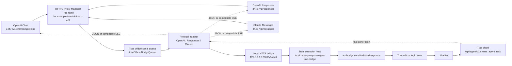

# Trae Official Login Bridge Notes

[中文版本](trae-official-bridge.zh-CN.md)

This document records the working solution for Trae International official-login
generation forwarding. It exists because Trae looks OpenAI-like from the outside,
but its successful generation path is not an OpenAI-compatible HTTP backend.

## Problem

The proxy originally exposed Trae official-login model discovery and route
validation, but generation returned a 501-style failure:

```text
Trae official login is connected for local login state, model discovery, and
route validation; generation still needs a Trae AhaNet official-client adapter.
It cannot be forwarded directly to OpenAI /chat/completions.
```

The important correction is that Trae and AGY are separate official-login paths.
AGY is Google / Code Assist and was already working. Trae must use Trae's own
local client path.

## What We Learned

Real Trae chat generation uses this path:

```text
Trae renderer chat UI
  -> TransportManager
  -> ai-agent RPC service=chat method=chat
  -> Trae ai-agent native module
  -> AhaNet
  -> https://coresg-normal.trae.ai/api/agent/v3/create_agent_task
```

Evidence from a real local Trae send:

- Renderer log showed `send chat`, `doRequestWithStream start: service=chat,
  method=chat`, and `TransportManager executeRequest, chat chat`.
- `ai-agent` log showed `service: "chat", method: "chat"` and successful cloud
  task completion.
- Trae's model/detail sync calls use
  `/api/ide/v1/get_detail_param`; that endpoint is not the chat generation
  endpoint.
- The backend chat task endpoint observed in logs is
  `/api/agent/v3/create_agent_task`.
- Port `127.0.0.1:51160` belongs to Trae CKG, not a chat HTTP API.
- Trae's current runtime uses Electron `ahaIpc`; an external Node
  `@aha-kit/ipc` client could not attach to the same chat path.

The useful internal commands found in Trae are:

- `wx.bridge.sendAndWaitResponse`
- `feishu.bridge.sendAndWaitResponse`
- `im.bridge.sendPromptStreaming`

The first two call Trae's internal `sendPromptAndWaitResponse`, which uses
Trae's own `sendToAgent` API and official login state.

## Implemented Architecture

We bridge through Trae itself instead of trying to clone AhaNet.

### Architecture Diagram



```text
OpenAI-compatible client
  -> HTTPS Proxy Manager openai-chat / openai-responses / claude entry
  -> Trae route, for example trae/minimax-m3
  -> local HTTP bridge http://127.0.0.1:17861/v1/chat
  -> Trae extension host
  -> wx.bridge.sendAndWaitResponse
  -> Trae official login + AhaNet
```

Code locations:

- Proxy adapter: `openai-proxy.js`
- Trae extension source:
  `tools/trae-openai-bridge-extension/package.json`
  `tools/trae-openai-bridge-extension/extension.js`
- Installed Trae extension:
  `%USERPROFILE%/.trae/extensions/local.https-proxy-manager-trae-bridge-0.1.0`
- Tests: `test/adapter.test.js`

The bridge listens only on localhost:

```text
http://127.0.0.1:17861/health
http://127.0.0.1:17861/v1/chat
```

Proxy configuration knobs:

- `TRAE_BRIDGE_HOST` defaults to `127.0.0.1`
- `TRAE_BRIDGE_PORT` or `TRAE_OPENAI_BRIDGE_PORT` defaults to `17861`
- `TRAE_BRIDGE_URL` or `TRAE_OPENAI_BRIDGE_URL` can override the base URL
- `TRAE_BRIDGE_TIMEOUT_MS` defaults to 5 minutes

## Request Conversion

For OpenAI Chat Completions, OpenAI Responses, and Claude Messages:

1. Match the public model route to the `trae-official` profile.
2. Normalize the model, for example `trae/minimax-m3` -> `minimax-m3`.
3. Convert the incoming protocol request into an OpenAI Chat-like message list.
4. Convert messages into a single Trae prompt with role labels:
   `System`, `Developer`, `User`, `Assistant`, `Tool`.
5. Extract data URL images into bridge image payloads when present.
6. POST `{ prompt, images, model, stream, metadata }` to the local Trae bridge.
7. Wrap Trae's final text as the requested protocol:
   - OpenAI Chat `chat.completion`
   - OpenAI Responses `response`
   - Claude Messages `message`
8. For `stream: true`, emit protocol-compatible SSE chunks.

Current streaming is compatibility streaming. It returns the final Trae response
as SSE chunks after Trae completes. It is not token-level AhaNet streaming.

The proxy serializes Trae bridge calls. Trae's current chat session can reject
parallel sends with `Now session is not waiting input`, so concurrent requests
from different proxy ports are queued before hitting the local bridge.

## Validation Commands

Check that Trae sees the extension:

```powershell
trae --list-extensions --show-versions | Select-String -Pattern 'https-proxy-manager'
```

Expected:

```text
local.https-proxy-manager-trae-bridge@0.1.0
```

Check the bridge directly:

```powershell
Invoke-WebRequest -UseBasicParsing -Uri 'http://127.0.0.1:17861/health' -TimeoutSec 3
```

Expected JSON includes:

```json
{
  "ok": true,
  "command": "wx.bridge.sendAndWaitResponse",
  "port": 17861
}
```

Check through the proxy management API:

```powershell
Invoke-WebRequest -UseBasicParsing -Uri 'http://127.0.0.1:1430/v1/local/trae/bridge/status' -TimeoutSec 5
```

Direct bridge smoke test:

```powershell
$payload = @{ prompt = '请只回复 OK'; model = 'minimax-m3' } | ConvertTo-Json
Invoke-WebRequest `
  -UseBasicParsing `
  -Uri 'http://127.0.0.1:17861/v1/chat' `
  -Method POST `
  -ContentType 'application/json; charset=utf-8' `
  -Body $payload `
  -TimeoutSec 240
```

Expected:

```json
{"ok":true,"command":"wx.bridge.sendAndWaitResponse","text":"OK"}
```

Full OpenAI Chat proxy test on port `3447`:

```powershell
$payload = @{
  model = 'trae/minimax-m3'
  messages = @(@{ role = 'user'; content = '请只回复 OK_FROM_PROXY' })
  stream = $false
} | ConvertTo-Json -Depth 8

Invoke-WebRequest `
  -UseBasicParsing `
  -Uri 'https://127.0.0.1:3447/v1/chat/completions' `
  -Method POST `
  -ContentType 'application/json; charset=utf-8' `
  -Body $payload `
  -SkipCertificateCheck `
  -TimeoutSec 240
```

Expected response shape:

```json
{
  "object": "chat.completion",
  "model": "minimax-m3",
  "choices": [
    {
      "message": {
        "role": "assistant",
        "content": "OK_FROM_PROXY"
      }
    }
  ]
}
```

Full OpenAI Responses proxy test on port `3445`:

```powershell
$payload = @{
  model = 'trae/minimax-m3'
  input = '请只回复 RESPONSES_OK'
  stream = $false
} | ConvertTo-Json -Depth 8

Invoke-WebRequest `
  -UseBasicParsing `
  -Uri 'https://127.0.0.1:3445/v1/responses' `
  -Method POST `
  -ContentType 'application/json; charset=utf-8' `
  -Body $payload `
  -SkipCertificateCheck `
  -TimeoutSec 240
```

Full Claude Messages proxy test on port `3443`:

```powershell
$payload = @{
  model = 'trae/minimax-m3'
  max_tokens = 64
  messages = @(@{ role = 'user'; content = '请只回复 CLAUDE_OK' })
  stream = $false
} | ConvertTo-Json -Depth 8

Invoke-WebRequest `
  -UseBasicParsing `
  -Uri 'https://127.0.0.1:3443/v1/messages' `
  -Method POST `
  -ContentType 'application/json; charset=utf-8' `
  -Body $payload `
  -SkipCertificateCheck `
  -TimeoutSec 240
```

Full OpenAI Chat streaming proxy test:

```powershell
$payload = @{
  model = 'trae/minimax-m3'
  messages = @(@{ role = 'user'; content = '请只回复 STREAM_OK' })
  stream = $true
} | ConvertTo-Json -Depth 8

Invoke-WebRequest `
  -UseBasicParsing `
  -Uri 'https://127.0.0.1:3447/v1/chat/completions' `
  -Method POST `
  -ContentType 'application/json; charset=utf-8' `
  -Body $payload `
  -SkipCertificateCheck `
  -TimeoutSec 240
```

Expected content type is `text/event-stream`, with chunks ending in:

```text
data: [DONE]
```

## Ports And Entries

The local proxy can expose multiple protocol entries. In the current setup:

- `https://localhost:3443/v1` is the Claude entry.
- `https://localhost:3445/v1` is the OpenAI Responses entry.
- `https://localhost:3447/v1` is the OpenAI Chat entry.

Trae official bridge now supports:

- `3443 /v1/messages`
- `3445 /v1/responses`
- `3447 /v1/chat/completions`

Use the protocol path that matches the entry. Calling `/v1/chat/completions` on
the Claude entry still returns a path mismatch by design.

## Troubleshooting

If `/v1/local/trae/bridge/status` returns `ECONNREFUSED`:

1. Confirm the extension is installed:
   `trae --list-extensions --show-versions`
2. Reload the Trae window or restart Trae.
3. Check `http://127.0.0.1:17861/health`.
4. Confirm no other process owns port `17861`.

If the bridge is healthy but generation fails:

1. Send a tiny direct bridge prompt first.
2. Make sure Trae itself is logged in and can send a message in the UI.
3. Check the latest Trae logs under:
   `%APPDATA%/Trae/logs/<timestamp>/window1/renderer.log`
   `%APPDATA%/Trae/logs/<timestamp>/Modular/ai-agent_*_stdout.log`
4. Look for:
   `send chat`
   `service: "chat", method: "chat"`
   `ChatStreamFrontResponseReporter status Success`

If a request fails with an entry path error:

- Match path to port:
  - Claude: `3443 /v1/messages`
  - Responses: `3445 /v1/responses`
  - Chat: `3447 /v1/chat/completions`

## Regression Tests

Run:

```powershell
npm test
```

The test suite includes:

- OpenAI Chat request to Trae bridge prompt conversion.
- data URL image extraction for Trae bridge payloads.
- Trae bridge text wrapping into OpenAI `chat.completion`.
