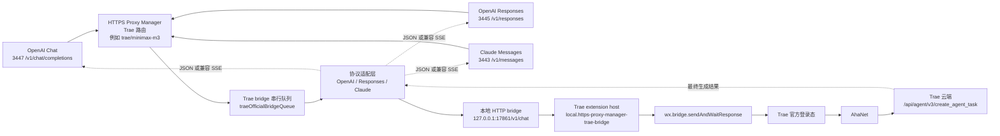

# Trae 官方登录桥接说明

[English version](trae-official-bridge.md)

这份文档记录 Trae International 官方登录生成转发的可用方案。核心结论是：
Trae 看起来像能直接套 OpenAI HTTP，但真正成功的生成路径不是普通
OpenAI-compatible 后端，而是 Trae 客户端自己的官方登录链路。

## 问题背景

之前代理已经支持 Trae 官方登录的本地状态识别、模型发现和路由校验，但生成
调用会失败。失败原因不是模型列表不对，而是不能把 Trae 官方登录请求直接转发到
OpenAI `/chat/completions`。

需要特别区分：

- AGY 是 Google / Code Assist 官方登录路径，已经可用。
- Trae 是 Trae International 自己的客户端路径，不能复用 AGY 适配器。

## 实际链路

真实 Trae 发送消息时走的是：

```text
Trae renderer chat UI
  -> TransportManager
  -> ai-agent RPC service=chat method=chat
  -> Trae ai-agent native module
  -> AhaNet
  -> https://coresg-normal.trae.ai/api/agent/v3/create_agent_task
```

排障时确认到的关键点：

- renderer 日志会出现 `send chat`、`doRequestWithStream start:
  service=chat, method=chat`、`TransportManager executeRequest, chat chat`。
- ai-agent 日志会出现 `service: "chat", method: "chat"`，成功时任务状态为
  `Completed`。
- `/api/ide/v1/get_detail_param` 是模型参数/详情接口，不是聊天生成接口。
- 聊天生成相关云端接口是 `/api/agent/v3/create_agent_task`。
- `127.0.0.1:51160` 是 Trae CKG 服务，不是聊天 HTTP API。
- 当前 Trae 使用 Electron `ahaIpc`，外部 Node 直接用 `@aha-kit/ipc` 不能接入
  同一条聊天路径。

Trae 内部已经有可复用命令：

- `wx.bridge.sendAndWaitResponse`
- `feishu.bridge.sendAndWaitResponse`
- `im.bridge.sendPromptStreaming`

当前方案复用 `wx.bridge.sendAndWaitResponse`，它会进入 Trae 自己的
`sendPromptAndWaitResponse` / `sendToAgent` 链路，从而复用官方登录态和 AhaNet。

## 当前实现

我们没有在代理里复刻 AhaNet，而是在 Trae 内部加一个本地扩展桥。

### 架构图



```text
OpenAI / Responses / Claude 客户端
  -> HTTPS Proxy Manager 对应端口
  -> Trae 路由，例如 trae/minimax-m3
  -> http://127.0.0.1:17861/v1/chat
  -> Trae extension host
  -> wx.bridge.sendAndWaitResponse
  -> Trae 官方登录 + AhaNet
```

代码位置：

- 代理适配：`openai-proxy.js`
- Trae 扩展源码：
  - `tools/trae-openai-bridge-extension/package.json`
  - `tools/trae-openai-bridge-extension/extension.js`
- 已安装到 Trae：
  - `%USERPROFILE%/.trae/extensions/local.https-proxy-manager-trae-bridge-0.1.0`
- 测试：`test/adapter.test.js`

本地桥只监听 localhost：

```text
http://127.0.0.1:17861/health
http://127.0.0.1:17861/v1/chat
http://127.0.0.1:17861/v1/chat/stream
http://127.0.0.1:17861/debug/commands
```

可配置环境变量：

- `TRAE_BRIDGE_HOST`，默认 `127.0.0.1`
- `TRAE_BRIDGE_PORT` 或 `TRAE_OPENAI_BRIDGE_PORT`，默认 `17861`
- `TRAE_BRIDGE_URL` 或 `TRAE_OPENAI_BRIDGE_URL`，可覆盖完整桥接地址
- `TRAE_BRIDGE_TIMEOUT_MS`，默认 5 分钟
- `TRAE_BRIDGE_LIVE_HEARTBEAT_MS`，live stream 代理侧心跳间隔，默认 2 秒
- `TRAE_BRIDGE_LOG_PROGRESS=0`，关闭 Trae 本地日志旁路进度事件
- `TRAE_BRIDGE_LOG_PROGRESS=visible`，将 Trae 日志旁路安全摘要写入 assistant
  正文；普通 SDK 可见，但会改变输出内容
- `TRAE_BRIDGE_RAW_PROGRESS=comment` 或 `1`，将 Raw Stream Patch 事件映射为
  API SSE comment，默认关闭
- `TRAE_BRIDGE_RAW_PROGRESS=visible`，将 Raw Stream Patch 安全摘要写入
  assistant 正文，例如 `[Trae plan_item tool=...]`
- `TRAE_BRIDGE_BUSY_RETRY_ATTEMPTS`，Trae 会话 busy / running 时的重试次数，默认 30
- `TRAE_BRIDGE_BUSY_RETRY_DELAY_MS`，busy 重试间隔，默认 1000ms

## 协议转换

Trae bridge 目前支持三个代理入口：

- `3447 /v1/chat/completions`
- `3445 /v1/responses`
- `3443 /v1/messages`

处理流程：

1. 根据模型路由匹配到 `trae-official` profile。
2. 规范化模型，例如 `trae/minimax-m3` -> `minimax-m3`。
3. 将 OpenAI Chat、OpenAI Responses 或 Claude Messages 转成 Chat-like messages。
4. 将 messages 拼成 Trae prompt，并保留角色标签：
   `System`、`Developer`、`User`、`Assistant`、`Tool`。
5. 提取 data URL 图片，作为 bridge image payload。
6. POST `{ prompt, images, model, stream, metadata }` 到本地 Trae bridge。
7. 将 Trae 最终文本包装回请求协议：
   - OpenAI Chat: `chat.completion`
   - OpenAI Responses: `response`
   - Claude Messages: `message`
8. `stream: true` 时输出对应协议可解析的 SSE。

当前 streaming 是兼容流式：等 Trae 完成后，把最终文本包装为 SSE chunk 输出。
它不是 token 级 AhaNet 实时流。

因此 Trae UI 里显示的思考过程、执行步骤和工具调用，当前不会从 OpenAI /
Claude / Responses 接口实时吐出。代理侧现在调用的是
`wx.bridge.sendAndWaitResponse`，这个命令只把 Trae 最终回复返回给本地 bridge。
如果要把过程映射到接口事件，需要先确认 Trae extension host 是否暴露可用的
streaming 命令，例如 `im.bridge.sendPromptStreaming`，以及这个命令是否能返回
可序列化的事件流。

新增的 `/v1/chat/stream` 会调用 `im.bridge.sendPromptStreaming`，把 Trae 的累计
文本回调转为 `text_delta` SSE，把未确认的 Trae 交互转为 `interaction` SSE。代理
再把这些事件转换到 OpenAI Chat、OpenAI Responses 或 Claude Messages 的流式
响应里。第一版不会把 Trae 内部工具伪造成客户端工具调用，而是作为可见文本标记
输出，避免客户端重复执行 Trae 已经处理的工具。

Trae 当前公开 streaming 命令通常只在最终 `ReplyUser` 计划项出现时才回调文本，
所以中间的 UI 思考/执行步骤不一定会变成 `text_delta`。bridge 会每 2 秒输出
`progress` SSE 心跳；代理侧将其转换为 OpenAI/Responses 的 SSE comment 或
Claude `ping` 事件。这个心跳只表示 Trae 仍在运行，不代表拿到了隐藏思考内容。

继续排查后确认，Trae 的 renderer / ai-agent 日志会更早记录部分执行状态，例如：

- `[ai-chat][sendToAgent]`：请求进入 Trae 会话。
- `[tooling] ... start/end`：Trae 侧 IDE 工具或命令开始/结束。
- `[ai-chat][PlanItemStreamParser] confirm_info received`：计划项确认状态。
- `first token flushed thought`：模型首 token 已到达，但日志里的 reasoning 文本不会转发。
- `[AgentStatus] received`、`plan final token cost`：agent 完成与耗时。

代理现在会在 live stream 期间从当前 Trae 日志文件的请求起始偏移开始尾随新增行，
把这些安全摘要转换成 `source:"trae-log"` 的进度事件。OpenAI Chat / Responses
入口会以 SSE comment 输出，例如：

```text
: trae-progress {"source":"trae-log","kind":"tool_start","command":"icube.common.commands.tooling.listFolder"}
```

Claude 入口仍保持协议兼容，只把这些日志进度映射为 `ping`，不把状态文本写入正文。
日志旁路不会输出命令结果正文，也不会输出日志中的 reasoning 片段。它只是让接口侧
能比最终回复更早看到 Trae 侧确实在执行哪些阶段。

如果 streaming 命令遇到 `Now session is not waiting input` / busy / running，
bridge 会按 `TRAE_BRIDGE_BUSY_RETRY_ATTEMPTS` 和
`TRAE_BRIDGE_BUSY_RETRY_DELAY_MS` 重试，并在 SSE 里输出 `phase:"busy"` 进度。
重试仍失败时会回退到 `wx.bridge.sendAndWaitResponse`。如果流式响应头已经发出，
后续错误会作为可见的 bridge busy / error 标记写入流里，然后正常结束流，避免
接口侧只看到长时间空白或突然断流。

## 并发处理

Trae 当前聊天会话不适合并行发送。并发打到 bridge 时可能返回：

```text
Now session is not waiting input
```

所以代理里对 Trae bridge 调用做了串行队列。多个端口同时请求 Trae 时，会在代理
侧排队，避免抢同一个 Trae 会话。

## 验证命令

确认 Trae 已识别扩展：

```powershell
trae --list-extensions --show-versions | Select-String -Pattern 'https-proxy-manager'
```

期望看到：

```text
local.https-proxy-manager-trae-bridge@0.1.0
```

检查 bridge：

```powershell
Invoke-WebRequest -UseBasicParsing -Uri 'http://127.0.0.1:17861/health' -TimeoutSec 3
```

期望 JSON 包含：

```json
{
  "ok": true,
  "command": "wx.bridge.sendAndWaitResponse",
  "port": 17861
}
```

检查 Trae extension host 当前可见的 bridge / streaming 候选命令：

```powershell
Invoke-WebRequest -UseBasicParsing -Uri 'http://127.0.0.1:17861/debug/commands' -TimeoutSec 3
```

重点看：

- `waitCommand`：当前实际用于生成的等待式命令。
- `streamCommand`：是否发现可用 streaming 候选命令。
- `streamingCommands`：候选 streaming 命令是否 available。
- `discoveredCommands`：Trae 当前暴露的相关命令列表。

通过管理端点检查：

```powershell
Invoke-WebRequest -UseBasicParsing -Uri 'http://127.0.0.1:1430/v1/local/trae/bridge/status' -TimeoutSec 5
```

直接 bridge 烟测：

```powershell
$payload = @{ prompt = '请只回复 OK'; model = 'minimax-m3' } | ConvertTo-Json
Invoke-WebRequest `
  -UseBasicParsing `
  -Uri 'http://127.0.0.1:17861/v1/chat' `
  -Method POST `
  -ContentType 'application/json; charset=utf-8' `
  -Body $payload `
  -TimeoutSec 240
```

期望：

```json
{"ok":true,"command":"wx.bridge.sendAndWaitResponse","text":"OK"}
```

OpenAI Chat 入口：

```powershell
$payload = @{
  model = 'trae/minimax-m3'
  messages = @(@{ role = 'user'; content = '请只回复 CHAT_OK' })
  stream = $false
} | ConvertTo-Json -Depth 8

Invoke-WebRequest `
  -UseBasicParsing `
  -Uri 'https://127.0.0.1:3447/v1/chat/completions' `
  -Method POST `
  -ContentType 'application/json; charset=utf-8' `
  -Body $payload `
  -SkipCertificateCheck `
  -TimeoutSec 240
```

OpenAI Responses 入口：

```powershell
$payload = @{
  model = 'trae/minimax-m3'
  input = '请只回复 RESPONSES_OK'
  stream = $false
} | ConvertTo-Json -Depth 8

Invoke-WebRequest `
  -UseBasicParsing `
  -Uri 'https://127.0.0.1:3445/v1/responses' `
  -Method POST `
  -ContentType 'application/json; charset=utf-8' `
  -Body $payload `
  -SkipCertificateCheck `
  -TimeoutSec 240
```

Claude Messages 入口：

```powershell
$payload = @{
  model = 'trae/minimax-m3'
  max_tokens = 64
  messages = @(@{ role = 'user'; content = '请只回复 CLAUDE_OK' })
  stream = $false
} | ConvertTo-Json -Depth 8

Invoke-WebRequest `
  -UseBasicParsing `
  -Uri 'https://127.0.0.1:3443/v1/messages' `
  -Method POST `
  -ContentType 'application/json; charset=utf-8' `
  -Body $payload `
  -SkipCertificateCheck `
  -TimeoutSec 240
```

## 端口说明

当前本地代理入口：

- `https://localhost:3443/v1`：Claude Messages
- `https://localhost:3445/v1`：OpenAI Responses
- `https://localhost:3447/v1`：OpenAI Chat

路径必须和端口协议匹配：

- Claude: `3443 /v1/messages`
- Responses: `3445 /v1/responses`
- Chat: `3447 /v1/chat/completions`

例如，在 Claude 入口调用 `/v1/chat/completions` 会被拒绝，这是正常的路径保护。

## Raw Stream Patch 诊断模式

`im.bridge.sendPromptStreaming` 是公开 bridge 命令，只能稳定拿到累计文本、
`interaction` 和运行心跳。要观察 Trae UI 中更早出现的计划项、模型配置、token
统计和内部 timing，需要临时 patch Trae 安装目录里的 workbench bundle。

本次验证确认的最深可用钩子是：

```text
Trae workbench.desktop.main.js
  -> TransportManager.executeStreamRequest
  -> this._client.sendStreamRequest("request_stream", packet, onData, onError, onEnd)
  -> onData(f)
  -> f.data.event / f.data.payload
```

这个位置比 `im.bridge.sendPromptStreaming` 更早。它直接位于 Aha RPC
`request_stream` 返回到 renderer 后的第一站，可以看到：

- `metadata`
- `model_config`
- `token_usage`
- `timing_events`
- `plan_item`
- `done`

验证时，最小请求 `请只回复 OK。` 的 `/v1/chat/stream` 返回过：

```text
RAW_EVENT_COUNT=18
TEXT_DELTA_COUNT=1
```

其中 `raw_event` 会先于最终 `text_delta` 出现。示例事件：

```text
event: raw_event
data: {"event":"plan_item","payload":{"agent_status":{"status":"running"}}}

event: raw_event
data: {"event":"done","payload":{"status":"completed"}}
```

### 安装与验证

安装实验补丁：

```powershell
node scripts/patch-trae-raw-stream.js
```

脚本会 patch 两类文件并自动备份：

- `%LOCALAPPDATA%/Programs/Trae/resources/app/out/vs/workbench/workbench.desktop.main.js`
- `%LOCALAPPDATA%/Programs/Trae/resources/app/node_modules/@byted-icube/ai-modules-chat/dist/index.mjs`

补丁加载需要重启 Trae。重启后检查命令是否出现：

```powershell
Invoke-RestMethod http://127.0.0.1:17861/debug/commands |
  ConvertTo-Json -Depth 6
```

期望包含：

```json
{
  "rawStreamCommand": "im.bridge.subscribeRawStream"
}
```

检查 raw 队列快照：

```powershell
Invoke-RestMethod http://127.0.0.1:17861/debug/raw-stream |
  ConvertTo-Json -Depth 8
```

检查 SSE 是否实时输出 raw 事件：

```powershell
$body = @{ prompt = '请只回复 OK。' } | ConvertTo-Json -Compress
$response = Invoke-WebRequest `
  -Uri http://127.0.0.1:17861/v1/chat/stream `
  -Method POST `
  -ContentType 'application/json' `
  -Body $body `
  -TimeoutSec 120

([regex]::Matches($response.Content, '^event: raw_event', 'Multiline')).Count
```

让 OpenAI / Responses / Claude API 侧也看到这些过程事件，需要重启代理并开启：

```powershell
$env:TRAE_BRIDGE_RAW_PROGRESS = 'comment'
```

开启后代理不会把过程写入 assistant 正文，而是写成 SSE comment：

```text
: trae-raw {"source":"trae-raw","event":"plan_item","agentStatus":"running","toolName":"finish"}
```

标准 SDK 可能忽略 SSE comment；`curl`、`Invoke-WebRequest` 或自定义 SSE 客户端可以
看到。这个模式只适合调试，不建议默认开启。

如果希望普通 SDK/客户端也看到过程，可以改用可见模式：

```powershell
$env:TRAE_BRIDGE_RAW_PROGRESS = 'visible'
$env:TRAE_BRIDGE_LOG_PROGRESS = 'visible'
```

这会把安全摘要写入流式正文，例如：

```text
[Trae tool_start command=icube.common.commands.tooling.listFolder]
[Trae plan_item tool=run_command status=success]
```

可见模式更接近 Trae UI 里的过程感，但它会改变 assistant 输出文本；面向自动化消费
时建议仍使用 `comment` 或单独读取诊断事件。

### 安全边界

Raw payload 可能包含 prompt、模型配置、token 计数、`ak` / `sk`、
`reasoning_content`、`thought` 等敏感字段。bridge 默认做递归脱敏：

- `authorization` / `token` / `api_key` / `secret` / `ak` / `sk` 等输出
  `[redacted]`
- `reasoning` / `thought` / `prompt` / `content` / `text` 等正文类字段只保留
  `{ redacted: true, chars: N }`
- 大对象限制深度、数组长度和字段数量，避免把整段内部上下文吐到接口侧
- `/v1/chat/stream` 只转发 `service:"chat", method:"chat"` 的 Aha RPC 事件，
  过滤掉非聊天 RPC 和 UI 层重复事件

### 完整性警告与回滚

这个方案会修改 Trae 安装目录文件。Trae 启动时可能提示：

```text
Trae 安装似乎损坏。请重新安装。
```

这是安装完整性校验命中了，不代表本地 bridge 代码坏了。该方案适合临时诊断和
验证，不建议长期作为默认产品路径。

回滚补丁：

```powershell
node scripts/unpatch-trae-raw-stream.js
```

回滚后重启 Trae。`rawStreamCommand` 和 `raw_event` 深层事件会消失，但 Trae 安装
完整性警告应随之消失。长期稳定方案仍应优先使用公开 bridge、日志旁路和心跳；
Raw Stream Patch 只作为 Debug 模式开关。

## 原生协议深探针（实验）

现有默认方案仍保留：公开 bridge、日志旁路、Raw Stream Patch 和可见摘要模式都不依赖
原生注入。下面这条线只用于验证 Trae agent 容器内更深的模型协议是否可观察。

先安装 Frida 工具（一次性）：

```powershell
python -m pip install --user frida-tools
```

静态/运行时扫描：

```powershell
node scripts/trae-deep-probe.js --launch-cmd
python scripts/trae-frida-scan.py
```

当前验证到的分层事实：

- `ai_agent.dll` 内存在 `LLMClientRequestRaw`、`LLMRawChatMessage`、
  `api/ide/v2/llm_raw_chat`、`request body`、`response body` 等协议字符串。
- 加载 `ai_agent.dll` 的 Trae 进程导入了 `WinHttpSendRequest` 和
  `WinHttpWriteData`，可作为 native HTTP 出站边界。
- 加载 `aha_net.dll` 的 Trae 进程暴露 `AhaNet_fetch`、
  `AhaNet_WsClient_send`，并通过 `sscronet.dll` 进入 Cronet 请求层。
- 默认 Trae 日志通常只给 URL、`body_len` 和 typed request 摘要，不给完整 body。

确定 PID 后，可做默认脱敏 hook：

```powershell
python scripts/trae-frida-scan.py

# 选择输出里带 ai_agent.dll 的 PID，观察 WinHTTP 边界
python scripts/trae-frida-native-probe.py --pid <ai_agent_pid> --duration 45

# 选择输出里带 aha_net.dll 的 PID，观察 AhaNet / Cronet 边界
python scripts/trae-frida-native-probe.py --pid <aha_net_pid> --duration 45
```

`trae-frida-native-probe.py` 默认只输出事件、长度、HTTP method、URL path、是否
像 JSON、是否命中协议关键词；不打印 header value、请求体、prompt、token 或模型
消息。只有显式加 `--capture-preview` 才会输出脱敏预览：

```powershell
python scripts/trae-frida-native-probe.py --pid <pid> --duration 20 --capture-preview
```

`--capture-preview` 仍可能包含敏感上下文，只能用于本机短时诊断，不要贴到 issue、
日志或聊天里。若要捕获真实模型 body，下一步不是再扩展 API 代理，而是继续在
`ai_agent.dll` 的 WinHTTP 写入点或 `aha_net.dll`/`sscronet.dll` 上传 provider
回调上做一次性本机 hook；这已经进入高风险 Debug 区，不适合作为常驻产品功能。

## 排障清单

如果 `/v1/local/trae/bridge/status` 返回 `ECONNREFUSED`：

1. 确认扩展已安装：
   `trae --list-extensions --show-versions`
2. Reload Trae 窗口或重启 Trae。
3. 检查 `http://127.0.0.1:17861/health`。
4. 确认没有其他进程占用 `17861`。

如果 bridge 健康但生成失败：

1. 先发一个最小 direct bridge prompt。
2. 确认 Trae UI 自己能正常发送消息。
3. 看最新 Trae 日志：
   - `%APPDATA%/Trae/logs/<timestamp>/window1/renderer.log`
   - `%APPDATA%/Trae/logs/<timestamp>/Modular/ai-agent_*_stdout.log`
4. 搜索：
   - `send chat`
   - `service: "chat", method: "chat"`
   - `ChatStreamFrontResponseReporter status Success`

如果出现 entry path 错误：

- 确认端口和路径匹配：
  - Claude: `3443 /v1/messages`
  - Responses: `3445 /v1/responses`
  - Chat: `3447 /v1/chat/completions`

## 回归测试

```powershell
npm test
```

当前测试覆盖：

- OpenAI Chat 请求转 Trae bridge prompt。
- data URL 图片提取。
- Trae bridge 文本包装成 OpenAI `chat.completion`。
