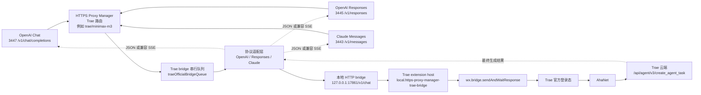

# Trae 官方登录桥接说明

[English version](trae-official-bridge.md)

这份文档记录 Trae International 官方登录生成转发的可用方案。核心结论是：
Trae 看起来像能直接套 OpenAI HTTP，但真正成功的生成路径不是普通
OpenAI-compatible 后端，而是 Trae 客户端自己的官方登录链路。

## 问题背景

之前代理已经支持 Trae 官方登录的本地状态识别、模型发现和路由校验，但生成
调用会失败。失败原因不是模型列表不对，而是不能把 Trae 官方登录请求直接转发到
OpenAI `/chat/completions`。

需要特别区分：

- AGY 是 Google / Code Assist 官方登录路径，已经可用。
- Trae 是 Trae International 自己的客户端路径，不能复用 AGY 适配器。

## 实际链路

真实 Trae 发送消息时走的是：

```text
Trae renderer chat UI
  -> TransportManager
  -> ai-agent RPC service=chat method=chat
  -> Trae ai-agent native module
  -> AhaNet
  -> https://coresg-normal.trae.ai/api/agent/v3/create_agent_task
```

排障时确认到的关键点：

- renderer 日志会出现 `send chat`、`doRequestWithStream start:
  service=chat, method=chat`、`TransportManager executeRequest, chat chat`。
- ai-agent 日志会出现 `service: "chat", method: "chat"`，成功时任务状态为
  `Completed`。
- `/api/ide/v1/get_detail_param` 是模型参数/详情接口，不是聊天生成接口。
- 聊天生成相关云端接口是 `/api/agent/v3/create_agent_task`。
- `127.0.0.1:51160` 是 Trae CKG 服务，不是聊天 HTTP API。
- 当前 Trae 使用 Electron `ahaIpc`，外部 Node 直接用 `@aha-kit/ipc` 不能接入
  同一条聊天路径。

Trae 内部已经有可复用命令：

- `wx.bridge.sendAndWaitResponse`
- `feishu.bridge.sendAndWaitResponse`
- `im.bridge.sendPromptStreaming`

当前方案复用 `wx.bridge.sendAndWaitResponse`，它会进入 Trae 自己的
`sendPromptAndWaitResponse` / `sendToAgent` 链路，从而复用官方登录态和 AhaNet。

## 当前实现

我们没有在代理里复刻 AhaNet，而是在 Trae 内部加一个本地扩展桥。

### 架构图



```text
OpenAI / Responses / Claude 客户端
  -> HTTPS Proxy Manager 对应端口
  -> Trae 路由，例如 trae/minimax-m3
  -> http://127.0.0.1:17861/v1/chat
  -> Trae extension host
  -> wx.bridge.sendAndWaitResponse
  -> Trae 官方登录 + AhaNet
```

代码位置：

- 代理适配：`openai-proxy.js`
- Trae 扩展源码：
  - `tools/trae-openai-bridge-extension/package.json`
  - `tools/trae-openai-bridge-extension/extension.js`
- 已安装到 Trae：
  - `%USERPROFILE%/.trae/extensions/local.https-proxy-manager-trae-bridge-0.1.0`
- 测试：`test/adapter.test.js`

本地桥只监听 localhost：

```text
http://127.0.0.1:17861/health
http://127.0.0.1:17861/v1/chat
```

可配置环境变量：

- `TRAE_BRIDGE_HOST`，默认 `127.0.0.1`
- `TRAE_BRIDGE_PORT` 或 `TRAE_OPENAI_BRIDGE_PORT`，默认 `17861`
- `TRAE_BRIDGE_URL` 或 `TRAE_OPENAI_BRIDGE_URL`，可覆盖完整桥接地址
- `TRAE_BRIDGE_TIMEOUT_MS`，默认 5 分钟

## 协议转换

Trae bridge 目前支持三个代理入口：

- `3447 /v1/chat/completions`
- `3445 /v1/responses`
- `3443 /v1/messages`

处理流程：

1. 根据模型路由匹配到 `trae-official` profile。
2. 规范化模型，例如 `trae/minimax-m3` -> `minimax-m3`。
3. 将 OpenAI Chat、OpenAI Responses 或 Claude Messages 转成 Chat-like messages。
4. 将 messages 拼成 Trae prompt，并保留角色标签：
   `System`、`Developer`、`User`、`Assistant`、`Tool`。
5. 提取 data URL 图片，作为 bridge image payload。
6. POST `{ prompt, images, model, stream, metadata }` 到本地 Trae bridge。
7. 将 Trae 最终文本包装回请求协议：
   - OpenAI Chat: `chat.completion`
   - OpenAI Responses: `response`
   - Claude Messages: `message`
8. `stream: true` 时输出对应协议可解析的 SSE。

当前 streaming 是兼容流式：等 Trae 完成后，把最终文本包装为 SSE chunk 输出。
它不是 token 级 AhaNet 实时流。

## 并发处理

Trae 当前聊天会话不适合并行发送。并发打到 bridge 时可能返回：

```text
Now session is not waiting input
```

所以代理里对 Trae bridge 调用做了串行队列。多个端口同时请求 Trae 时，会在代理
侧排队，避免抢同一个 Trae 会话。

## 验证命令

确认 Trae 已识别扩展：

```powershell
trae --list-extensions --show-versions | Select-String -Pattern 'https-proxy-manager'
```

期望看到：

```text
local.https-proxy-manager-trae-bridge@0.1.0
```

检查 bridge：

```powershell
Invoke-WebRequest -UseBasicParsing -Uri 'http://127.0.0.1:17861/health' -TimeoutSec 3
```

期望 JSON 包含：

```json
{
  "ok": true,
  "command": "wx.bridge.sendAndWaitResponse",
  "port": 17861
}
```

通过管理端点检查：

```powershell
Invoke-WebRequest -UseBasicParsing -Uri 'http://127.0.0.1:1430/v1/local/trae/bridge/status' -TimeoutSec 5
```

直接 bridge 烟测：

```powershell
$payload = @{ prompt = '请只回复 OK'; model = 'minimax-m3' } | ConvertTo-Json
Invoke-WebRequest `
  -UseBasicParsing `
  -Uri 'http://127.0.0.1:17861/v1/chat' `
  -Method POST `
  -ContentType 'application/json; charset=utf-8' `
  -Body $payload `
  -TimeoutSec 240
```

期望：

```json
{"ok":true,"command":"wx.bridge.sendAndWaitResponse","text":"OK"}
```

OpenAI Chat 入口：

```powershell
$payload = @{
  model = 'trae/minimax-m3'
  messages = @(@{ role = 'user'; content = '请只回复 CHAT_OK' })
  stream = $false
} | ConvertTo-Json -Depth 8

Invoke-WebRequest `
  -UseBasicParsing `
  -Uri 'https://127.0.0.1:3447/v1/chat/completions' `
  -Method POST `
  -ContentType 'application/json; charset=utf-8' `
  -Body $payload `
  -SkipCertificateCheck `
  -TimeoutSec 240
```

OpenAI Responses 入口：

```powershell
$payload = @{
  model = 'trae/minimax-m3'
  input = '请只回复 RESPONSES_OK'
  stream = $false
} | ConvertTo-Json -Depth 8

Invoke-WebRequest `
  -UseBasicParsing `
  -Uri 'https://127.0.0.1:3445/v1/responses' `
  -Method POST `
  -ContentType 'application/json; charset=utf-8' `
  -Body $payload `
  -SkipCertificateCheck `
  -TimeoutSec 240
```

Claude Messages 入口：

```powershell
$payload = @{
  model = 'trae/minimax-m3'
  max_tokens = 64
  messages = @(@{ role = 'user'; content = '请只回复 CLAUDE_OK' })
  stream = $false
} | ConvertTo-Json -Depth 8

Invoke-WebRequest `
  -UseBasicParsing `
  -Uri 'https://127.0.0.1:3443/v1/messages' `
  -Method POST `
  -ContentType 'application/json; charset=utf-8' `
  -Body $payload `
  -SkipCertificateCheck `
  -TimeoutSec 240
```

## 端口说明

当前本地代理入口：

- `https://localhost:3443/v1`：Claude Messages
- `https://localhost:3445/v1`：OpenAI Responses
- `https://localhost:3447/v1`：OpenAI Chat

路径必须和端口协议匹配：

- Claude: `3443 /v1/messages`
- Responses: `3445 /v1/responses`
- Chat: `3447 /v1/chat/completions`

例如，在 Claude 入口调用 `/v1/chat/completions` 会被拒绝，这是正常的路径保护。

## 排障清单

如果 `/v1/local/trae/bridge/status` 返回 `ECONNREFUSED`：

1. 确认扩展已安装：
   `trae --list-extensions --show-versions`
2. Reload Trae 窗口或重启 Trae。
3. 检查 `http://127.0.0.1:17861/health`。
4. 确认没有其他进程占用 `17861`。

如果 bridge 健康但生成失败：

1. 先发一个最小 direct bridge prompt。
2. 确认 Trae UI 自己能正常发送消息。
3. 看最新 Trae 日志：
   - `%APPDATA%/Trae/logs/<timestamp>/window1/renderer.log`
   - `%APPDATA%/Trae/logs/<timestamp>/Modular/ai-agent_*_stdout.log`
4. 搜索：
   - `send chat`
   - `service: "chat", method: "chat"`
   - `ChatStreamFrontResponseReporter status Success`

如果出现 entry path 错误：

- 确认端口和路径匹配：
  - Claude: `3443 /v1/messages`
  - Responses: `3445 /v1/responses`
  - Chat: `3447 /v1/chat/completions`

## 回归测试

```powershell
npm test
```

当前测试覆盖：

- OpenAI Chat 请求转 Trae bridge prompt。
- data URL 图片提取。
- Trae bridge 文本包装成 OpenAI `chat.completion`。
